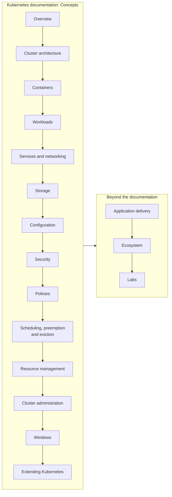

# Kubernetes Knowledge

A personal, expert level knowledge base about Kubernetes: its architecture, API objects and mechanisms, how workloads are run, networked, stored, secured, scheduled and observed, and the practices and ecosystem around it. Organized by the Concepts section of the official Kubernetes documentation.

## Table of Contents

- [About](#about)
- [Purpose](#purpose)
- [Scope](#scope)
- [Areas](#areas)
- [Full table of contents](#full-table-of-contents)
- [How to use this repository](#how-to-use-this-repository)
- [Reading the knowledge base](#reading-the-knowledge-base)
- [Repository layout](#repository-layout)
- [Sources and migration](#sources-and-migration)
- [Contributing and working with AI agents](#contributing-and-working-with-ai-agents)
- [Status](#status)

## About

This repository collects what I learn about Kubernetes as a platform and DevOps engineer: how the control plane and the nodes work together, how Pods live and die, how traffic reaches them, how the scheduler decides, how the cluster protects itself under pressure, and how applications are delivered and observed. Each note explains one concept in plain English, with diagrams, a worked example with manifests and links to the official documentation. The notes are written so that they are still useful when I come back after a year, and so that someone new to a topic can follow them from top to bottom.

This is a personal knowledge base, not official documentation. Kubernetes ships a minor release about every four months, so every note records what was checked and against which version, and marks what still has to be verified.

## Purpose

The repository exists to:

- build a durable reference on Kubernetes that I can search, extend and trust,
- force real understanding by explaining every mechanism precisely, with examples, analogies and diagrams,
- prepare for platform engineering work and the CNCF certifications (CKA, CKAD, CKS),
- keep one consistent standard, so the collection stays coherent as it grows,
- provide a source of truth that both people and AI assistants can work with under the same rules.

## Scope

**In scope**

- Upstream Kubernetes concepts, API objects, controllers and the reasoning behind them.
- Operating clusters: scheduling, eviction, autoscaling, observability, security and extension.
- Application delivery on Kubernetes: CI/CD, GitOps, Helm, deployment strategies.
- The ecosystem around Kubernetes: managed services, distributions, alternative orchestrators and tools, described in relation to upstream concepts.
- Manifests, commands and configuration examples, with versions.

**Out of scope**

- Kubeconfig files, tokens, certificates, cloud account IDs or other real identifiers.
- Content copied wholesale from documentation, courses or exam material.
- Deep product documentation of a single cloud provider beyond what a comparison needs; it belongs in the cloud specific knowledge bases.

## Areas

The top level follows the chapters of the [Concepts section of the Kubernetes documentation](https://kubernetes.io/docs/concepts/) (checked against v1.37, 2026-11), in the same order. A reader who knows where kubernetes.io puts a page knows where the note is, and a new topic has an obvious home. Three areas are added after them, because the documentation does not cover their subject: application delivery, ecosystem and labs. Each area has a `README.md` that lists its notes in reading order and its planned topics.



| Area | What it covers |
| --- | --- |
| [Overview](overview/README.md) | What Kubernetes is and why it exists, the Kubernetes API, a map of advanced topics. |
| [Cluster architecture](cluster-architecture/README.md) | Control plane components, etcd, node components. |
| [Containers](containers/README.md) | Container fundamentals and orchestration, images, container environment, RuntimeClass, lifecycle hooks, Docker and LXC. |
| [Workloads](workloads/README.md) | Pods, their lifecycle, init, sidecar and ephemeral containers, probes, disruptions, QoS classes, Deployments, ReplicaSets, StatefulSets, DaemonSets, Jobs, HPA and VPA. |
| [Services and networking](services-and-networking/README.md) | The network model, IP ranges and dual-stack, Services, Ingress, network policies. |
| [Storage](storage/README.md) | Volumes, volume types, CSI, mount propagation. |
| [Configuration](configuration/README.md) | Configuration good practices, ConfigMaps, Secrets, resource requests and limits. |
| [Security](security/README.md) | Security overview, RBAC good practices, security context. |
| [Policies](policies/README.md) | LimitRange and namespace defaults. |
| [Scheduling, preemption and eviction](scheduling-preemption-and-eviction/README.md) | kube-scheduler, scheduling framework, taints and tolerations, topology spread, priority and preemption, node-pressure and API-initiated eviction. |
| [Resource management](resource-management/README.md) | Node resource managers and dynamic resource allocation (planned). |
| [Cluster administration](cluster-administration/README.md) | Node autoscaling, observability, logging architecture, system logs, metrics and traces. |
| [Windows](windows/README.md) | Windows nodes and containers (planned). |
| [Extending Kubernetes](extending-kubernetes/README.md) | Extension points, custom resources, scheduler extenders. |
| [Application delivery](application-delivery/README.md) | CI/CD integration, GitOps, Helm, rolling updates, canary, blue/green, rollbacks. |
| [Ecosystem](ecosystem/README.md) | Managed Kubernetes services, distributions, alternative orchestrators, security scanners. |
| [Labs](labs/README.md) | Home lab and hands-on exercises (planned). |

Where a concept fits two areas, it has one home note and the other area links to it. For example, NetworkPolicy lives in services and networking and the security overview links to it; LimitRange lives in policies and the resource management note links to it.

## Full table of contents

[ToC.md](ToC.md) lists every file in the repository as an indented tree, with planned topics shown without links. Use it to see the whole structure at once. Use the area READMEs for the recommended reading order.

## How to use this repository

- To learn a topic, open the area, then read the notes in the order the area `README.md` gives. For a first pass through Kubernetes, read the areas in the order of the table above.
- To look something up, start from [ToC.md](ToC.md) or search with `grep -rn "term" --include="*.md" .`.
- To find open gaps and claims still to verify, run `grep -rn "TODO:" --include="*.md" .`.

## Reading the knowledge base

This repository is set up for [Librarian OS](https://japonics.io), a reader for Markdown knowledge repositories. [librarian-os.json](librarian-os.json) names the project and lists the entry points (the area directories). Librarian OS renders the notes with Mermaid diagrams, search, a graph of the relations between notes and practice questions.

```bash
# in the librarian-os directory
npm install
npm run dev -- --repo /absolute/path/to/this/repository
```

The relations come from the sidecar files described in [GUIDELINE.md](GUIDELINE.md#35-sidecar-metadata): every `note.md` has a `note.md.json` next to it. The tools that keep them valid run from Librarian OS: `npm run check`, `npm run scaffold` and `npm run toc`, each with this repository's path as the argument.

## Repository layout

```text
ToC.md                  # full tree of every file
GUIDELINE.md            # rules for structure, note format and style
INSTRUCTIONS.md         # Librarian OS adaptation guide
_sources/               # original exports that notes are migrated from (not committed)
librarian-os.json       # configuration for Librarian OS (project name, entry points, rules)
_assets/<area>/         # images and other files used by notes
<area>/
    README.md           # notes in reading order and planned topics
    README.md.json      # its sidecar
    <topic>.md          # a single note
    <topic>.md.json     # its sidecar: node header, relations and sources
    <section>/          # optional group of related notes
```

The full rules for structure and naming are in [GUIDELINE.md](GUIDELINE.md#3-repository-structure-and-naming).

## Sources and migration

The notes were migrated from an export of my earlier Kubernetes notes (a ClickUp document) kept locally in `_sources/` and excluded from version control. All of its content was carried over: it was restructured into the areas above, put into the note skeleton, extended with diagrams, worked examples and practice questions, and checked for outdated statements. Corrections are stated in the notes, and statements that still need verification are marked with `TODO:` lines. Screenshots of YAML and tables were transcribed into text, and diagrams were redrawn in Mermaid where possible. The remaining images, mostly taken from the Kubernetes documentation (CC BY 4.0) and vendor articles, are kept in `_assets/` with credit in their alt text for personal study.

## Contributing and working with AI agents

All notes follow [GUIDELINE.md](GUIDELINE.md). It applies to people and to AI agents alike. Agent-specific entry points are [AGENTS.md](AGENTS.md) and [CLAUDE.md](CLAUDE.md). Both point to the GUIDELINE and do not repeat its rules.

## Status

All seventeen areas exist. Fourteen areas have notes; resource management, Windows and labs have their structure and planned topics. The remaining planned topics are listed in each area README and in [ToC.md](ToC.md). Every note is in `draft` status until it has been checked against the current documentation, which is tracked with `TODO:` lines.
