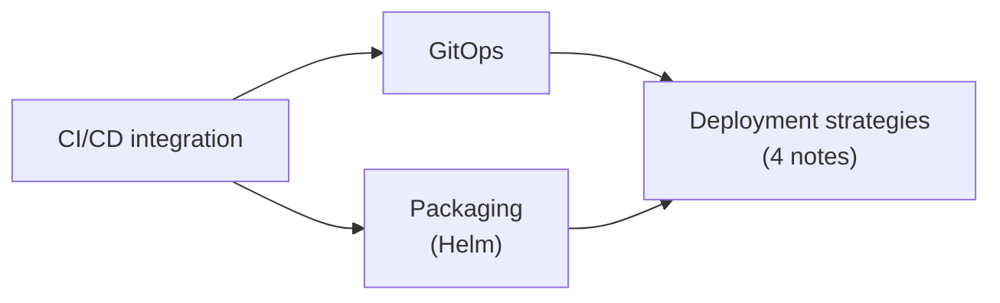

# Application delivery

Practices for getting applications into a cluster and changing them safely: CI/CD pipelines, GitOps, packaging with Helm, and deployment strategies with rollbacks. This area is not a chapter of the Kubernetes documentation Concepts; its tools correspond to the "Application Definition and Image Build" and "Continuous Integration and Delivery" categories of the CNCF Cloud Native Landscape.

## Map of the area

## Notes and sections in reading order

1. [CI/CD integration](ci-cd-integration.md): pipeline stages, push and pull models, pipeline practices.
2. [GitOps](gitops.md): principles, deployment sequence with Flux and the GitLab agent, OCI artifacts as source, Flux and Argo CD.
3. [Packaging](packaging/README.md): Helm.
4. [Deployment strategies](deployment-strategies/README.md): rolling updates, canary, blue/green, rollbacks.

## Planned topics

- Argo CD in depth
- Flux in depth
- Secrets in GitOps (SOPS, Sealed Secrets, External Secrets)
- Environment promotion and release management
- Skaffold and inner-loop development tools
