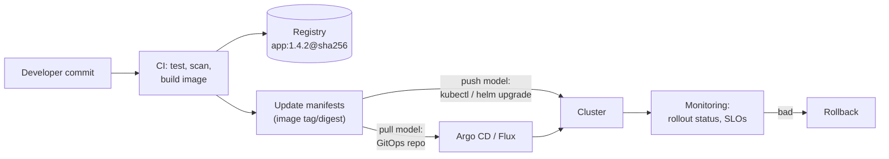

# CI/CD integration

## Summary

Kubernetes deliberately does not build or deploy code; a CI/CD pipeline does. The pipeline takes a commit, tests it, builds an immutable container image, pushes it to a registry, updates Kubernetes manifests (directly, through Helm or Kustomize, or through a GitOps repository) and lets a Deployment roll out the new version with a chosen strategy such as RollingUpdate or canary, while monitoring tells whether to proceed or roll back. Two models exist: *push*, where the pipeline applies changes to the cluster, and *pull*, where an agent in the cluster applies what is in Git (GitOps).

## Prerequisites

- [Deployments](../workloads/workload-management/deployments.md).
- [Images](../containers/images.md).

## Core concepts

### Deployments as the target of delivery

A Deployment is the Kubernetes resource used to declaratively manage the rollout and scaling of application containers across a cluster. Teams define the desired state, and Kubernetes automatically manages the underlying Pods and ReplicaSets to reach it. Kubernetes and its ecosystem provide deployment strategies such as RollingUpdate (built in), Recreate (built in) and canary or blue/green (with several Deployments, a service mesh or a progressive delivery controller) to control how new versions are rolled out and scaled. See [Deployment strategies](deployment-strategies/README.md).

### The pipeline

Integrating CI/CD with Kubernetes means setting up a pipeline that builds and deploys an application to a cluster. The process typically includes:

1. developing the application code,
2. setting up a source code repository,
3. choosing a CI/CD tool (GitLab CI, GitHub Actions, Jenkins, Tekton, Argo Workflows and others),
4. building a container image,
5. pushing the image to a container registry,
6. deploying the application with Kubernetes manifests (plain YAML, Helm charts or Kustomize overlays),
7. monitoring and troubleshooting the pipeline and the deployment.

By automating testing and deployment, CI/CD with Kubernetes improves software quality, speeds up development and makes deployments consistent and reliable.



### Push and pull models

| Aspect | Push (pipeline deploys) | Pull (GitOps agent deploys) |
| --- | --- | --- |
| Credentials | CI needs cluster credentials | Only the in-cluster agent has them |
| Drift | Not detected | Detected and corrected continuously |
| Audit | Pipeline logs | Git history |
| Multi-cluster | One job per cluster | Agents per cluster pull the same repo |
| Simplicity | Simple for one cluster | Extra component to run |

Details of the pull model are in [GitOps](gitops.md).

### Pipeline practices

- **Build once, promote the same artifact.** The image built from a commit is tested and then promoted unchanged through environments; only configuration differs.
- **Immutable references.** Deploy by digest or unique tag, never `latest`.
- **Gate on rollout status.** `kubectl rollout status --timeout` fails the job when `progressDeadlineSeconds` is exceeded.
- **Scan and sign.** Image scanning and signing (for example with Cosign) before deployment; admission policies can verify signatures.
- **Separate application and deployment repositories** when several teams deploy, so that configuration changes are reviewed separately.

## Worked example

A push-model deploy job (untested here; GitLab CI syntax, `kubectl` v1.30, cluster credentials from a protected CI variable):

```yaml
# .gitlab-ci.yml (excerpt)
stages: [build, deploy]

build:
  stage: build
  image: gcr.io/kaniko-project/executor:v1.23.2-debug
  script:
    - /kaniko/executor --context "$CI_PROJECT_DIR" --destination "$CI_REGISTRY_IMAGE:$CI_COMMIT_SHA"

deploy-staging:
  stage: deploy
  image: bitnami/kubectl:1.30
  environment: staging
  script:
    - kubectl -n staging set image deployment/api api="$CI_REGISTRY_IMAGE:$CI_COMMIT_SHA"
    - kubectl -n staging rollout status deployment/api --timeout=180s
```

If the rollout does not complete in 180 seconds, the job fails; a follow-up job or a person runs `kubectl rollout undo` (see [Rollbacks](deployment-strategies/rollbacks.md)).

## Trade offs and when to use it

- **Push** is the fastest way to start and fine for one cluster with a trusted CI system.
- **Pull (GitOps)** scales to many clusters and keeps credentials out of CI, at the cost of running and learning an agent.
- **Imperative `kubectl set image`** is simple but leaves Git out of date; writing the change to manifests keeps Git as the source of truth.

## Common mistakes

- **Rebuilding images per environment**, so production runs something never tested.
- **Long-lived cluster-admin credentials in CI.**
- **Not waiting for rollout status**, so a failed deployment looks green.

## Practice

1. Name the main stages of a CI/CD pipeline for Kubernetes.
2. What is the security advantage of the pull model?
3. Why deploy by digest?

Answers: 1. Code, repository, CI tool, image build, push to registry, deploy manifests, monitor (and roll back). 2. Cluster credentials stay inside the cluster; CI only needs Git access. 3. A digest identifies exactly one image content, so what was tested is what runs, and rollbacks are exact.

## Further reading

- [Deployments](https://kubernetes.io/docs/concepts/workloads/controllers/deployment/), Kubernetes documentation.
- [Managing Workloads](https://kubernetes.io/docs/concepts/workloads/management/), Kubernetes documentation.
- [Continuous Delivery](https://martinfowler.com/bliki/ContinuousDelivery.html), Martin Fowler. The practice behind the pipeline.
