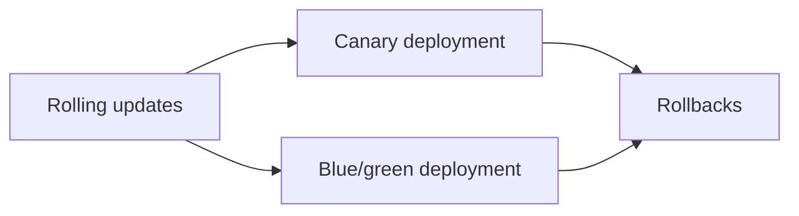

# Deployment strategies

How a new version of an application replaces the old one: gradually Pod by Pod, by shifting a share of traffic, by switching between two complete environments, and how to go back when it fails.

## Map of the section

## Notes in reading order

1. [Rolling updates](rolling-updates.md): RollingUpdate and Recreate, `maxSurge` and `maxUnavailable`, pros and cons, best practices.
2. [Canary deployment](canary-deployment.md): process, implementations, Cloud Deploy types and phases, benefits, comparison with blue/green.
3. [Blue/green deployment](blue-green-deployment.md): two environments, switching traffic, comparison of strategies.
4. [Rollbacks](rollbacks.md): reasons, mechanisms, revisions, pros and cons, best practices.

## Planned topics

- Progressive delivery with Argo Rollouts and Flagger
- A/B testing and feature flags
- Shadow (mirrored) deployments
