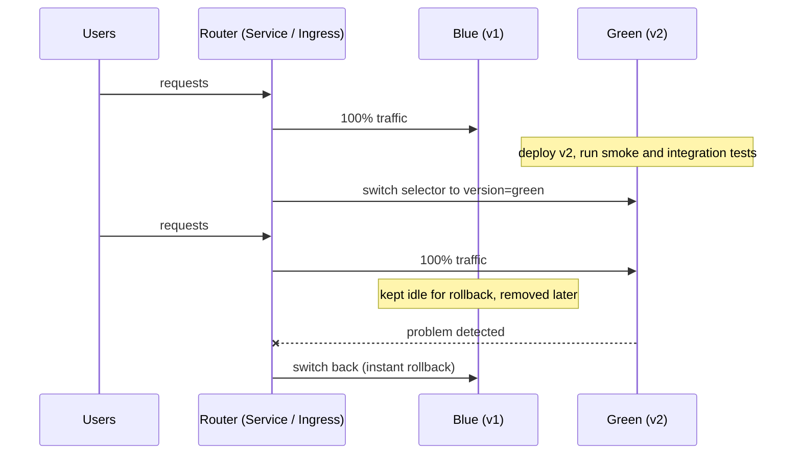

# Blue/green deployment

## Summary

A blue/green deployment runs two identical production environments: *blue* with the current version and *green* with the new one. Green is deployed and tested while blue serves all users; then traffic is switched to green in one step, and blue stays ready as an instant rollback target. In Kubernetes the switch is usually a change of a Service selector, an Ingress or Gateway backend, or a load balancer target. It gives zero-downtime releases and fast rollback, at the cost of double capacity during the release and careful handling of shared state such as databases.

## Prerequisites

- [Services](../../services-and-networking/services.md).
- [Canary deployment](canary-deployment.md) (for comparison).

## Core concepts

### Definition

Blue/green is a deployment strategy for releasing new versions by running two identical production environments, one with the current version (blue) and the other with the new version (green). After the green environment is fully tested, traffic is routed from blue to green, giving users a transition without downtime or disruption.

In Kubernetes, blue/green deployments can be implemented with a variety of tools and techniques, including deployment strategies, traffic routing and load balancing.

*Analogy.* A theater with two stages: while the audience watches the play on the blue stage, the crew builds and rehearses the new set on the green stage. When ready, the curtain on blue closes and green opens. If the new set collapses, the blue stage is still standing. The analogy breaks at shared props: a database used by both "stages" cannot simply be swapped back.

### How it works

Blue/green deployment is a release strategy for updating production applications without downtime. It creates two identical production instances of the application behind a load balancer or service mesh. At any time, one responds to user traffic and the other receives updates from the team's continuous integration (CI) server.

When a new version (green) is deployed, all user traffic keeps going to the production environment (blue). Green is tested, and when testing is complete, users are switched to green. Blue serves as a backup, which enables easy rollback if green has problems.



### Blue/green in Kubernetes

| Switch mechanism | How | Note |
| --- | --- | --- |
| Service selector | Change `version: blue` to `version: green` in the Service | Simple; affects new connections, existing ones drain |
| Ingress or Gateway backend | Point the route to the green Service | Allows a preview host for green |
| Progressive delivery controller | Argo Rollouts `blueGreen` strategy with preview and active Services | Automated promotion and analysis |
| DNS or external load balancer | Change the target | Slow (DNS TTL); for whole clusters |

### Comparison of strategies

| Strategy | Versions visible to users | Extra capacity | Rollback speed | Granularity |
| --- | --- | --- | --- | --- |
| Recreate | One (downtime between) | None | Slow (redeploy) | All at once |
| Rolling update | Both, briefly | Up to `maxSurge` | Medium (roll back) | Pod by Pod |
| Blue/green | One at a time | Double during release | Instant (switch back) | All at once |
| Canary | Both, controlled share | Small | Fast | Percentage of traffic |

## Worked example

Selector based blue/green (untested here; Kubernetes v1.30 or later; two Deployments `shop-blue` and `shop-green` with labels `app: shop` and `version: blue|green`):

```yaml
apiVersion: v1
kind: Service
metadata: { name: shop }
spec:
  selector: { app: shop, version: blue }
  ports: [{ port: 80, targetPort: 8080 }]
---
apiVersion: v1
kind: Service
metadata: { name: shop-preview }        # testers reach green before the switch
spec:
  selector: { app: shop, version: green }
  ports: [{ port: 80, targetPort: 8080 }]
```

```bash
kubectl rollout status deploy/shop-green
kubectl run -it --rm smoke --image=curlimages/curl:8.10.1 -- curl -fsS http://shop-preview/health
kubectl patch svc shop -p '{"spec":{"selector":{"app":"shop","version":"green"}}}'    # switch
kubectl get endpointslices -l kubernetes.io/service-name=shop -o wide                 # now green Pod IPs
# rollback: patch the selector back to version: blue
```

## Trade offs and when to use it

- **Benefits.** Zero downtime, full testing of the new environment before exposure, instant rollback.
- **Costs.** Double resources during the release; all users switch at once, so a problem missed in testing hits everyone; database schema changes must be compatible with both versions (expand and contract migrations).
- **Fits** smaller, lower-risk releases that should go out quickly and often, or releases where mixed versions are not acceptable.

## Common mistakes

- **Incompatible database migrations**, which make switching back impossible.
- **Deleting blue immediately** after the switch, removing the rollback path.
- **Forgetting long-lived connections**, which keep talking to blue after the selector changes.

## Practice

1. What does blue serve while green is tested?
2. How do you switch traffic in plain Kubernetes?
3. Why is blue/green rollback faster than a Deployment rollback?

Answers: 1. 100% of user traffic. 2. Change the Service selector (or the route's backend) from the blue to the green Pods. 3. The old version is still running and ready; only the routing changes back, nothing has to be started.

## Further reading

- [BlueGreenDeployment](https://martinfowler.com/bliki/BlueGreenDeployment.html), Martin Fowler, 2010.
- [Argo Rollouts: BlueGreen strategy](https://argoproj.github.io/argo-rollouts/features/bluegreen/), Argo project.
- [Service](https://kubernetes.io/docs/concepts/services-networking/service/), Kubernetes documentation. Selectors used for the switch.
