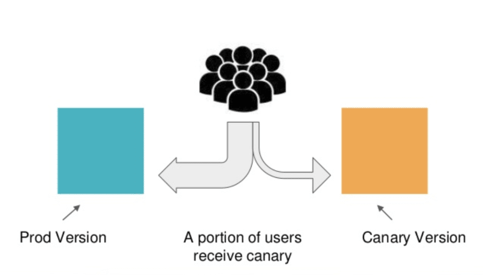
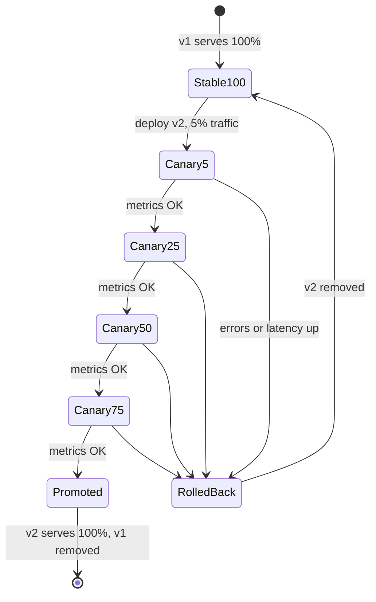
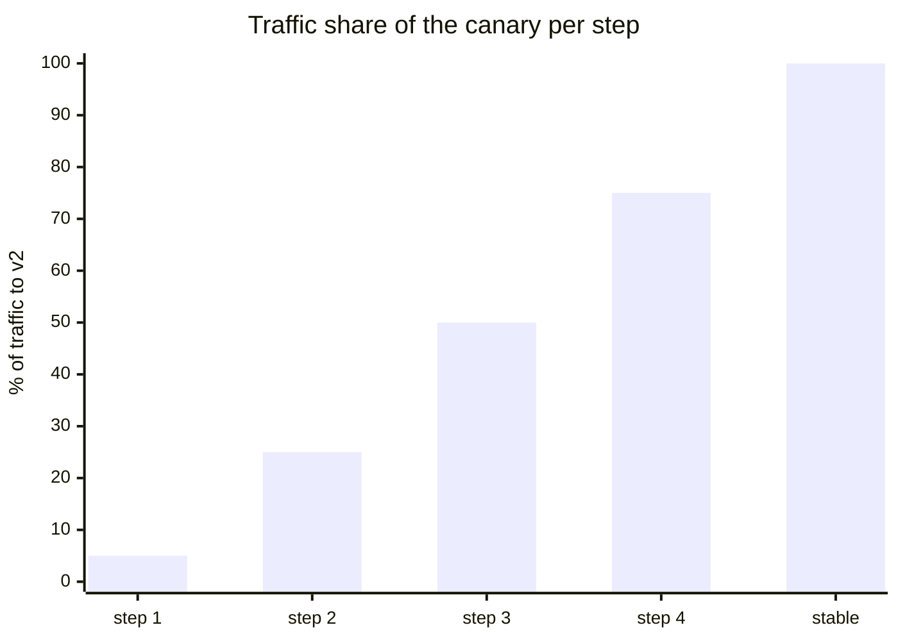

# Canary deployment

## Summary

A canary deployment releases a new version to a small share of users or traffic first, observes it under real conditions, and increases the share step by step (for example 5%, 25%, 50%, 75%, 100%) or rolls back if problems appear. In Kubernetes, a rough canary uses two Deployments behind one Service (traffic split by replica ratio); precise canaries use a service mesh, an Ingress or Gateway with weighted routing, or a progressive delivery controller (Argo Rollouts, Flagger) or managed delivery service (for example Google Cloud Deploy) that automates traffic shifting and analysis.

## Prerequisites

- [Rolling updates](rolling-updates.md).
- [Services](../../services-and-networking/services.md).

## Core concepts

### Definition

Canary deployment is a technique to gradually roll out a new version of an application by directing a small percentage of users or traffic to the new version while the majority keep using the old one. This tests the new version under real-world conditions before fully committing to the update.

In Kubernetes, canary deployments can be implemented with tools such as Istio, Linkerd or NGINX-based ingress, or with built-in features such as several Deployments and Service selectors.

The name comes from the canaries miners took underground: the bird reacted to gas before the miners did. The canary version is exposed first, so that problems show up while few users are affected.



### Why use a canary strategy

A canary deployment lets you release an application partially. You can make sure the new version is reliable before you deliver it to all users. For example, you deploy the new version to a limited number of Pods while the old version keeps running and receives most of the traffic, and then send more and more traffic to the new Pods.

### How it works

A general process for canary deployments:

1. In the beginning, the current version receives 100% of user traffic.
2. A new deployment, the "canary", is created with new Pods and receives only a small amount of traffic, for example 5%, while 95% of users stay on the old version.
3. Different types of tests (for example smoke tests) run against the new version without affecting most users.
4. A decision about the current canary step is made, ideally automatically:
   - **If the new version works as expected**, a larger share of live traffic is sent to it and the process repeats for further percentages (for example 5%, 25%, 50%, 75%, 100%).
   - **If the new version has issues**, traffic is switched back to the original version. This has minimal impact on most users. The canary version is destroyed and everything returns to the original state.
5. In the end, 100% of traffic goes to the new version and the old version can be discarded.





### Implementations in Kubernetes

| Approach | Traffic control | Analysis | Effort |
| --- | --- | --- | --- |
| Two Deployments, one Service (shared label) | By replica ratio (1 of 20 Pods = about 5%) | Manual | Lowest |
| Ingress or Gateway API weighted backends | Percentage per route | Manual or external | Medium |
| Service mesh (Istio, Linkerd) | Percentage, headers, cookies | With a controller | Higher |
| Progressive delivery controller (Argo Rollouts, Flagger) | Uses mesh or ingress | Automated metric analysis and rollback | Medium |
| Managed delivery service (Google Cloud Deploy, others) | Built-in phases | Verify jobs | Low, vendor specific |

### Types of canary in Google Cloud Deploy (vendor example)

As a product example (checked against the Cloud Deploy documentation structure, 2026-11), Google Cloud Deploy offers three kinds of canary deployment:

- **Automated.** You configure Cloud Deploy with a series of percentages that express a progressive deployment. Cloud Deploy performs additional operations on your behalf to split traffic between the old and new versions.
- **Custom-automated.** For each phase you provide the phase name, the percentage goal, the Skaffold profile to use for the phase, and whether to include a verify job. You do not need to provide traffic-balancing configuration; Cloud Deploy handles it.
- **Custom.** You configure each canary phase separately, with the same per-phase settings (name, percentage goal, Skaffold profile, verify job), and in addition you provide all of the traffic-balancing configuration yourself.

**Phases.** When you create a release for a canary deployment, the rollout is created with a phase for each canary increment, plus a final `stable` phase for 100%. For example, with increments of 25%, 50% and 75%, the rollout has the phases:

- `canary-25`
- `canary-50`
- `canary-75`
- `stable`

### Benefits

- **Capacity testing.** When a new microservice replaces a legacy system, you can test in production how much capacity you will need. Launching a canary and testing it on a small fraction of users lets you predict the capacity needed to scale the system to full size.
- **Early feedback.** Many issues that affect end users only occur in production. Canaries expose features to users in a realistic environment, so errors and bugs are observed and user feedback is obtained early. This lets developers add the features users need and improves the software and user experience.
- **Easy rollback.** If severe issues are detected, rollback is fast: switch traffic back to the primary version or turn off a feature flag.

### Canary compared with blue/green

Both canary and blue/green deployments run two versions of the application in parallel. The key difference is that a blue/green deployment shows only one version to users at a time, while a canary shows both in parallel and gradually exposes the canary version. Blue/green deployments are more appropriate than canaries for smaller, low-risk deployments that need to be released quickly and frequently (opinion found in vendor guidance; teams with good automation often canary everything). See [Blue/green deployment](blue-green-deployment.md).

## Worked example

A replica-ratio canary with plain Kubernetes (untested here; Kubernetes v1.30 or later):

```yaml
apiVersion: v1
kind: Service
metadata: { name: shop }
spec:
  selector: { app: shop }            # matches both tracks
  ports: [{ port: 80, targetPort: 8080 }]
---
apiVersion: apps/v1
kind: Deployment
metadata: { name: shop-stable }
spec:
  replicas: 19
  selector: { matchLabels: { app: shop, track: stable } }
  template:
    metadata: { labels: { app: shop, track: stable } }
    spec:
      containers: [{ name: shop, image: registry.example.com/shop:1.8.0 }]
---
apiVersion: apps/v1
kind: Deployment
metadata: { name: shop-canary }
spec:
  replicas: 1                        # about 5% of 20 Pods
  selector: { matchLabels: { app: shop, track: canary } }
  template:
    metadata: { labels: { app: shop, track: canary } }
    spec:
      containers: [{ name: shop, image: registry.example.com/shop:1.9.0 }]
```

```bash
kubectl scale deploy shop-canary --replicas=5; kubectl scale deploy shop-stable --replicas=15   # about 25%
# compare error rates by the 'track' label in monitoring, then promote:
kubectl set image deploy/shop-stable shop=registry.example.com/shop:1.9.0 && kubectl scale deploy shop-canary --replicas=0
```

Replica ratios give only approximate traffic shares, and long-lived connections skew them; use weighted routing for precise percentages.

## Trade offs and when to use it

- **Benefits.** Real-traffic validation with limited blast radius; data-driven promotion.
- **Costs.** Needs good metrics segmented by version, automation, and tolerance for two versions running together (including database compatibility).
- **When not to use it.** Very low traffic services (too few requests to judge a 5% canary), or changes that cannot coexist with the old version.

## Common mistakes

- **No per-version metrics**, so the canary cannot be judged.
- **Sticky sessions or caches** that pin users unevenly.
- **Schema migrations that break the old version** while the canary runs.

## Practice

1. List the steps of a canary rollout.
2. With 20 Pods behind one Service, how many canary Pods give about 10% of traffic, and why is it only approximate?
3. What phases does a Cloud Deploy canary with 30% and 60% increments have?
4. What is the key difference between canary and blue/green?

Answers: 1. 100% on stable; deploy canary with a small share; test; decide automatically to increase or roll back; repeat until 100%; remove the old version. 2. Two; kube-proxy balances connections randomly, and long-lived connections are not rebalanced. 3. `canary-30`, `canary-60`, `stable`. 4. Blue/green exposes one version at a time and switches all traffic; canary exposes both and shifts traffic gradually.

## Further reading

- [Managing Workloads: canary deployments](https://kubernetes.io/docs/concepts/workloads/management/#canary-deployments), Kubernetes documentation.
- [Use a canary deployment strategy](https://cloud.google.com/deploy/docs/deployment-strategies/canary), Google Cloud Deploy documentation.
- [Flagger](https://flagger.app/), Flux project.
- [Canary Release](https://martinfowler.com/bliki/CanaryRelease.html), Danilo Sato, martinfowler.com, 2014.
