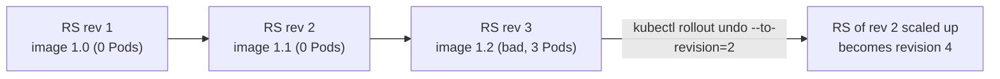

# Rollbacks

## Summary

A rollback reverts an application to a previous version when a release causes problems. Kubernetes keeps *revisions* of Deployments (as old ReplicaSets), StatefulSets and DaemonSets (as ControllerRevisions), so `kubectl rollout undo` restores an earlier Pod template quickly. A rollback restores code and configuration in the template, not data: database schema changes, external dependencies and other services may not roll back with it. Good rollbacks depend on versioned artifacts, backward compatible migrations, monitoring that detects the problem, and rehearsed procedures, ideally automated in the delivery pipeline or by a progressive delivery controller.

## Prerequisites

- [Deployments](../../workloads/workload-management/deployments.md#rolling-back).
- [Rolling updates](rolling-updates.md).

## Core concepts

### Definition

A rollback in Kubernetes is the process of reverting an application to a previous state or version. It is typically done when a recent update causes issues and the system must be restored to a stable condition.

### Reasons for rollbacks

1. **Application bugs.** The new deployment introduces bugs or performance problems.
2. **Failed deployments.** The deployment does not succeed or does not meet expected criteria (for example `ProgressDeadlineExceeded`).
3. **Configuration errors.** Misconfiguration in the new version causes instability.
4. **Dependency issues.** Incompatibility with other services or dependencies.

### Mechanisms

1. **Deployment rollbacks.** Reverting to a previous Deployment revision (`kubectl rollout undo deployment/<name>`).
2. **StatefulSet rollbacks.** Rolling back stateful applications to a previous revision; note the [forced rollback](../../workloads/workload-management/statefulsets.md#forced-rollback) procedure when Pods are stuck.
3. **DaemonSet rollbacks.** Reverting updates applied to daemon sets running on all nodes.
4. **Outside the controllers**: `helm rollback` (release revisions, see [Helm](../packaging/helm.md)), `git revert` in [GitOps](../gitops.md), switching traffic back in [blue/green](blue-green-deployment.md) or [canary](canary-deployment.md) setups.

### Revisions

Revisions are the historical versions of a resource, particularly Deployments. Each time the Pod template of a Deployment is updated, a new revision is created. Revisions let you track changes and roll back if necessary.

**How it works:**

1. **Deployment history.** Kubernetes keeps a history of changes to a Deployment as old ReplicaSets (scaled to zero), up to `revisionHistoryLimit` (default 10). This history includes the container images, configuration and resource specifications of each Pod template.
2. **Revision numbering.** Each template change increments the revision number. The first rollout is revision 1, and later updates increment it. A rollback to revision 2 creates a new, higher revision with the template of revision 2 (the old number disappears from the history).
3. **Annotations.** Kubernetes uses annotations to store the revision number (`deployment.kubernetes.io/revision` on the Deployment and its ReplicaSets) and the change cause (`kubernetes.io/change-cause`, which you set yourself; the `--record` flag that set it automatically is deprecated).



Only the Pod template is rolled back. Replica count, strategy and other Deployment fields stay as they are, and ConfigMaps or Secrets referenced by name are not versioned with the revision unless their names change.

### Pros and cons

**Pros**

1. **Quick recovery** from failed deployments.
2. **Minimized downtime**: application stability is restored quickly.
3. **Ease of use**: Kubernetes provides simple commands to manage rollbacks.

**Cons**

1. **State inconsistency.** Rollbacks may not restore data state, which can lead to inconsistencies.
2. **Complexity with dependencies.** Rolling back one service may require coordinated rollbacks of dependent services.
3. **Potential data loss.** If the new version changed the schema, rolling back can cause data compatibility problems.

### Best practices

1. **Version control.** Version deployments properly (immutable image tags or digests, versioned ConfigMaps) so that stable versions are easy to identify and restore.
2. **Automated rollbacks.** Integrate automated rollback into CI/CD pipelines for quick recovery (for example on `rollout status` failure or failed analysis in Argo Rollouts or Flagger).
3. **Monitor rollbacks.** Make sure monitoring confirms the application is stable after a rollback.
4. **Database migrations.** Handle schema changes carefully. Use backward compatible changes (expand and contract) and migration tools such as Liquibase or Flyway, so that the previous version still works with the new schema.
5. **Testing.** Test rollbacks in staging environments to make sure the process works as expected.

## Worked example

Roll back a bad image and record change causes (untested here; Kubernetes v1.30 or later):

```bash
kubectl annotate deployment/api kubernetes.io/change-cause="api 1.4.2: add caching" --overwrite
kubectl set image deployment/api api=registry.example.com/api:1.4.2
kubectl annotate deployment/api kubernetes.io/change-cause="api 1.5.0: new checkout flow" --overwrite
kubectl set image deployment/api api=registry.example.com/api:1.5.0
kubectl rollout history deployment/api
# REVISION  CHANGE-CAUSE
# 1         <none>
# 2         api 1.4.2: add caching
# 3         api 1.5.0: new checkout flow
kubectl rollout history deployment/api --revision=2       # shows the full template of revision 2
kubectl rollout undo deployment/api --to-revision=2
kubectl rollout status deployment/api
kubectl get rs -l app=api -o custom-columns=NAME:.metadata.name,REV:.metadata.annotations.deployment\\.kubernetes\\.io/revision,PODS:.status.replicas
```

## Trade offs and when to use it

- **Rollback or roll forward.** Rolling back is fastest for code bugs; rolling forward with a fix is often safer when data or schemas changed.
- **Controller rollback or GitOps revert.** In GitOps setups, roll back through Git; a `kubectl rollout undo` would be reverted by the agent.

## Common mistakes

- **`revisionHistoryLimit: 0`**, which makes rollback impossible.
- **Rolling back code after a destructive migration.**
- **Mutable tags**, so "the previous version" is no longer the same image.
- **Using `kubectl rollout undo` in a GitOps-managed cluster.**

## Practice

1. What exactly is restored by `kubectl rollout undo`?
2. Where does Kubernetes keep Deployment revisions?
3. Why are backward compatible database migrations a precondition for safe rollbacks?

Answers: 1. The Pod template of the chosen revision (not replicas, not data, not referenced ConfigMaps). 2. In old ReplicaSets with the revision annotation, up to `revisionHistoryLimit`. 3. After rollback, the previous version runs against the new schema; only compatible changes let it work.

## Further reading

- [Deployments: rolling back](https://kubernetes.io/docs/concepts/workloads/controllers/deployment/#rolling-back-a-deployment), Kubernetes documentation.
- [kubectl rollout undo](https://kubernetes.io/docs/reference/kubectl/generated/kubectl_rollout/kubectl_rollout_undo/), Kubernetes documentation.
- [ParallelChange (expand and contract)](https://martinfowler.com/bliki/ParallelChange.html), Danilo Sato, martinfowler.com.
