# Rolling updates

## Summary

A rolling update replaces the Pods of an application gradually: new Pods are started and old ones removed in small batches, so the service stays available throughout. In Kubernetes it is the default Deployment strategy (`RollingUpdate`), tuned by `maxSurge` (extra Pods allowed) and `maxUnavailable` (Pods allowed to be down) and gated by readiness probes; the alternative built-in strategy is `Recreate`, which stops everything first. Rolling updates give zero downtime and an easy rollback for stateless services, but both versions run at the same time, and the update takes longer and needs spare capacity.

## Prerequisites

- [Deployments](../../workloads/workload-management/deployments.md#update-strategy).
- [Probes](../../workloads/pods/probes.md).

## Core concepts

### Definition

A rolling update is a deployment strategy for releasing new versions of an application by gradually updating existing Pods with the new version, while making sure the application remains available during the process.

Kubernetes lets teams configure rolling updates to update a certain number or percentage of Pods at a time and wait for them to become available before continuing. If problems appear, Kubernetes provides a rollback mechanism to revert to the previous version of the application (see [Rollbacks](rollbacks.md)).

*Analogy.* Replacing the planks of a bridge one at a time while traffic keeps crossing. The analogy breaks because traffic on a Kubernetes "bridge" can step on old and new planks in the same trip: requests may hit both versions during the update, so they must be compatible.

### Types of Deployment strategy

1. **RollingUpdate (default)**
   - The default strategy in Kubernetes. Pods are updated one by one or in small batches.
   - It supports the `maxUnavailable` and `maxSurge` parameters to control the update.
2. **Recreate**
   - All existing Pods are destroyed before new ones are created.
   - This leads to downtime but guarantees a clean slate for the new version (no two versions at once).

```mermaid
gantt
  title RollingUpdate vs Recreate (4 replicas)
  dateFormat X
  axisFormat %s
  section RollingUpdate
  v1 Pods (4 to 0)      :active, 0, 8
  v2 Pods (0 to 4)      :2, 10
  section Recreate
  v1 Pods               :active, 0, 3
  downtime              :crit, 3, 5
  v2 Pods               :5, 10
```



### How maxSurge and maxUnavailable shape the rollout

| Setting | Effect | Capacity during update | Needs spare capacity |
| --- | --- | --- | --- |
| `maxSurge: 25%`, `maxUnavailable: 25%` (default) | Balanced | At least 75% | Up to 25% extra |
| `maxSurge: 1`, `maxUnavailable: 0` | Safest for capacity | 100% | One extra Pod |
| `maxSurge: 0`, `maxUnavailable: 1` | No extra resources | n-1 Pods | None |
| `maxSurge: 100%`, `maxUnavailable: 0` | Fast, like a blue/green inside one Deployment | 100% | Double |

`minReadySeconds` adds a soak time: a new Pod must stay ready for that long before it counts as available.

### Pros and cons

**Pros**

1. **No downtime.** Services remain available during the update.
2. **Incremental changes.** Issues with the new version are easier to spot because the change is gradual.
3. **Rollback capability.** You can easily roll back to the previous version if problems are found.

**Cons**

1. **Longer update time.** The update can be slower than other strategies.
2. **Resource overhead.** Additional resources may be needed while old and new versions coexist.
3. **Coordination complexity.** It requires careful coordination and monitoring for a smooth update; both versions must be compatible (API, database schema, sessions).

### When to use rolling updates

Rolling updates suit:

- **Production environments**, where application availability is critical.
- **Microservices architectures**, where services are loosely coupled and can be updated independently.
- **Stateless applications**, where instances can be replaced without affecting overall state.

They are a poor fit when two versions cannot run together (use Recreate or blue/green) or when you need traffic-percentage control and automated analysis (use canary).

### Best practices

1. **Test updates in staging** before production.
2. **Monitor updates.** Track health and performance during the update (error rate, latency, restarts), not only `rollout status`.
3. **Gradual rollout.** Start with a small share of Pods and increase if no issues appear (small `maxSurge`, `minReadySeconds`, or pause after the first batch).
4. **Automation and CI/CD.** Integrate rolling updates into pipelines for automated, consistent updates (see [CI/CD integration](../ci-cd-integration.md)).
5. **Readiness probes and graceful shutdown.** Without readiness probes, Pods count as available too early; without a `preStop` delay and SIGTERM handling, in-flight requests fail.

## Worked example

A conservative rolling update with a soak time and a pause after the first batch (untested here; Kubernetes v1.30 or later):

```yaml
spec:
  replicas: 10
  minReadySeconds: 30
  strategy:
    type: RollingUpdate
    rollingUpdate:
      maxSurge: 2
      maxUnavailable: 0
```

```bash
kubectl set image deployment/api api=registry.example.com/api:2.0.0
sleep 60 && kubectl rollout pause deployment/api      # observe the first new Pods under real traffic
kubectl get pods -l app=api -L pod-template-hash     # mixture of old and new hashes
kubectl rollout resume deployment/api
kubectl rollout status deployment/api --timeout=15m
```

With 10 replicas, `maxSurge: 2` and `maxUnavailable: 0`, at most 12 Pods exist and at least 10 are available at every moment.

## Trade offs and when to use it

Rolling updates are the default for good reasons: no extra tooling and no downtime. Their limits are coarse control (Pod ratios, not traffic percentages), no automated analysis, and a mixed-version window. Progressive delivery controllers (Argo Rollouts, Flagger) add analysis and traffic shifting on top.

## Common mistakes

- **Breaking changes between versions** (removed API fields, incompatible schema) during the mixed window.
- **`maxUnavailable: 0` and `maxSurge: 0`** together, which the API rejects.
- **No spare capacity for surge Pods**, which leaves them Pending and stalls the rollout.

## Practice

1. Which two parameters control a rolling update?
2. When would you choose Recreate?
3. Why can a rolling update without readiness probes cause an outage?

Answers: 1. `maxSurge` and `maxUnavailable` (plus `minReadySeconds`). 2. When two versions must never run together and short downtime is acceptable. 3. New Pods count as available immediately, so old Pods are removed before the new ones can serve.

## Further reading

- [Deployments: strategy](https://kubernetes.io/docs/concepts/workloads/controllers/deployment/#strategy), Kubernetes documentation.
- [Performing a Rolling Update](https://kubernetes.io/docs/tutorials/kubernetes-basics/update/update-intro/), Kubernetes documentation tutorial.
- [Argo Rollouts](https://argoproj.github.io/rollouts/), Argo project.
