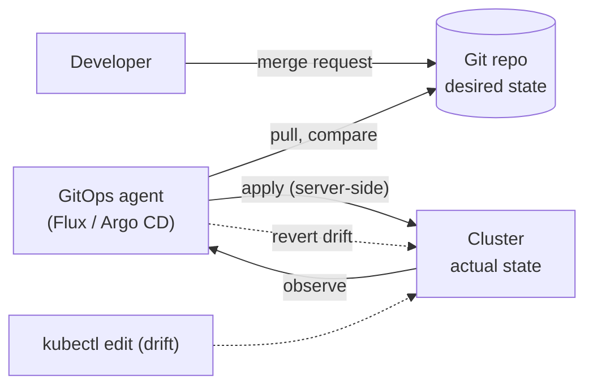
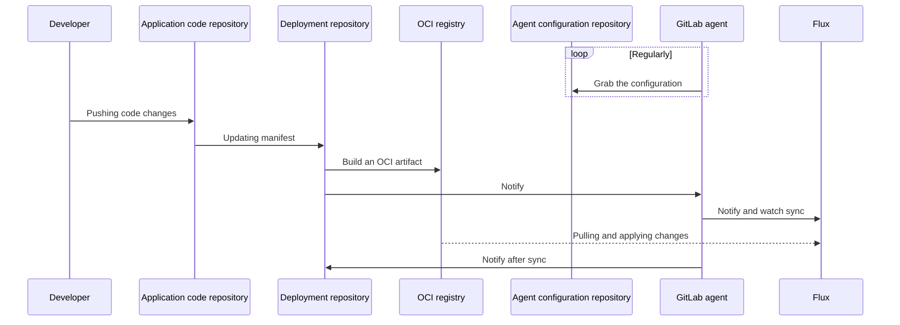

# GitOps

## Summary

GitOps manages infrastructure and applications by keeping their declarative configuration in Git (or another versioned store) as the single source of truth, and letting an agent in the cluster continuously pull that configuration and reconcile the cluster to it. Changes happen through commits and merge requests, not through `kubectl` against the cluster; drift is detected and corrected automatically. Flux and Argo CD are the common agents. Storing the desired state as OCI artifacts in a registry, instead of reading Git directly, is an increasingly common variant.

## Prerequisites

- [CI/CD integration](ci-cd-integration.md).
- [Configuration best practices](../configuration/configuration-best-practices.md).

## Core concepts

### Definition

GitOps is a set of practices for managing infrastructure and applications using Git repositories as the source of truth for declarative configuration. The OpenGitOps project defines four principles: the desired state is **declarative**, **versioned and immutable**, **pulled automatically**, and **continuously reconciled**.

In Kubernetes, GitOps uses Git as the single source of truth for the desired state of the system, automates deployment and management tasks, and is often combined with continuous delivery practices. The result is a more consistent, reliable and automated way to manage infrastructure and applications.

With GitOps, you manage containerized clusters and applications from a Git repository that:

- is the single source of truth of your system,
- is the single place where you operate your system.

By combining Git, Kubernetes and a GitOps agent, you get:

- Git as the interface through which you operate (the GitOps workflow),
- Kubernetes as the automation and convergence system,
- Git CI/CD for continuous integration,
- an agent for continuous deployment and cluster observability,
- built-in automatic drift remediation,
- resource management with server-side apply, for transparent multi-actor field management.

*Analogy.* GitOps is like a thermostat with the set point written in a logbook: anyone who wants a different temperature writes a new entry (commit), and the thermostat (agent) keeps comparing the room with the latest entry and corrects it. Turning the radiator knob by hand (kubectl edit) is undone at the next check. The analogy breaks for secrets, which should not be written in the logbook in plain text.



### Deployment sequence

The following sequence shows a GitOps deployment with the GitLab agent for Kubernetes and Flux, using an OCI registry between the deployment repository and the cluster:



1. The agent regularly reads its own configuration from the agent configuration repository.
2. A developer pushes code changes to the application repository.
3. The application pipeline updates the manifest in the deployment repository.
4. The deployment repository's pipeline builds an OCI artifact from the manifests and pushes it to the registry.
5. The pipeline notifies the GitLab agent, which notifies Flux and watches the synchronization.
6. Flux pulls the artifact from the OCI registry and applies the changes to the cluster.
7. The agent notifies the deployment repository after the sync.

### OCI artifacts as the source

GitLab's recommendation for Flux is to use OCI images (artifacts) as the source of the desired state instead of having the cluster read a Git repository directly:

| OCI registry | Git repository |
| --- | --- |
| Designed to serve container images at scale. | Designed to version and store source code. |
| Immutable, supports security scans. | Mutable. |
| The default Git branch can store cluster state without triggering a sync. | The default Git branch triggers a sync when used to store cluster state. |

Git remains the place where changes are reviewed; the pipeline publishes a reviewed, immutable snapshot to the registry, which the agent consumes. This decouples "merged" from "deployed" and reuses registry features (signing, scanning, caching).

### Flux and Argo CD

| Aspect | Flux | Argo CD |
| --- | --- | --- |
| Model | Set of controllers (source, kustomize, helm, notification) | Application controller with UI |
| UI | None built in (third party UIs) | Rich web UI |
| Multi-tenancy | Kubernetes RBAC and namespaces | Projects and its own RBAC |
| Sources | Git, OCI, Helm repositories, buckets | Git, Helm, OCI |
| Status | CNCF graduated | CNCF graduated |

## Worked example

A Flux setup that reconciles a path of a Git repository every minute (untested here; Flux v2.4, Kubernetes v1.30 or later):

```yaml
apiVersion: source.toolkit.fluxcd.io/v1
kind: GitRepository
metadata: { name: platform, namespace: flux-system }
spec:
  interval: 1m
  url: https://git.example.com/platform/deploy.git
  ref: { branch: main }
---
apiVersion: kustomize.toolkit.fluxcd.io/v1
kind: Kustomization
metadata: { name: shop, namespace: flux-system }
spec:
  interval: 5m
  path: ./clusters/prod/shop
  prune: true                 # delete objects removed from Git
  sourceRef: { kind: GitRepository, name: platform }
  wait: true
```

```bash
flux get kustomizations
kubectl -n shop scale deploy api --replicas=1     # manual drift
flux reconcile kustomization shop                  # replicas restored to the value in Git
git revert <bad-commit> && git push                # rollback through Git
```

## Trade offs and when to use it

- **Benefits.** Auditability (every change is a commit), easy rollback (revert), drift correction, no cluster credentials in CI, multi-cluster fan-out.
- **Costs.** Another system to operate; secrets need extra tooling (SOPS, Sealed Secrets, External Secrets); emergency changes must also go through Git or be reverted.
- **Debated choices.** Monorepo versus repo per environment, branches versus directories per environment; the Flux and Argo CD communities recommend directories over long-lived environment branches.

## Common mistakes

- **Plain Secrets in Git.**
- **Editing resources in the cluster** and being surprised when the agent reverts them.
- **Environment branches** that drift apart and make promotion a merge conflict.
- **Disabling pruning**, which leaves orphaned objects after removal from Git.

## Practice

1. State the four OpenGitOps principles.
2. Why does storing state in an OCI registry help compared with the default Git branch?
3. How do you roll back in GitOps?

Answers: 1. Declarative, versioned and immutable, pulled automatically, continuously reconciled. 2. Artifacts are immutable and scannable, and a commit to the default branch does not immediately trigger a sync; publishing is an explicit step. 3. Revert the commit (or point to the previous artifact); the agent reconciles the cluster.

## Further reading

- [OpenGitOps principles](https://opengitops.dev/), OpenGitOps project (CNCF).
- [Flux documentation](https://fluxcd.io/flux/), Flux project.
- [Argo CD documentation](https://argo-cd.readthedocs.io/), Argo project.
- [GitOps with the GitLab agent for Kubernetes](https://docs.gitlab.com/user/clusters/agent/gitops/), GitLab documentation. Source of the deployment sequence and the OCI recommendation.
