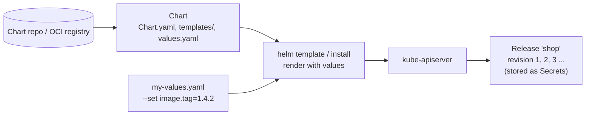

# Helm

## Summary

Helm is the package manager for Kubernetes. A *chart* packages templated manifests (Go templates), default values and metadata; installing a chart with your own values creates a *release*, whose revisions Helm records so that you can upgrade and roll back. Charts can depend on other charts and are shared through repositories and OCI registries (Artifact Hub is the public index). Helm makes complex applications installable in one command and reusable across environments, at the cost of template complexity and the need to trust third party charts.

## Prerequisites

- [Configuration best practices](../../configuration/configuration-best-practices.md).
- [Deployments](../../workloads/workload-management/deployments.md).

## Core concepts

### Definition

Helm is a Kubernetes package manager that simplifies deploying and managing complex applications through reusable, versioned Helm charts. Charts are composed of YAML files that describe related sets of Kubernetes resources, customized with values files and Go templates.

Charts can depend on other charts, and can be stored in a central repository for sharing. (The original public "Helm Hub" was replaced by Artifact Hub in 2020; charts are also distributed from OCI registries.) By using Helm, teams streamline application management and avoid duplicated effort.

*Analogy.* A chart is like a recipe with blanks: "bake for {{ minutes }} at {{ temperature }}". The values file fills the blanks for your kitchen, and Helm keeps a diary of every dish it cooked so it can serve yesterday's version again. The analogy breaks because Helm does not watch the dish afterwards: if someone changes the cluster by hand, Helm does not notice until the next upgrade.



### Chart structure

```text
shop/
  Chart.yaml          # name, version (chart), appVersion, dependencies
  values.yaml         # defaults
  values.schema.json  # optional JSON schema for values
  templates/
    deployment.yaml
    service.yaml
    _helpers.tpl      # named templates
    NOTES.txt         # printed after install
  charts/             # packaged dependencies
```

### Usage

1. **Installing software.** Deploy applications quickly without working out all settings yourself (`helm install`).
2. **Managing releases.** Helm tracks the version history of deployments (release revisions), which makes it easy to roll back to an older version when something goes wrong (`helm rollback`).
3. **Customizing deployments.** Before installing a chart, adjust its settings to fit your needs (values files, `--set`).

### Types of charts

- **Stable charts**: well tested, ready-to-use charts for popular software. (Historically the `helm/charts` "stable" repository, deprecated in 2020; today maintained by the software projects themselves and by publishers such as Bitnami.)
- **Incubator charts**: for newer software or charts that are not as thoroughly tested yet (historically the "incubator" repository, also deprecated).
- **Vendor-specific charts**: companies publish their own charts for their software, sometimes with extra features.

Today "stable" and "incubator" mean maturity levels rather than repositories; Artifact Hub shows verified publishers and official charts.

### Pros and cons

**Pros**

- **Simplicity.** Charts make complex Kubernetes applications easier to manage.
- **Reusability.** The same chart deploys an application across different environments.
- **Community.** A large community creates and shares charts, so you often do not start from scratch.

**Cons**

- **Complexity.** Helm simplifies deployment, but learning Helm and its templating can be complex; heavily templated charts are hard to read and debug.
- **Security.** Charts can introduce security risks if not managed carefully, especially from untrusted sources (privileged settings, broad RBAC, unpinned images).
- **Overhead.** For very simple applications, Helm can be overkill and add unnecessary complexity.

| Tool | Approach | Good for |
| --- | --- | --- |
| Helm | Templates + values, releases with history | Distributing software to others, complex apps |
| Kustomize | Patches over plain YAML, no templates | In-house apps with per-environment overlays |
| Plain YAML | No abstraction | Small apps, learning |

## Worked example

Install, upgrade and roll back a release (untested here; Helm v3.16, Kubernetes v1.30 or later):

```bash
helm repo add bitnami https://charts.bitnami.com/bitnami
helm show values bitnami/nginx | head -40
cat > my-values.yaml <<'EOF'
replicaCount: 3
service:
  type: ClusterIP
EOF
helm install web bitnami/nginx -n web --create-namespace -f my-values.yaml
helm upgrade web bitnami/nginx -n web -f my-values.yaml --set replicaCount=5
helm history web -n web           # REVISION 1 deployed -> superseded, 2 deployed
helm rollback web 1 -n web        # creates revision 3 with the content of revision 1
helm template web bitnami/nginx -f my-values.yaml | kubectl apply --dry-run=server -f -   # render and validate
```

## Trade offs and when to use it

- **Use Helm** to consume third party software and to publish your own for others.
- **Consider Kustomize** for internal apps where templating adds more indirection than value; many GitOps setups combine both (Helm for vendors, Kustomize overlays on top).
- **Pin chart versions** and review values and rendered output, especially RBAC and security contexts.

## Common mistakes

- **Unpinned chart versions** in automation, which upgrade silently.
- **Secrets in values files committed to Git.**
- **Manual `kubectl edit` on Helm-managed objects**, overwritten at the next upgrade (or causing conflicts with server-side apply).
- **Ignoring `helm template` output**: what is applied is the rendered YAML, not the values.

## Practice

1. What is the difference between a chart and a release?
2. Where does Helm 3 store release history?
3. What does `helm rollback web 1` create?
4. Name one risk of installing a chart from an unknown source.

Answers: 1. A chart is the package (templates, defaults); a release is an installed instance of a chart with specific values in a namespace. 2. In Secrets (by default) in the release's namespace. 3. A new revision whose content equals revision 1. 4. It may create privileged Pods, broad RBAC rules or pull untrusted images.

## Further reading

- [Helm documentation](https://helm.sh/docs/), Helm project.
- [Chart best practices](https://helm.sh/docs/chart_best_practices/), Helm project.
- [Artifact Hub](https://artifacthub.io/), CNCF. Index of Helm charts and other packages.
- [Kustomize](https://kustomize.io/), Kubernetes SIG CLI.
