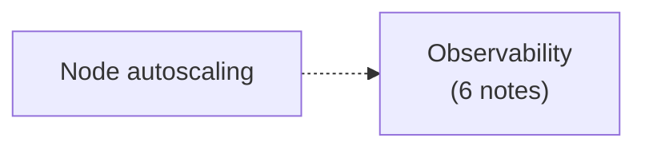

# Cluster administration

Lower level details relevant to creating and administering a Kubernetes cluster: scaling the number of nodes, and observing the cluster through logs, metrics and traces. Corresponds to the "Cluster Administration" chapter of the Kubernetes documentation Concepts.

## Map of the area

## Notes and sections in reading order

1. [Node autoscaling](node-autoscaling.md): Cluster Autoscaler, Karpenter, Descheduler, cluster proportional autoscalers.
2. [Observability](observability/README.md): observability, logging architecture, system logs, system metrics, resource metrics pipeline, system traces.

## Planned topics

- Node shutdowns (graceful and non-graceful)
- Swap memory management
- Certificates
- Cluster networking (setup and network plugins in operation)
- Admission webhook good practices
- Good practices for dynamic resource allocation as a cluster admin
- Compatibility version for control plane components
- Proxies in Kubernetes
- API Priority and Fairness
- Installing addons
- Coordinated leader election
- Cluster upgrades and etcd backup and restore
- Cluster federation and multi-cluster management
