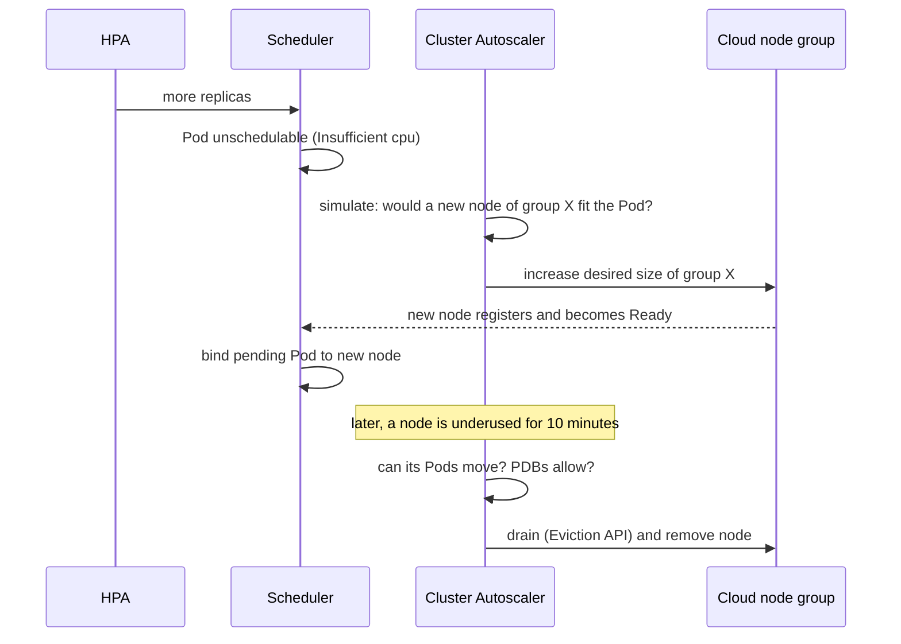
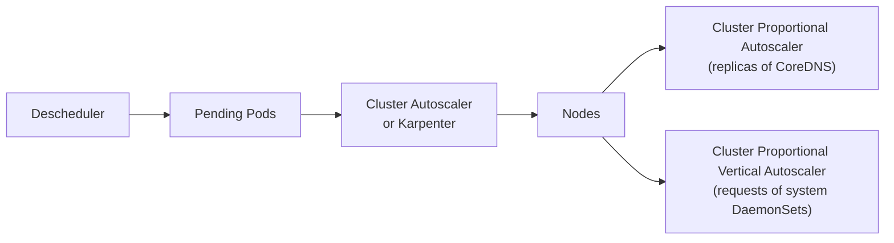
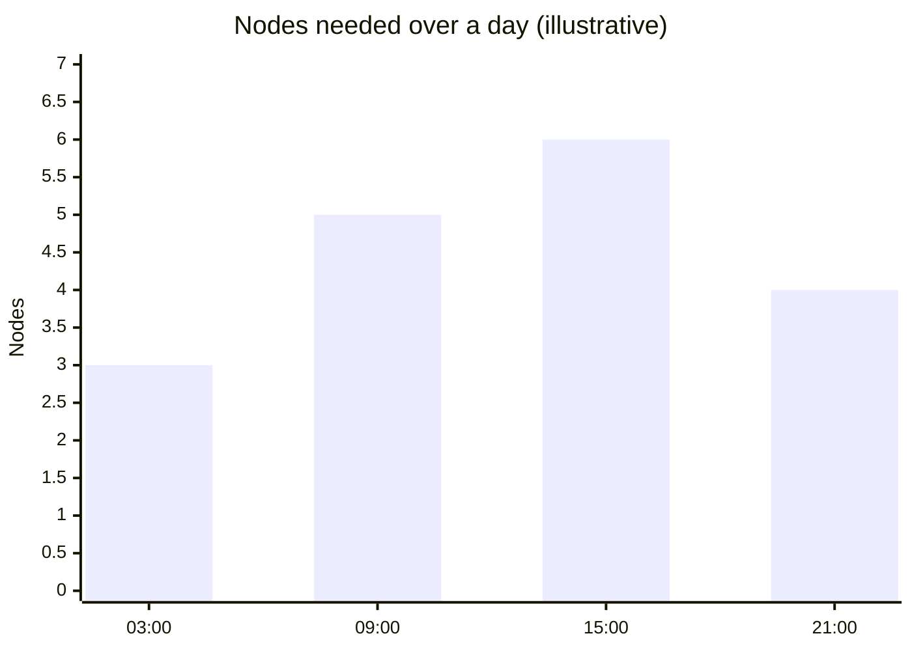

# Node autoscaling

## Summary

Node autoscaling adjusts the number (and sometimes the type) of nodes in a cluster to the demand of the Pods. The Cluster Autoscaler adds nodes from predefined node groups when Pods are unschedulable and removes nodes that are underused and whose Pods can move elsewhere. Karpenter provisions individual nodes directly through cloud provider APIs, choosing instance types for cost, and consolidates the cluster by replacing nodes. Related tools are the Descheduler (moves Pods to help consolidation) and the cluster proportional autoscalers (size system workloads by cluster size).

## Prerequisites

- [Workload autoscaling overview](../workloads/autoscaling/workload-autoscaling-overview.md).
- [kube-scheduler](../scheduling-preemption-and-eviction/kube-scheduler.md).

## Core concepts

### Cluster Autoscaler

You can use the Cluster Autoscaler to manage the scale of your nodes automatically. It can integrate with a cloud provider, or with the Kubernetes Cluster API, to do the actual node management.

The Cluster Autoscaler adds nodes when there are unschedulable Pods, and removes nodes when they are empty (more precisely: underutilized, with all their Pods able to run elsewhere and allowed to move by PodDisruptionBudgets).

**Benefits.** Autoscaling is most valuable for services with fluctuating load, for example a 24/7 service that is busy during US daytime but quiet at night. It adjusts both the number of nodes and the number of Pods to user demand: the Cluster Autoscaler handles nodes and the Horizontal Pod Autoscaler handles Pods, and together they automate capacity in both directions.

### Cost-aware multidimensional scaling with Karpenter

Karpenter manages nodes directly, through plugins for cloud providers, and optimizes for overall cost. It works with cloud providers that offer API-driven server management and pricing information over a web API.

Instead of scaling predefined node groups, Karpenter looks at the pending Pods and launches nodes of the instance types that fit them best. For example, if you start more Pods, Karpenter might decide to add a larger node than the ones currently running, and then shut down an existing node once the new one is in service (consolidation).

| Aspect | Cluster Autoscaler | Karpenter |
| --- | --- | --- |
| Unit of scaling | Node groups (ASGs, managed instance groups) with fixed instance types | Individual nodes, instance type chosen per decision |
| Scale down | Removes underutilized nodes | Consolidates: deletes or replaces nodes with cheaper ones |
| Providers | Many cloud providers, Cluster API | AWS (originated there), Azure, and others through providers |
| Status | Kubernetes SIG Autoscaling project | Kubernetes SIG Autoscaling subproject (originally AWS) |

### Related components

**Descheduler.** The descheduler helps consolidate Pods onto fewer nodes, to support automatic scale down when the cluster has spare capacity. It evicts Pods that violate policies (for example topology spread or low node utilization strategies) so that the scheduler can place them better.

**Sizing a workload based on cluster size.**

- **Cluster Proportional Autoscaler.** For workloads that need to scale with the size of the cluster (for example `cluster-dns` or other system components), use the Cluster Proportional Autoscaler. It watches the number of schedulable nodes and cores and scales the number of replicas of the target workload accordingly.
- **Cluster Proportional Vertical Autoscaler.** If the number of replicas should stay the same, you can scale workloads vertically according to the cluster size with the Cluster Proportional Vertical Autoscaler. The project is in **beta** and can be found on GitHub. While the Cluster Proportional Autoscaler scales the number of replicas of a workload, the Cluster Proportional Vertical Autoscaler adjusts the resource requests of a workload (for example a Deployment or DaemonSet) based on the number of nodes and/or cores in the cluster.

## Worked example

Daily load cycle (illustrative numbers): a service needs 40 vCPU of requests at the daytime peak and 10 at night, on nodes with 8 allocatable vCPU.

| Hour | Requested vCPU | Nodes needed (ceil(requests / 8) + 1 spare) |
| --- | --- | --- |
| 03:00 | 10 | 3 |
| 09:00 | 25 | 5 |
| 15:00 | 40 | 6 |
| 21:00 | 18 | 4 |

Without autoscaling, the cluster must run 6 nodes all day (144 node-hours); with autoscaling, roughly 3 to 6 nodes follow the load (about 108 node-hours in this example), a saving of about 25%.

## Trade offs and when to use it

- **Scale-up latency.** New nodes take one to several minutes; keep headroom with overprovisioning Pods (low priority placeholders) for spiky loads.
- **Scale-down safety.** Strict PDBs, local storage or Pods without controllers block node removal (`cluster-autoscaler.kubernetes.io/safe-to-evict` annotations control this).
- **Cluster Autoscaler or Karpenter.** Node groups are predictable and simple; Karpenter is more cost efficient with diverse instance types but changes nodes more often.

## Common mistakes

- **Pods without requests**: the autoscaler cannot compute what they need.
- **Expecting scale up for Pods that no node type could ever fit.**
- **Topology spread or anti-affinity on zones with empty node groups** (see [Pod topology spread constraints](../scheduling-preemption-and-eviction/pod-topology-spread-constraints.md#known-limitations)).

## Practice

1. What triggers the Cluster Autoscaler to add a node?
2. What does Karpenter optimize that node group based scaling does not?
3. Which tool scales CoreDNS replicas with the number of nodes?

Answers: 1. Pods that are unschedulable because no existing node fits them, when a node from a group would fit. 2. The instance type and overall cost per decision, with consolidation. 3. The Cluster Proportional Autoscaler.

## Further reading

- [Node Autoscaling](https://kubernetes.io/docs/concepts/cluster-administration/node-autoscaling/), Kubernetes documentation.
- [Cluster Autoscaler](https://github.com/kubernetes/autoscaler/tree/master/cluster-autoscaler), Kubernetes SIG Autoscaling.
- [Karpenter](https://karpenter.sh/), Karpenter project.
- [Cluster Proportional Autoscaler](https://github.com/kubernetes-sigs/cluster-proportional-autoscaler), Kubernetes SIGs.
- [Cluster Proportional Vertical Autoscaler](https://github.com/kubernetes-sigs/cluster-proportional-vertical-autoscaler), Kubernetes SIGs.
