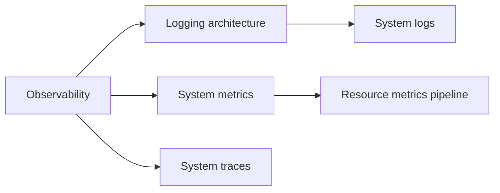

# Observability

Monitoring, logging and tracing of a Kubernetes cluster: what observability is and which tools provide it, how container and component logs are produced and collected, which metrics Kubernetes exposes, how resource metrics reach the autoscalers, and how components emit traces. Corresponds to the "Observability", "Logging Architecture", "System Logs", "Metrics For Kubernetes System Components" and "Traces For Kubernetes System Components" pages of the Cluster Administration chapter, and to the resource metrics pages of the documentation's monitoring tasks.

## Map of the section

## Notes in reading order

1. [Observability](observability.md): definition, benefits, Kubernetes signals, tools, best practices.
2. [Logging architecture](logging-architecture.md): container logs, rotation, component logs, node agent, sidecars, direct push.
3. [System logs](system-logs.md): klog, structured and contextual logging, JSON format, verbosity, log locations, node log query.
4. [System metrics](system-metrics.md): component `/metrics`, node metrics data, Summary API sources.
5. [Resource metrics pipeline](resource-metrics-pipeline.md): metrics-server, `metrics.k8s.io`, full metrics pipelines and adapters.
6. [System traces](system-traces.md): OpenTelemetry in kube-apiserver and kubelet, trace collection.

## Planned topics

- Metrics for Kubernetes object states (kube-state-metrics)
- Events and event exporters
- Auditing as an observability signal
- Monitoring with Prometheus Operator (ServiceMonitor, PrometheusRule)
- Debugging clusters and applications (tasks)

TODO: Decide whether a separate monitoring overview note is needed or whether the notes above cover it.
