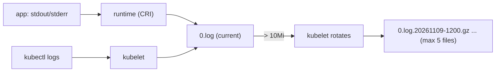
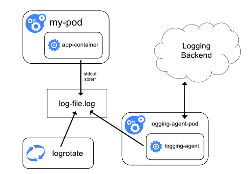
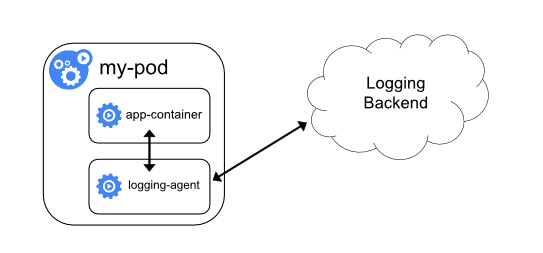
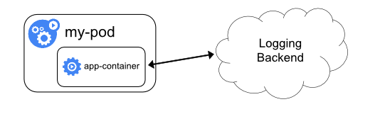

# Logging architecture

## Summary

Containers should log to `stdout` and `stderr`. The container runtime writes these streams to files on the node in the CRI logging format, the kubelet rotates them (`containerLogMaxSize` 10Mi, `containerLogMaxFiles` 5 by default) and serves them through `kubectl logs`. Those files disappear with the Pod or the node, so Kubernetes needs *cluster-level logging* to a separate backend, which it does not provide itself. The three common architectures are a node-level logging agent (DaemonSet), a sidecar container (streaming to its own `stdout` or running an agent), and applications pushing logs directly to a backend. System components log to journald or `/var/log`.

## Prerequisites

- [Observability](observability.md).
- [Node components](../../cluster-architecture/node-components.md).

## Core concepts

### Why logs need their own storage

Application logs help you understand what happens inside an application and are essential for debugging and monitoring. Most applications have a logging mechanism, and most container engines support it, typically through the standard output and standard error streams. However, the native functionality of a container engine or runtime is usually not enough for a complete logging solution.

For example, you want to access logs if a container crashes, a Pod is evicted or a node dies. In a cluster, logs should have separate storage and a lifecycle independent of nodes, Pods or containers. This concept is called *cluster-level logging*. Cluster-level logging requires a separate backend to store, analyze and query logs. Kubernetes does not provide a native storage solution for log data, but you can integrate many existing logging solutions.

### Pod and container logs

Kubernetes captures logs from each container in a running Pod. The figure shows the node-level path: the container writes to `stdout` and `stderr`, the runtime writes a log file, and the kubelet and log rotation manage it.


A container runtime handles and redirects any output generated to a containerized application's `stdout` and `stderr` streams. Different runtimes implement this in different ways; however, the integration with the kubelet is standardized as the *CRI logging format* (each line prefixed with a timestamp, the stream name and a tag for partial or full lines), stored under `/var/log/pods/<namespace>_<pod>_<uid>/<container>/`.

By default, if a container restarts, the kubelet keeps one terminated container with its logs (`kubectl logs --previous`). If a Pod is evicted from the node, all corresponding containers are also evicted, along with their logs.

The kubelet makes logs available to clients through a special feature of the Kubernetes API (the Pod `log` subresource). The usual way to access it is `kubectl logs`.

### Log rotation

The kubelet is responsible for rotating container logs and managing the logging directory structure. It sends this information to the container runtime (using the CRI), and the runtime writes the container logs to the given location.

Two kubelet configuration settings control rotation: `containerLogMaxSize` (default 10Mi) is the maximum size of each log file, and `containerLogMaxFiles` (default 5) the maximum number of files per container. For clusters with high log volume, `containerLogMaxWorkers` (number of concurrent rotations) and `containerLogMonitorInterval` (how often logs are checked for rotation) tune efficiency.

When you run `kubectl logs`, the kubelet on the node handles the request and reads directly from the log file. It returns the content of the current log file only: after a rotation, earlier files are not returned. So with the defaults, at most about 10 MiB of recent output is available through `kubectl logs` per container.



### System component logs

There are two types of system components: those that typically run in a container, and those directly involved in running containers. For example:

- The kubelet and the container runtime do not run in containers. The kubelet runs your containers (grouped together in Pods).
- The Kubernetes scheduler, controller manager and API server run within Pods (usually static Pods). The etcd component runs in the control plane, most commonly also as a static Pod. If your cluster uses kube-proxy, you typically run it as a `DaemonSet`.

**Log locations.** On Linux nodes that use systemd, the kubelet and container runtime write to journald by default; you read them with `journalctl -u kubelet`. Without systemd, they write to `.log` files in `/var/log`. To redirect kubelet logs, use the `kube-log-runner` helper. The container runtime writes Pod logs to `/var/log/pods` by default.

Kubernetes cluster components that run in Pods write to files inside `/var/log`, bypassing the default logging mechanism (they do not write to the systemd journal). You can use Kubernetes storage mechanisms to map persistent storage into the container that runs the component. You can change the Pod log directory with `podLogsDir` in the kubelet configuration.

**Note on rotation.** When you deploy components such as the scheduler to log to a volume shared from the node, make sure that those logs are rotated: Kubernetes does not manage that rotation. Your operating system may rotate some logs automatically; for example, if `/var/log` is shared into a static Pod, logs there are rotated like any other file outside Kubernetes. Deployment tools may automate this, but it may also be your responsibility. Details are in [System logs](system-logs.md).

### Cluster-level logging architectures

Kubernetes does not provide a native solution for cluster-level logging, but there are several common approaches:

- Use a node-level logging agent that runs on every node.
- Include a dedicated sidecar container for logging in an application Pod.
- Push logs directly to a backend from within an application.

```mermaid
flowchart TB
  subgraph a1["1. Node logging agent"]
    p1["app -> stdout"] --> nf["/var/log/pods"] --> ag["agent DaemonSet"] --> be1[("backend")]
  end
  subgraph a2["2a. Streaming sidecar"]
    p2["app -> file"] --> sc["sidecar: tail -> stdout"] --> nf2["/var/log/pods"] --> ag2["node agent"] --> be2[("backend")]
  end
  subgraph a3["2b. Sidecar with agent"]
    p3["app -> file"] --> sa["sidecar agent"] --> be3[("backend")]
  end
  subgraph a4["3. Direct push"]
    p4["app SDK"] --> be4[("backend")]
  end
```



**Using a node logging agent.**



You can implement cluster-level logging by including a node-level logging agent on each node. The agent is a dedicated tool that exposes logs or pushes them to a backend. Commonly it is a container with access to a directory with log files from all application containers on that node.

Because the agent must run on every node, run it as a `DaemonSet`. Node-level logging creates only one agent per node and does not require changes to the applications on the node. Containers write to `stdout` and `stderr`, with no agreed format; the node-level agent collects these logs and forwards them for aggregation. Examples of agents: Fluent Bit, Fluentd, Vector, the OpenTelemetry Collector, Promtail or Grafana Alloy.

**Using a sidecar container with the logging agent.** You can use a sidecar container in one of these ways:

- The sidecar container streams application logs to its own `stdout`.
- The sidecar container runs a logging agent, which is configured to pick up logs from an application container.


*Streaming sidecar container.* By having sidecar containers write to their own `stdout` and `stderr` streams, you take advantage of the kubelet and the logging agent that already run on each node. The sidecar containers read logs from a file, a socket or journald, and each one prints a log to its own stream. This approach lets you separate several log streams from different parts of an application, some of which may lack support for writing to `stdout` or `stderr`. The logic behind redirecting logs is minimal, so the overhead is small. Because `stdout` and `stderr` are handled by the kubelet, you can also use built-in tools like `kubectl logs`. (The cost is that log data is written twice on the node disk.)



*Sidecar container with a logging agent.* If the node-level logging agent is not flexible enough for your situation, you can create a sidecar container with a separate logging agent configured specifically for your application. Note that this consumes more resources (one agent per Pod), and you cannot access those logs with `kubectl logs`, because they are not controlled by the kubelet.

**Exposing logs directly from the application.** Cluster-logging that exposes or pushes logs directly from every application is outside the scope of Kubernetes.



| Approach | App changes | Resource cost | `kubectl logs` works | Typical use |
| --- | --- | --- | --- | --- |
| Node logging agent | None | One agent per node | Yes | Default choice |
| Streaming sidecar | None (app writes files) | Small; logs written twice | Yes | Apps that cannot log to stdout |
| Sidecar with agent | None | One agent per Pod | No | Per-app parsing or destinations |
| Direct push | SDK or appender in the app | In the app | No | Special requirements, serverless style apps |

## Worked example

A streaming sidecar for an application that writes two log files (untested here; Kubernetes v1.30 or later; uses native sidecars):

```yaml
apiVersion: v1
kind: Pod
metadata:
  name: counter
spec:
  volumes:
    - name: varlog
      emptyDir: {}
  initContainers:
    - name: count-log-1
      image: busybox:1.36
      restartPolicy: Always
      args: [/bin/sh, -c, 'tail -n+1 -F /var/log/1.log']
      volumeMounts: [{ name: varlog, mountPath: /var/log }]
    - name: count-log-2
      image: busybox:1.36
      restartPolicy: Always
      args: [/bin/sh, -c, 'tail -n+1 -F /var/log/2.log']
      volumeMounts: [{ name: varlog, mountPath: /var/log }]
  containers:
    - name: count
      image: busybox:1.36
      args:
        - /bin/sh
        - -c
        - 'i=0; while true; do echo "$i: $(date)" >> /var/log/1.log; echo "$(date) INFO $i" >> /var/log/2.log; i=$((i+1)); sleep 1; done'
      volumeMounts: [{ name: varlog, mountPath: /var/log }]
```

```bash
kubectl apply -f counter.yaml
kubectl logs counter -c count-log-1 | head -3   # 0: ..., 1: ...
kubectl logs counter -c count-log-2 | head -3   # ... INFO 0
```

## Trade offs and when to use it

- **Node agent** is the cheapest and simplest; it relies on applications logging to `stdout`.
- **Sidecars** handle legacy file logging but multiply resource use and disk writes.
- **Direct push** couples applications to a backend and loses logs when the backend is unreachable unless buffered.

## Common mistakes

- **Relying on `kubectl logs` for incident analysis**: logs vanish with evicted Pods and rotations.
- **Logging to files inside the container** without a sidecar or agent: nobody collects them, and they fill the writable layer.
- **Unstructured logs**: use JSON or another structured format to make querying cheap.
- **Ignoring rotation of component logs** in `/var/log`.

## Practice

1. What are the default kubelet log rotation settings?
2. Where do the kubelet and container runtime write logs on a systemd node?
3. Which cluster-level architecture keeps `kubectl logs` working without changing the application that writes to files?
4. What happens to container logs when a Pod is evicted?

Answers: 1. `containerLogMaxSize` 10Mi, `containerLogMaxFiles` 5. 2. journald (`journalctl -u kubelet`). 3. A streaming sidecar that tails the files to its own `stdout`. 4. They are removed together with the containers.

## Further reading

- [Logging Architecture](https://kubernetes.io/docs/concepts/cluster-administration/logging/), Kubernetes documentation.
- [Fluent Bit Kubernetes documentation](https://docs.fluentbit.io/manual/installation/downloads/kubernetes), Fluent Bit project.
- [Kubelet Configuration (v1beta1)](https://kubernetes.io/docs/reference/config-api/kubelet-config.v1beta1/), Kubernetes documentation. The `containerLog*` settings.
