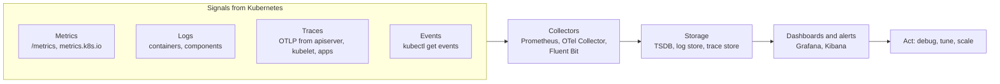

# Observability

## Summary

Observability is the ability to understand the inner workings of a cluster and its applications from the data they emit: metrics, logs, traces and events. Kubernetes produces this data (component metrics, container and system logs, traces from the API server and kubelet, Events) but does not store or analyze it; that is done by an observability stack such as Prometheus and Grafana, the ELK stack, OpenTelemetry pipelines or commercial platforms. Monitoring answers known questions with predefined checks; observability lets you investigate unknown problems by correlating the signals.

## Prerequisites

- [Cluster architecture overview](../../cluster-architecture/cluster-architecture-overview.md).

## Core concepts

### Definition

Observability in Kubernetes refers to the ability to gain insight into the inner workings of the cluster and the applications and services running on it. An *observability engine* in Kubernetes is a tool or platform that collects, analyzes and visualizes data from the different sources of the environment. Common ones are Prometheus, Grafana, Jaeger and the Elastic Stack (ELK).

Observability in Kubernetes is the continuous process of using the metrics, events, logs and trace data that a Kubernetes system generates to identify, understand and optimize its health and performance.

The term comes from control theory, where a system is observable if its internal state can be inferred from its outputs. In DevOps, observability means collecting, analyzing and acting on a system's output data to find strengths, weaknesses and root causes in complex systems such as Kubernetes. Monitoring, in contrast, relies on predefined criteria to understand a system: it tells you *that* a known threshold was crossed, while observability helps you find *why*.



### Benefits

The benefits of Kubernetes observability, some immediate and some over time:

- **Improves visibility.** Observability tools and techniques give deeper and clearer visibility into the system based on its inputs and outputs.
- **Minimizes complexity.** It brings together health and performance data from many components, giving a clear picture of the distributed system.
- **Improves understanding.** It correlates telemetry to provide context that helps identify issues or opportunities and how they relate to each other.
- **Helps prevent problems before they occur.** By interpreting observability data proactively, you can detect potential issues before they escalate into problems that affect Service Level Agreements (SLAs) or customer experience.
- **Provides actionable information.** Health and performance data is broken down into granular insights that improve root cause analysis.
- **Helps reduce downtime.** By identifying the root cause of an issue, observability shortens the time to discover, fix and restore normal operations.
- **Minimizes unwanted surprises.** Because observability also surfaces "unknown unknowns", it draws attention to unexpected changes in the environment.
- **Enables continuous improvement.** Lessons learned can be applied to later deployments, for example predicting which issues to expect when upgrading Kubernetes, an add-on or an application.

### Kubernetes building blocks

| Signal | Kubernetes source | Home note |
| --- | --- | --- |
| Resource metrics (CPU, memory) | kubelet and metrics-server, `metrics.k8s.io` | [Resource metrics pipeline](resource-metrics-pipeline.md) |
| Component metrics | `/metrics` of apiserver, scheduler, controller manager, kubelet | [System metrics](system-metrics.md) |
| Container logs | Runtime log files, `kubectl logs` | [Logging architecture](logging-architecture.md) |
| Component logs | klog, journald, `/var/log` | [System logs](system-logs.md) |
| Traces | OTLP from kube-apiserver and kubelet | [System traces](system-traces.md) |
| Object state | Events, kube-state-metrics | Planned |

### Tools

The following tools are common in Kubernetes observability (vendor descriptions summarized; this is not an endorsement, and offerings change, checked 2026-11 only for names):

| Tool | Category | What it does |
| --- | --- | --- |
| **CloudZero** | Cost observability (commercial) | Designed as an observability platform for cost rather than only a cost monitoring tool. Captures, enriches and presents Kubernetes cost data from infrastructure and applications without requiring cost allocation tags. |
| **Prometheus** | Metrics, open source (CNCF graduated) | Full-stack metrics and alerting. Scrapes metrics from containers, Pods, nodes, Services and applications. Cloud native, with time series storage, its own query language (PromQL) and third party exporters. Runs standalone, with the Prometheus Operator, or together with Grafana. |
| **Grafana** | Visualization, open source and enterprise | A widely used visualization and analytics tool that works with Kubernetes and Prometheus. The paid Enterprise edition adds authentication features, premium support and integrations with commercial platforms such as AppDynamics (APM) and Datadog. The open source edition visualizes metrics, logs and traces. |
| **ELK Stack** | Logs, open source | Elasticsearch (search and analytics engine), Logstash (server-side ingest pipeline that pulls data from many sources concurrently, transforms it and pushes it to a store such as Elasticsearch) and Kibana (visualization with graphs and charts). Beats ship log data. (Licensing of Elasticsearch changed over time; OpenSearch is an open source fork.) |
| **Splunk** | Full-stack, commercial | Fast, detailed and hierarchical analysis of nodes, Pods and containers. Collects infrastructure and application data and logs, and uses machine learning to give context about cluster health and performance. |
| **Instana** | Full-stack, commercial (IBM) | Captures health and performance data from containers, nodes, applications and Pods. Supports Kubernetes distributions such as Red Hat OpenShift, Amazon EKS and Rancher, discovers services automatically and correlates in real time. |
| **Sematext** | Agent-based, commercial | Runs as a DaemonSet and uses container and host logs, metrics and events from infrastructure, applications, nodes, Pods, Services and third party integrations. |
| **Pixie** | eBPF based, open source (CNCF sandbox) | Lightweight observation of metrics, events, traces and logs using eBPF probes, without code changes. Runs entirely inside Kubernetes and lets you debug with scripts ("debugging as code"). |
| **New Relic with Pixie** | Full-stack, commercial | New Relic's Kubernetes monitoring combined with Pixie's eBPF data: New Relic adds premium support, long-term Pixie data retention, incident correlation and smart alerting; Pixie contributes unsampled request visibility and service-level metrics. |

Other widely used projects: OpenTelemetry (vendor neutral instrumentation and collector), Jaeger and Grafana Tempo (traces), Loki (logs), Thanos and Mimir (scalable Prometheus storage).

### Best practices

- Keep track of all key components: Pods, nodes, clusters, Deployments and Services.
- Use metrics, logs and traces together; they are often called the three pillars of observability, and events add Kubernetes specific context.
- Automate observability with tooling, so that you collect accurate, real-time, actionable data.
- Do not rely only on the built-in observability of managed services such as GKE, AKS and EKS. They may not give the insights that matter most for your particular business.
- Relate findings to what else is going on (context): deployments, scaling events, node changes.
- Use observability proactively to identify, understand and resolve potential problems before they become costly.

## Worked example

A minimal open source stack on a test cluster (untested here; Helm 3, kube-prometheus-stack chart):

```bash
helm repo add prometheus-community https://prometheus-community.github.io/helm-charts
helm install monitoring prometheus-community/kube-prometheus-stack -n monitoring --create-namespace
kubectl -n monitoring port-forward svc/monitoring-grafana 3000:80
# Grafana dashboards: "Kubernetes / Compute Resources / Namespace (Pods)", "Node Exporter / Nodes"
kubectl get events -A --sort-by=.lastTimestamp | tail     # the fourth signal: Events
```

The chart installs Prometheus, Alertmanager, Grafana, node-exporter (DaemonSet) and kube-state-metrics, which together cover metrics and alerting; logs and traces need additional components (for example Loki and Tempo, or an OpenTelemetry Collector).

## Trade offs and when to use it

- **Open source stacks** give control and no license costs but need operation at scale (storage, retention, high availability).
- **Commercial platforms** reduce operational load and add correlation features, at a cost per host, per GB or per metric.
- **OpenTelemetry** decouples instrumentation from the backend, which avoids lock-in.

## Common mistakes

- **High cardinality labels** (user IDs, request IDs) in metrics, which explode storage.
- **Logs without correlation IDs**, which cannot be joined with traces.
- **Dashboards without alerts**, or alerts on causes instead of symptoms.
- **Treating `kubectl logs` as a log system.** Logs disappear with Pods and nodes.

## Practice

1. What is the difference between monitoring and observability?
2. Name the three pillars of observability and the Kubernetes specific fourth signal.
3. Which Kubernetes object gives short-lived information about scheduling failures and probe failures?

Answers: 1. Monitoring checks predefined criteria; observability lets you infer internal state and investigate unknown problems from outputs. 2. Metrics, logs, traces; Events. 3. Events.

## Further reading

- [Observability](https://kubernetes.io/docs/concepts/cluster-administration/observability/), Kubernetes documentation.
- [Prometheus documentation](https://prometheus.io/docs/introduction/overview/), Prometheus project.
- [OpenTelemetry documentation](https://opentelemetry.io/docs/), OpenTelemetry project.
- [Kubernetes observability tools](https://www.cloudzero.com/blog/kubernetes-observability/), CloudZero. Source of the tool overview.
