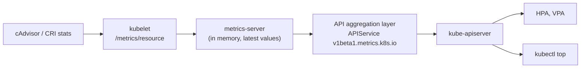

# Resource metrics pipeline

## Summary

Kubernetes has two metrics pipelines. The *resource metrics pipeline* is small and built in: metrics-server collects CPU and memory usage from every kubelet, keeps it in memory for a short time and serves it as the `metrics.k8s.io` API, which the Horizontal Pod Autoscaler, the Vertical Pod Autoscaler and `kubectl top` use. A *full metrics pipeline* (for example Prometheus with an adapter) gives richer metrics and serves them through `custom.metrics.k8s.io` or `external.metrics.k8s.io`, so autoscalers can react to application metrics.

## Prerequisites

- [System metrics](system-metrics.md).
- [Horizontal Pod Autoscaler](../../workloads/autoscaling/horizontal-pod-autoscaler.md) (consumer of the pipeline).

## Core concepts

### Why measure resources

To scale an application and provide a reliable service, you need to understand how it behaves when it is deployed. You can examine application performance in a cluster by examining the containers, Pods, Services and the characteristics of the overall cluster. Kubernetes provides detailed information about an application's resource usage at each of these levels, which lets you evaluate performance and find where bottlenecks can be removed to improve overall performance.

### Resource metrics pipeline

The resource metrics pipeline provides a limited set of metrics related to cluster components such as the Horizontal Pod Autoscaler controller, as well as the `kubectl top` utility. These metrics are collected by the lightweight, short-term, in-memory metrics-server and are exposed through the `metrics.k8s.io` API.

metrics-server discovers all nodes in the cluster and queries each node's kubelet for CPU and memory usage. The kubelet acts as a bridge between the Kubernetes master and the nodes, managing the Pods and containers running on a machine. The kubelet translates each Pod into its containers and fetches individual container usage statistics from the container runtime through the CRI. If you use a container runtime that relies on Linux cgroups and namespaces to implement containers, and the runtime does not publish usage statistics, the kubelet can look up those statistics directly (using code from cAdvisor). The kubelet then exposes the aggregated Pod resource usage statistics through the metrics-server Resource Metrics API. This API is served at `/metrics/resource/v1beta1` on the kubelet's authenticated and read-only ports (in current versions, `/metrics/resource` on the authenticated port).



metrics-server is registered with the API server through the [aggregation layer](../../extending-kubernetes/extending-kubernetes-overview.md#api-extensions), so `metrics.k8s.io` looks like any other Kubernetes API. It is a cluster add-on and is installed separately in most self-managed clusters.

### Full metrics pipeline

A full metrics pipeline gives access to richer metrics. Kubernetes can respond to these metrics by automatically scaling or adapting the cluster based on its current state, using mechanisms such as the Horizontal Pod Autoscaler. The monitoring pipeline fetches metrics from the kubelet (and other sources) and then exposes them to Kubernetes through an adapter that implements the `custom.metrics.k8s.io` or `external.metrics.k8s.io` API.

Kubernetes is designed to work with OpenMetrics, one of the CNCF Observability and Analysis monitoring projects, which builds on and carefully extends the Prometheus exposition format in almost 100% backwards-compatible ways.

| Pipeline | API | Data | Retention | Typical implementation |
| --- | --- | --- | --- | --- |
| Resource metrics | `metrics.k8s.io` | CPU and memory of nodes and Pods | Latest values only | metrics-server |
| Custom metrics | `custom.metrics.k8s.io` | Any metric about Kubernetes objects (for example requests per second per Pod) | Backend dependent | Prometheus Adapter, KEDA |
| External metrics | `external.metrics.k8s.io` | Metrics not tied to objects (queue length, cloud service metrics) | Backend dependent | Prometheus Adapter, KEDA, cloud adapters |

## Worked example

Install metrics-server and query the API (untested here; Kubernetes v1.30 or later; on kind add `--kubelet-insecure-tls` to the metrics-server arguments because kubelet certificates are self-signed):

```bash
kubectl apply -f https://github.com/kubernetes-sigs/metrics-server/releases/latest/download/components.yaml
kubectl get apiservice v1beta1.metrics.k8s.io       # AVAILABLE True
kubectl top nodes
kubectl top pods -A --sort-by=memory | head
kubectl get --raw /apis/metrics.k8s.io/v1beta1/namespaces/kube-system/pods | jq '.items[0].containers'
```

## Trade offs and when to use it

- **metrics-server** is cheap and enough for HPA on CPU and memory and for `kubectl top`, but keeps no history; it is not a monitoring system.
- **A full pipeline** enables scaling on application metrics and dashboards with history, at the cost of running Prometheus (or similar) and an adapter.

## Common mistakes

- **Using metrics-server data for capacity planning** (there is no history).
- **HPA targets `<unknown>`** because metrics-server is not installed or its APIService is unavailable.
- **Two adapters registering the same API group**, which conflict in the aggregation layer.

## Practice

1. Which components consume `metrics.k8s.io`?
2. Where does metrics-server get its data?
3. Which API would expose the length of an external message queue to the HPA?

Answers: 1. The HPA, the VPA and `kubectl top`. 2. From each kubelet's resource metrics endpoint, which gets container statistics from the runtime or cAdvisor. 3. `external.metrics.k8s.io`.

## Further reading

- [Resource metrics pipeline](https://kubernetes.io/docs/tasks/debug/debug-cluster/resource-metrics-pipeline/), Kubernetes documentation.
- [Tools for Monitoring Resources](https://kubernetes.io/docs/tasks/debug/debug-cluster/resource-usage-monitoring/), Kubernetes documentation.
- [metrics-server](https://github.com/kubernetes-sigs/metrics-server), Kubernetes SIGs.
- [OpenMetrics](https://openmetrics.io/), OpenMetrics project.
