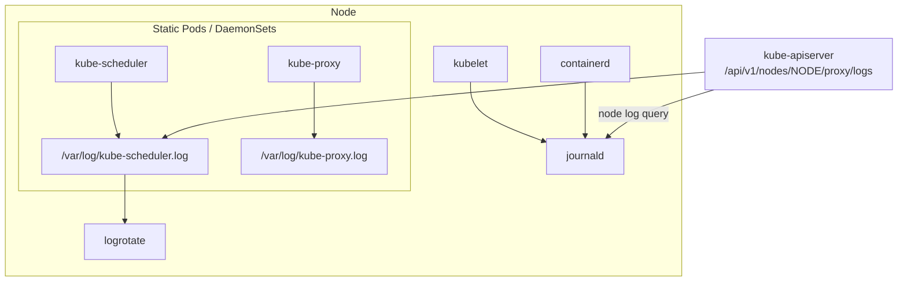

# System logs

## Summary

Kubernetes system components (kube-apiserver, kube-scheduler, kube-controller-manager, kubelet, kube-proxy) log through *klog*, the Kubernetes logging library. They write to stderr; where the output ends up depends on how the component is run: journald for the kubelet and runtime on systemd hosts, `.log` files in `/var/log` for components in containers. klog supports structured logging (key-value pairs), contextual logging, a JSON output format and verbosity levels with `-v`. With node log query, authorized users can read node service logs through the API server without SSH.

## Prerequisites

- [Logging architecture](logging-architecture.md).

## Core concepts

### Purpose

System component logs record events happening in the cluster, which is very useful for debugging. You can configure log verbosity to see more or less detail. Logs can be as coarse grained as showing errors within a component, or as fine grained as showing step-by-step traces of events (such as HTTP access logs, Pod state changes, controller actions or scheduler decisions).

### klog

klog is the Kubernetes logging library. It generates log messages for the Kubernetes system components. Output is always written to stderr, regardless of the output format. Output redirection is expected to be handled by the component that invokes a Kubernetes component: a POSIX shell, or a tool such as systemd. (Legacy klog flags for writing to files, such as `--log-file`, were deprecated and removed from most components; `kube-log-runner` does the redirection instead.)

### Structured logging

Structured logging introduces a uniform structure in log messages that allows programmatic extraction of information. You can store and process structured logs with less effort and cost. The code that generates a log message decides whether it uses traditional unstructured klog output or structured logging.

The default formatting of structured log messages is text, in a format that is backward compatible with traditional klog:

```text
<klog header> "<message>" <key1>="<value1>" <key2>="<value2>" ...
```

Example:

```text
I1025 00:15:15.525108       1 controller_utils.go:116] "Pod status updated" pod="kube-system/kubedns" status="ready"
```

### Contextual logging

Contextual logging builds on top of structured logging. It is primarily about how developers use logging calls: code based on this concept is more flexible and supports additional use cases, as described in the Contextual Logging KEP (KEP-3077). If developers use additional functions such as `WithValues` or `WithName` in their components, log entries contain additional information that is passed into functions by their caller (for example the Pod or the controller a log line belongs to).

### JSON log format

The `--logging-format=json` flag changes the format of logs from the klog native format to JSON. Components that support JSON format include:

- kube-controller-manager
- kube-apiserver
- kube-scheduler
- kubelet

JSON output is easier to parse by log pipelines; the header fields become `ts`, `v`, `msg`, plus the key-value pairs.

### Log verbosity level

The `-v` flag controls log verbosity. Increasing the value increases the number of logged events; decreasing it decreases them. Higher verbosity settings log increasingly less severe events. A verbosity of 0 logs only critical events.

| Level | Typical content |
| --- | --- |
| 0 | Always visible to an operator: critical events, programmer errors |
| 1, 2 | Reasonable defaults: configuration, important state changes (`-v=2` is a common production level) |
| 3, 4 | Extended information about changes, debug level |
| 5 to 10 | Trace level, request and response bodies at the highest levels |

### Log location

There are two types of system components: those that run in a container and those that do not:

- The Kubernetes scheduler and kube-proxy run in a container.
- The kubelet and the container runtime do not run in containers.

On machines with systemd, the kubelet and container runtime write to journald. Otherwise, they write to `.log` files in the `/var/log` directory. System components inside containers always write to `.log` files in `/var/log`, bypassing the default logging mechanism. Similar to container logs, you should rotate system component logs in `/var/log`. In clusters created by the `kube-up.sh` script, log rotation is configured by the `logrotate` tool, which rotates logs daily or once the log size exceeds 100 MB.



### Log query

To help with debugging issues on nodes, Kubernetes v1.27 introduced a feature to view logs of services running on the node (alpha, behind the `NodeLogQuery` feature gate; the kubelet also needs `enableSystemLogHandler` and `enableSystemLogQuery`). Provided you are authorized to interact with node objects, you can try it on all nodes or a subset. Example, retrieving kubelet service logs from a node:

```bash
# Fetch kubelet logs from a node named node-1.example
kubectl get --raw "/api/v1/nodes/node-1.example/proxy/logs/?query=kubelet"
```

You can also fetch files, provided the files are in a directory from which the kubelet allows log fetches. For example, a log from `/var/log` on a Linux node:

```bash
kubectl get --raw "/api/v1/nodes/<insert-node-name-here>/proxy/logs/?query=/<insert-log-file-name-here>"
```

The kubelet uses heuristics to retrieve logs. This helps if you do not know whether a given system service writes logs to the operating system's native logger such as journald or to a log file in `/var/log/`. The heuristics first check the native logger, and if that is not available, try to retrieve the first logs from `/var/log/<servicename>`, `/var/log/<servicename>.log` or `/var/log/<servicename>/<servicename>.log`. Additional query parameters filter by time (`sinceTime`, `untilTime`), lines (`tailLines`), boot and pattern.

Note that this uses the node `proxy` subresource, which is a powerful permission (see [RBAC good practices](../../security/rbac-good-practices.md#access-to-the-proxy-subresource-of-nodes)).

TODO: Verify the current maturity of node log query (beta in v1.30) against the v1.37 documentation.

## Worked example

Raise scheduler verbosity temporarily and read its decisions (untested here; kubeadm cluster, Kubernetes v1.30 or later):

```bash
# on the control plane node: add "- --v=4" to the command in the static Pod manifest
sudo sed -i 's/- kube-scheduler/- kube-scheduler\n    - --v=4/' /etc/kubernetes/manifests/kube-scheduler.yaml
kubectl -n kube-system logs -l component=kube-scheduler --tail=50 | grep -i "Attempting to schedule\|Successfully bound"
journalctl -u kubelet --since "10 min ago" | grep -i error | tail
```

Revert the verbosity afterwards: level 4 and above produce large volumes on busy clusters.

## Trade offs and when to use it

- **Higher verbosity** helps debugging but costs CPU, disk and log storage; raise it temporarily.
- **JSON format** is easier for pipelines but harder for humans reading raw logs.
- **Node log query** avoids SSH but needs a sensitive permission.

## Common mistakes

- **Looking for kubelet logs with `kubectl logs`.**
- **Leaving verbosity at 6 or higher** in production.
- **Forgetting rotation** for component logs on shared host paths.

## Practice

1. Where does klog write its output?
2. How do you switch kube-apiserver to JSON logs?
3. In which order does the node log query look for a service's logs?

Answers: 1. stderr; redirection is done by whatever runs the component. 2. `--logging-format=json`. 3. The native logger (journald) first, then `/var/log/<service>`, `/var/log/<service>.log`, `/var/log/<service>/<service>.log`.

## Further reading

- [System Logs](https://kubernetes.io/docs/concepts/cluster-administration/system-logs/), Kubernetes documentation.
- [Logging conventions](https://github.com/kubernetes/community/blob/master/contributors/devel/sig-instrumentation/logging.md), Kubernetes community. Verbosity level guidelines.
- [klog](https://github.com/kubernetes/klog), Kubernetes project.
