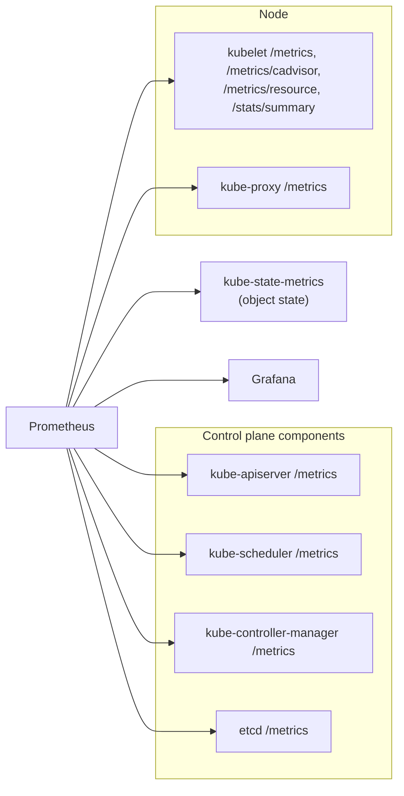
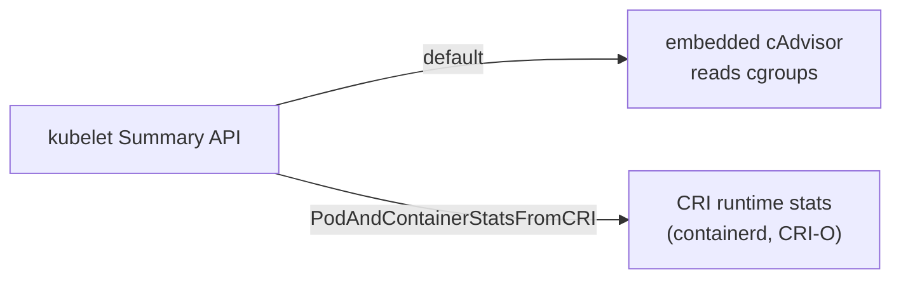

# System metrics

## Summary

Kubernetes components expose metrics in the Prometheus text format on their `/metrics` endpoints (API server request rates and latencies, scheduler attempts, workqueue depths, etcd latencies). The kubelet additionally collects node, volume, Pod and container statistics and exposes them through the Summary API and the `/metrics/cadvisor` and `/metrics/resource` endpoints, gathered by its embedded cAdvisor or, with the `PodAndContainerStatsFromCRI` feature, from the CRI runtime. Monitoring tools such as Prometheus scrape these endpoints; Grafana and the Kubernetes Dashboard visualize them.

## Prerequisites

- [Observability](observability.md).

## Core concepts

### What to monitor

Metrics worth monitoring include CPU usage, memory usage, network usage, disk usage, API server metrics, Pod and container metrics, and cluster-level metrics (object counts, Pending Pods, node conditions). These metrics give insight into the performance and health of the cluster, the nodes and the applications running on them.

Tools such as Prometheus, Grafana and the Kubernetes Dashboard collect and analyze these metrics. By monitoring them, administrators can identify performance issues and optimize the cluster for performance and scalability.



| Signal | Example metric | Why it matters |
| --- | --- | --- |
| API server latency | `apiserver_request_duration_seconds` | Control plane health, SLOs |
| API server errors | `apiserver_request_total{code=~"5.."}` | Failing clients and controllers |
| Scheduler | `scheduler_pending_pods`, `scheduler_schedule_attempts_total` | Capacity problems |
| etcd | `etcd_disk_wal_fsync_duration_seconds` | Disk latency, leader elections |
| Container CPU | `container_cpu_usage_seconds_total`, `container_cpu_cfs_throttled_periods_total` | Saturation and throttling |
| Container memory | `container_memory_working_set_bytes` | OOM and eviction risk |
| Object state (kube-state-metrics) | `kube_pod_status_phase`, `kube_deployment_status_replicas_unavailable` | Workload health |

Component metrics have a stability level (`ALPHA`, `BETA`, `STABLE`); only stable metrics are guaranteed not to change between releases.

### Node metrics data

The kubelet gathers metric statistics at the node, volume, Pod and container level, and emits this information in the Summary API. You can send a proxied request to the stats summary API through the Kubernetes API server:

```bash
kubectl get --raw "/api/v1/nodes/<node-name>/proxy/stats/summary"
```

### Summary metrics API source

By default, Kubernetes fetches node summary metrics data using an embedded cAdvisor that runs within the kubelet. If you enable the `PodAndContainerStatsFromCRI` feature gate in your cluster, and you use a container runtime that supports statistics access through the Container Runtime Interface (CRI), the kubelet fetches Pod and container level metric data using CRI, not cAdvisor.



## Worked example

Reading metrics without a monitoring stack (untested here; Kubernetes v1.30 or later; requires permissions for `nodes/proxy` and non-resource URL `/metrics`):

```bash
kubectl get --raw /metrics | grep '^apiserver_request_total' | head -3
kubectl get --raw "/api/v1/nodes/$(kubectl get nodes -o jsonpath='{.items[0].metadata.name}')/proxy/stats/summary" \
  | jq '.node.memory.workingSetBytes, .pods[0].podRef'
kubectl get --raw "/api/v1/nodes/<node>/proxy/metrics/cadvisor" | grep container_cpu_cfs_throttled_periods_total | head
```

## Trade offs and when to use it

- **Scraping everything** is easy but expensive; drop high cardinality series you do not use (for example per-container network metrics in large clusters).
- **cAdvisor or CRI stats.** CRI based stats remove duplication of work between the runtime and cAdvisor; cAdvisor is the mature default.

## Common mistakes

- **Building alerts on ALPHA metrics**, which may be renamed.
- **Confusing usage metrics with object state**: CPU usage comes from the kubelet, Deployment availability from kube-state-metrics.
- **Ignoring CPU throttling metrics** when latency is high.

## Practice

1. Which endpoint gives node, volume, Pod and container statistics from the kubelet?
2. What changes when `PodAndContainerStatsFromCRI` is enabled?
3. Which component turns object state (such as Deployment replicas) into metrics?

Answers: 1. The Summary API, `/api/v1/nodes/<node>/proxy/stats/summary`. 2. Pod and container stats come from the CRI runtime instead of the embedded cAdvisor. 3. kube-state-metrics.

## Further reading

- [Metrics For Kubernetes System Components](https://kubernetes.io/docs/concepts/cluster-administration/system-metrics/), Kubernetes documentation.
- [Node metrics data](https://kubernetes.io/docs/reference/instrumentation/node-metrics/), Kubernetes documentation.
- [Kubernetes Metrics Reference](https://kubernetes.io/docs/reference/instrumentation/metrics/), Kubernetes documentation.
- [kube-state-metrics](https://github.com/kubernetes/kube-state-metrics), Kubernetes project.
