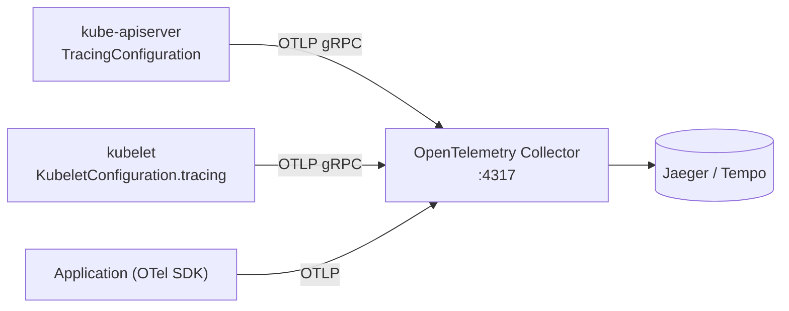
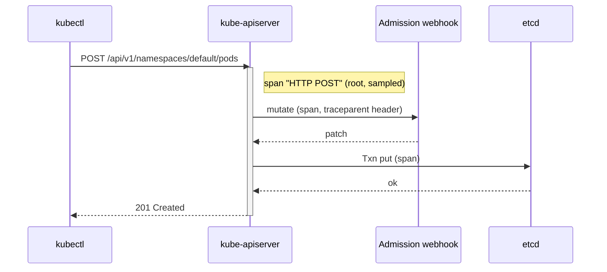

# System traces

## Summary

Tracing follows a request through several components and records each step as a *span* with timing. Kubernetes components emit traces with OpenTelemetry: kube-apiserver creates spans for incoming HTTP requests and for its outgoing calls to webhooks, etcd and itself, and the kubelet creates spans for its CRI calls and its HTTP servers. Both export with the OpenTelemetry Protocol (OTLP) over gRPC, usually to an OpenTelemetry Collector, with a configurable endpoint and sampling rate. Traces help find which component makes an API call or a Pod start slow.

## Prerequisites

- [Observability](observability.md).
- [Control plane](../../cluster-architecture/control-plane.md).

## Core concepts

### What tracing is

Tracing in Kubernetes means following the flow of requests through the components of the system, with tools such as Jaeger or Zipkin to store and display the traces. Tracing helps identify performance bottlenecks, debug issues and optimize the system for performance and scalability. By examining traces, administrators can find issues and take corrective action.

Older material names OpenTracing and OpenCensus as the way to capture traces consistently across components and applications. Both projects were merged into **OpenTelemetry** in 2019 and are archived; Kubernetes components and current instrumentation libraries use OpenTelemetry and its W3C Trace Context propagation.

*Analogy.* A trace is like a parcel tracking history: every depot scan (span) records where the parcel was and for how long, and the tracking number (trace ID) ties the scans together. The analogy breaks because spans nest: one depot visit can contain several sub-steps with their own timings.

### Trace collection

Kubernetes components have built-in gRPC exporters for OTLP to export traces, either to an OpenTelemetry Collector, or directly to a backend without a collector. The Collector is the usual choice: it receives, batches, samples and forwards traces to backends such as Jaeger, Grafana Tempo or a commercial service.



### Component traces

**kube-apiserver traces.** kube-apiserver generates spans for incoming HTTP requests, and for outgoing requests to webhooks, etcd and re-entrant requests (requests to itself). It propagates the [W3C Trace Context](https://www.w3.org/TR/trace-context/) with outgoing requests, but does not use the trace context attached to incoming requests, because kube-apiserver is often a public endpoint and an external client could otherwise influence tracing. It is enabled with `--tracing-config-file` pointing to a `TracingConfiguration` (endpoint and `samplingRatePerMillion`).

**kubelet traces.** The kubelet CRI interface and its authenticated HTTP servers are instrumented to generate trace spans. As with the API server, the endpoint and sampling rate are configurable. Trace context propagation is also configured: the parent span's sampling decision is always respected, and the configured sampling rate applies only to spans without a parent. If tracing is enabled without a configured endpoint, the default OpenTelemetry Collector receiver address `localhost:4317` is used.



Stability: API server and kubelet tracing were introduced as alpha (v1.22 and v1.25) and graduated to beta; TODO: verify whether they are stable in v1.37.

## Worked example

Enable API server tracing to a local collector (untested here; kubeadm cluster, Kubernetes v1.30 or later; an OpenTelemetry Collector listening on the control plane node at `localhost:4317`):

```yaml
# /etc/kubernetes/tracing-config.yaml
apiVersion: apiserver.config.k8s.io/v1beta1
kind: TracingConfiguration
endpoint: localhost:4317
samplingRatePerMillion: 10000    # 1% of requests
```

```yaml
# kubelet configuration fragment
apiVersion: kubelet.config.k8s.io/v1beta1
kind: KubeletConfiguration
tracing:
  endpoint: localhost:4317
  samplingRatePerMillion: 10000
```

```bash
# add to the kube-apiserver static Pod: --tracing-config-file=/etc/kubernetes/tracing-config.yaml (and mount the file)
kubectl run trace-demo --image=nginx:1.27
# in Jaeger: service "apiserver", operation "HTTP POST", child spans for etcd and webhooks;
# service "kubelet", spans for RunPodSandbox, PullImage, CreateContainer
```

## Trade offs and when to use it

- **Sampling rate** trades visibility for overhead and storage; 1 per million to 1% is common for the API server, with tail sampling in the Collector to keep slow or failed requests.
- **Component traces** answer control plane questions; application latency needs application instrumentation too.

## Common mistakes

- **Expecting client trace context to propagate into kube-apiserver**: it is deliberately ignored.
- **Pointing components directly at a remote backend** without a Collector, losing batching and retry.
- **Using OpenTracing or OpenCensus libraries** for new instrumentation.

## Practice

1. Which outgoing calls of kube-apiserver produce spans?
2. Why does kube-apiserver ignore incoming trace context?
3. What endpoint does the kubelet use when tracing is enabled without one?

Answers: 1. Webhooks, etcd and re-entrant requests to itself. 2. It is often a public endpoint; external callers should not control its tracing. 3. `localhost:4317`, the default OTLP gRPC receiver.

## Further reading

- [Traces For Kubernetes System Components](https://kubernetes.io/docs/concepts/cluster-administration/system-traces/), Kubernetes documentation.
- [OpenTelemetry documentation](https://opentelemetry.io/docs/), OpenTelemetry project.
- [W3C Trace Context](https://www.w3.org/TR/trace-context/), W3C Recommendation.
- [Jaeger documentation](https://www.jaegertracing.io/docs/), Jaeger project.
