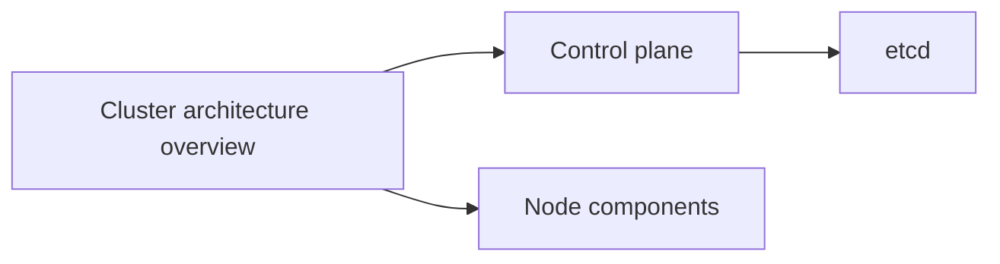

# Cluster architecture

The architectural concepts behind Kubernetes: the control plane and its components, etcd as the store of all cluster data, and the components that run on every node. Corresponds to the "Cluster Architecture" chapter of the Kubernetes documentation Concepts.

## Map of the area

Read the overview first. Control plane and node components can be read in either order; etcd goes deeper into the store behind the control plane.

## Notes in reading order

1. [Cluster architecture overview](cluster-architecture-overview.md): components, hub-and-spoke design, where components run, high availability.
2. [Control plane](control-plane.md): kube-apiserver, kube-scheduler, kube-controller-manager, cloud-controller-manager.
3. [etcd](etcd.md): data model, Raft consensus, quorum, how Kubernetes uses etcd, operations.
4. [Node components](node-components.md): kubelet, kube-proxy, container runtime and the CRI.

## Planned topics

- Nodes (registration, status, heartbeats, node controller)
- Communication between nodes and the control plane
- Controllers (the control loop pattern)
- Leases
- Cloud controller manager (in depth)
- About cgroup v2
- Kubernetes self-healing
- Garbage collection
- Mixed version proxy
