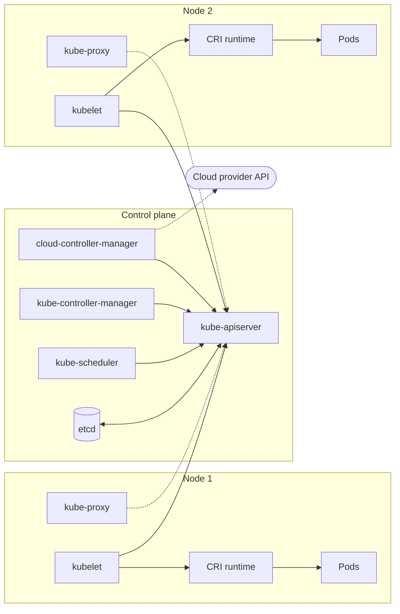

# Cluster architecture overview

## Summary

A Kubernetes cluster consists of a *control plane* that stores and reconciles the desired state, and a set of *nodes* that run the Pods. The control plane is made of the API server, etcd, the scheduler, the controller manager and, in clouds, the cloud controller manager. Every node runs the kubelet, usually kube-proxy, and a container runtime. All components communicate through the API server; this hub-and-spoke design is what lets each component fail, restart or scale independently.

## Prerequisites

- [What is Kubernetes](../overview/what-is-kubernetes.md).

## Core concepts

### The components and how they connect

The figure below is the reference picture of a cluster. Look at the arrows: every component points to `kube-api-server`, and only the cloud controller manager talks to the cloud provider API.


The same structure as a text diagram:



| Layer | Component | Responsibility | Home note |
| --- | --- | --- | --- |
| Control plane | kube-apiserver | Front end of the control plane, exposes the Kubernetes API, validates and persists objects. | [Control plane](control-plane.md#kube-apiserver) |
| Control plane | etcd | Consistent key-value store for all cluster data. | [etcd](etcd.md) |
| Control plane | kube-scheduler | Assigns new Pods to nodes. | [Control plane](control-plane.md#kube-scheduler) |
| Control plane | kube-controller-manager | Runs the built-in controllers (node, Job, EndpointSlice, ServiceAccount and many more). | [Control plane](control-plane.md#kube-controller-manager) |
| Control plane | cloud-controller-manager | Runs cloud specific controllers (nodes, routes, load balancers). | [Control plane](control-plane.md#cloud-controller-manager) |
| Node | kubelet | Makes sure the containers described in PodSpecs are running and healthy. | [Node components](node-components.md#kubelet) |
| Node | kube-proxy | Implements Service virtual IPs with packet filtering rules. Optional with some network plugins. | [Node components](node-components.md#kube-proxy) |
| Node | Container runtime | Runs containers through the CRI (containerd, CRI-O). | [Node components](node-components.md#container-runtime) |

### Hub and spoke

Two rules shape the architecture:

1. **Only the API server talks to etcd.** Every other component reads and writes cluster state through the API. This gives one place for authentication, authorization, admission and validation.
2. **Components watch, not poll.** Controllers, the scheduler and kubelets open long-lived *watch* connections to the API server and react to changes. The API server is the hub, the components are spokes.

The result is that components are loosely coupled: a crashed scheduler does not stop running Pods, and a restarted controller manager re-lists the state and continues.

### Where the components run

Control plane components can run on any machine, but setup tools usually start them all on dedicated control plane nodes and do not run user containers there. With kubeadm they run as *static Pods* managed by the kubelet from manifests in `/etc/kubernetes/manifests`. In managed services (EKS, GKE, AKS) the provider runs the control plane and you only see the nodes.

For high availability, run at least three control plane nodes: the API server scales horizontally behind a load balancer, etcd needs a majority (quorum) of its members, and the scheduler and controller managers use leader election so that only one instance acts at a time.

## Worked example

Inspect the components of a kubeadm or kind cluster (untested here; kind v0.30, Kubernetes v1.37):

```bash
kind create cluster --name arch
kubectl get pods -n kube-system -o wide
# etcd-arch-control-plane, kube-apiserver-..., kube-controller-manager-...,
# kube-scheduler-..., kube-proxy-xxxxx (one per node), coredns-..., kindnet-...
docker exec arch-control-plane ls /etc/kubernetes/manifests
# etcd.yaml  kube-apiserver.yaml  kube-controller-manager.yaml  kube-scheduler.yaml
kubectl get leases -n kube-system   # kube-scheduler and kube-controller-manager leader leases
```

The static Pod manifests confirm that control plane components are Pods run by the kubelet on the control plane node, not objects managed by a Deployment. The Lease objects show leader election.

## Trade offs and when to use it

- **Self-managed control plane** (kubeadm, k3s, Talos) gives full control over versions, flags and etcd, at the cost of running upgrades, backups and certificates yourself.
- **Managed control plane** removes that work but limits access to control plane flags and logs, and the provider decides the version window.
- **Stacked or external etcd.** Running etcd on the control plane nodes (stacked) is simpler; an external etcd cluster isolates failures and allows separate scaling.

## Common mistakes

- **Running two control plane nodes.** etcd needs a majority; with two members, losing one stops writes. Use an odd number: 1, 3 or 5.
- **Running user workloads on control plane nodes** without thought. kubeadm taints them with `node-role.kubernetes.io/control-plane:NoSchedule` for a reason.
- **Debugging Pods by looking at etcd.** Read through the API; etcd holds serialized (often protobuf) data and bypasses RBAC.

## Practice

1. Which component is the only client of etcd?
2. Why can a cluster keep serving traffic while the scheduler is down?
3. How do the scheduler and controller manager avoid acting twice in an HA control plane?

Answers: 1. kube-apiserver. 2. Running Pods are managed by the kubelets and Services by kube-proxy rules; only new Pods wait for scheduling. 3. Leader election with Lease objects: only the leader acts.

## Further reading

- [Cluster Architecture](https://kubernetes.io/docs/concepts/architecture/), Kubernetes documentation. Components and their interactions.
- [Kubernetes Components](https://kubernetes.io/docs/concepts/overview/components/), Kubernetes documentation. Short definitions of each component.
- [Options for Highly Available Topology](https://kubernetes.io/docs/setup/production-environment/tools/kubeadm/ha-topology/), Kubernetes documentation. Stacked versus external etcd.
