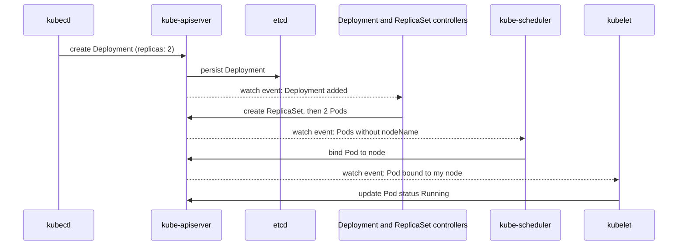
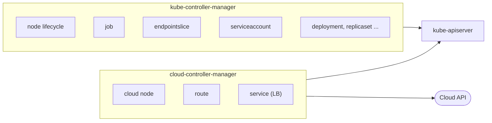

# Control plane

## Summary

The control plane makes global decisions about the cluster, such as scheduling, and detects and responds to cluster events, such as starting a new Pod when a Deployment's `replicas` field is not satisfied. It consists of the kube-apiserver (the API front end), etcd (the store, covered in [its own note](etcd.md)), the kube-scheduler (placement), the kube-controller-manager (built-in control loops) and, in cloud environments, the cloud-controller-manager (cloud specific control loops).

## Prerequisites

- [Cluster architecture overview](cluster-architecture-overview.md).

## Core concepts

### What the control plane does

The control plane's components make global decisions about the cluster and react to events. They can run on any machine in the cluster; for simplicity, setup scripts typically start all control plane components on the same machine and do not run user containers on it. Production clusters run several control plane machines for high availability.



The sequence shows that no component calls another directly. Each one writes to the API server and reacts to watch events from it.

### kube-apiserver

The API server exposes the Kubernetes API and is the front end of the control plane. Its main implementation is `kube-apiserver`. For every request it runs the same pipeline: authentication, authorization (for example RBAC), admission control (mutating, then validating), schema validation, and finally persistence to etcd. It also serves watches, which is how all other components learn about changes.

`kube-apiserver` is designed to scale horizontally: it is stateless, so you run several instances and balance traffic between them. All instances share the same etcd cluster.

### kube-scheduler

The scheduler watches for newly created Pods with no assigned node (`spec.nodeName` empty) and selects a node for each of them. Factors in the decision include individual and collective resource requirements, hardware, software and policy constraints, affinity and anti-affinity specifications, data locality, inter-workload interference and deadlines. It records the decision by creating a *binding*, which sets `spec.nodeName`. Details are in [kube-scheduler](../scheduling-preemption-and-eviction/kube-scheduler.md).

### kube-controller-manager

The controller manager runs *controller* processes. A controller is a control loop that watches the shared state through the API server and makes changes to move the current state towards the desired state.

Logically each controller is a separate process, but to reduce complexity they are all compiled into one binary and run in one process. Examples:

| Controller | Job |
| --- | --- |
| Node controller | Notices and responds when nodes go down (marks them `NotReady`, taints them, triggers eviction of their Pods). |
| Job controller | Watches Job objects, which represent one-off tasks, and creates Pods to run those tasks to completion. |
| EndpointSlice controller | Populates EndpointSlice objects, the link between Services and Pods. |
| ServiceAccount controller | Creates the default ServiceAccount in new namespaces. |
| Deployment, ReplicaSet, StatefulSet, DaemonSet controllers | Keep workload resources at their desired state. |
| Namespace, garbage collector, TTL-after-finished controllers | Clean up dependents and finished objects. |

In an HA control plane only one instance is active at a time; the others wait, coordinated by leader election on a Lease object in `kube-system`.

### cloud-controller-manager

The cloud controller manager embeds cloud specific control logic. It links the cluster to the cloud provider's API and separates the components that interact with the cloud from those that only interact with the cluster. This let cloud providers release their integration on their own schedule instead of inside the Kubernetes code base.

It runs only controllers that are specific to the cloud provider. Clusters on premises or in a learning environment on a PC have no cloud controller manager. Like kube-controller-manager, it combines several logically independent control loops into one binary run as one process, and it can run several replicas to improve performance or tolerate failures. The controllers that can have cloud provider dependencies are:

- **Node controller**: checks the cloud provider to determine whether a node that stopped responding has been deleted in the cloud, and labels and annotates nodes with cloud information (zone, instance type).
- **Route controller**: sets up routes in the underlying cloud infrastructure so that Pods on different nodes can reach each other.
- **Service controller**: creates, updates and deletes cloud provider load balancers for Services of type `LoadBalancer`.



## Worked example

Watching a controller act (untested here; any cluster with `kubectl` v1.30 or later):

```bash
kubectl create namespace demo
kubectl get serviceaccount -n demo        # 'default' created by the ServiceAccount controller
kubectl create job hello -n demo --image=busybox:1.36 -- echo hello
kubectl get pods -n demo --watch          # the Job controller created a Pod, which completes
kubectl get lease -n kube-system kube-controller-manager -o jsonpath='{.spec.holderIdentity}{"\n"}'
```

Expected result: the `default` ServiceAccount appears within seconds without anyone creating it, the Job's Pod reaches `Completed`, and the Lease shows which controller manager instance is the leader.

## Trade offs and when to use it

- **One binary, many controllers.** Packaging controllers together reduces operational load but means a bug or a resource leak in one controller affects all of them. Flags such as `--controllers` can disable individual controllers.
- **Cloud controller manager.** Splitting cloud logic out allows independent releases; on bare metal you replace its functions with other tools (for example MetalLB for load balancers).

## Common mistakes

- **Expecting the scheduler to start containers.** It only writes `spec.nodeName`; the kubelet starts containers.
- **Looking for a "Deployment process".** Deployment logic is a controller inside kube-controller-manager; its logs are there.
- **Forgetting leader election when debugging HA.** Only the leader's logs show controller activity.

## Practice

1. Which steps does every write request pass through in kube-apiserver before it reaches etcd?
2. Why can the API server scale horizontally while the controller manager runs active-passive?
3. Which controller creates the cloud load balancer for a `type: LoadBalancer` Service?

Answers: 1. Authentication, authorization, mutating admission, validation (schema and validating admission), then persistence. 2. The API server is stateless and every request is independent; controllers reconcile shared state and two active instances would fight. 3. The service controller in the cloud-controller-manager.

## Further reading

- [Kubernetes Components](https://kubernetes.io/docs/concepts/overview/components/), Kubernetes documentation. Control plane components.
- [Controllers](https://kubernetes.io/docs/concepts/architecture/controller/), Kubernetes documentation. The control loop pattern.
- [Cloud Controller Manager](https://kubernetes.io/docs/concepts/architecture/cloud-controller/), Kubernetes documentation. Cloud specific controllers.
- [Leases](https://kubernetes.io/docs/concepts/architecture/leases/), Kubernetes documentation. Leader election and node heartbeats.
