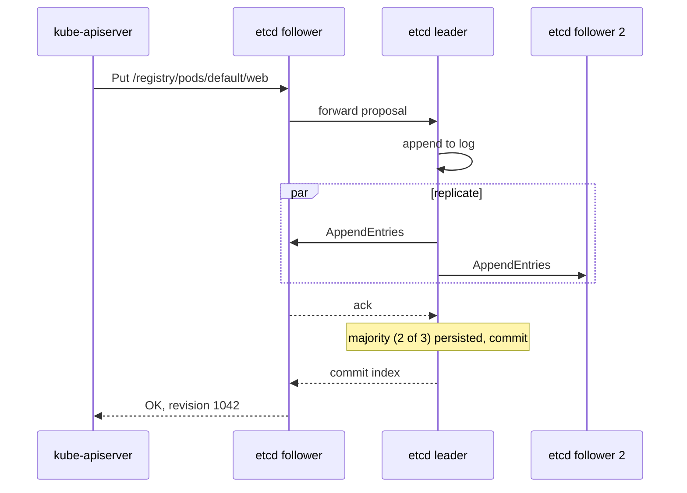
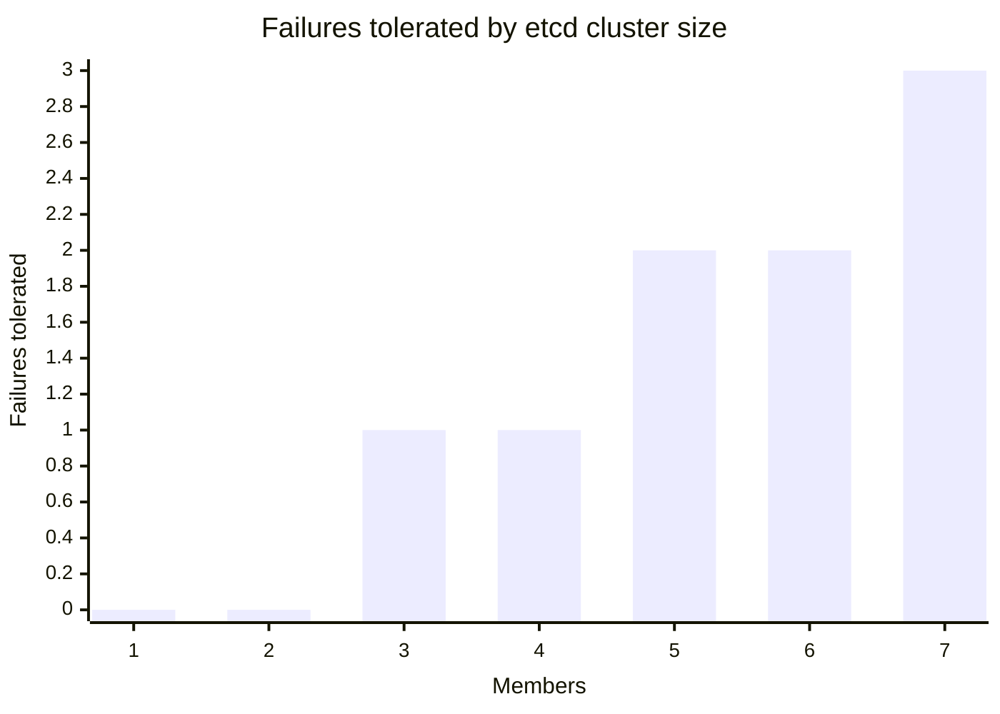

# etcd

## Summary

etcd is the consistent, highly available key-value store that holds all Kubernetes cluster data: every object, its desired state (`spec`) and its observed state (`status`). It stays consistent by replicating every write through the Raft consensus algorithm, which needs a majority of members (a quorum) to agree. Only the kube-apiserver talks to etcd; everything else reads and writes through the API. Losing etcd data means losing the cluster, so backups and quorum are the first concern of anyone who runs a control plane.

## Prerequisites

- [Control plane](control-plane.md).
- Basic distributed systems vocabulary: replication, leader, majority.

## Core concepts

### Data model

etcd stores keys and values. In etcd v3 (used by all current Kubernetes versions) the key space is flat, but Kubernetes uses keys that look like paths, so the data reads like a directory tree:

```text
/registry/pods/default/web-7d4b9c-abcde
/registry/deployments/default/web
/registry/secrets/kube-system/bootstrap-token-abcdef
/registry/apiregistration.k8s.io/apiservices/v1.apps
```

The key identifies a resource, and the value is the serialized object (Protocol Buffers for built-in types, JSON for custom resources). Changes to resources and their state are therefore changes to etcd values. Each change increments a global *revision*, and clients can *watch* a key range from a revision on. The API server uses these watches to feed its own watch cache, from which controllers, the scheduler and kubelets are served.

**Common misconception.** etcd data is often described as "hierarchical directories forming a standard file system". That describes the etcd v2 API. In v3, directories do not exist; prefix queries on path-like keys give the same effect.

### Consistency through Raft

etcd is strongly consistent (linearizable reads and writes by default) because it uses the Raft algorithm:

1. Members elect a **leader** by vote. A candidate needs votes from a majority of members.
2. The leader is the single source of truth for ordering writes. A write sent to any member is forwarded to the leader.
3. The leader appends the write to its log and replicates it to the **followers**.
4. When a majority has persisted the entry, the leader commits it, applies it to the key-value store and answers the client. Followers apply committed entries in the same order, so they converge to the leader's state.
5. If the leader fails, the followers notice missing heartbeats and elect a new leader by the same rule. As long as a majority of members is up, a leader can be elected and requests are served.



### Quorum and cluster size

Quorum for `n` members is `floor(n/2) + 1`. The table shows why odd sizes are used:

| Members | Quorum | Failures tolerated |
| --- | --- | --- |
| 1 | 1 | 0 |
| 2 | 2 | 0 |
| 3 | 2 | 1 |
| 4 | 3 | 1 |
| 5 | 3 | 2 |
| 7 | 4 | 3 |



Adding a fourth member does not tolerate more failures than three, but it adds one more machine that must acknowledge writes. Three or five members is the usual choice; more members make writes slower because more acknowledgements are needed.

### How Kubernetes uses etcd

Kubernetes interacts with etcd only through the API server. etcd stores all cluster information: the desired state, the current state reported in `status` fields, the configuration of resources and runtime data such as Leases and Events. etcd can run as a single member (development) or as a multi-member cluster (production). As requests are handled, the data in etcd changes, and Kubernetes uses this in the following ways.

Four uses are commonly listed. They are shown here with corrections, because two of them attribute to etcd work that other components do:

| Common statement | Precise version |
| --- | --- |
| "etcd monitors the nodes, sees which resources are free, and the control plane assigns tasks accordingly." | etcd only stores data. Nodes report capacity and allocatable resources in their Node objects; the **scheduler** reads them (from the API server's cache) and assigns Pods. |
| "etcd monitors the health of all nodes at regular intervals; the control plane can delete the node or reassign tasks." | **Kubelets** send heartbeats (Node status and Lease objects stored in etcd); the **node lifecycle controller** watches them, marks nodes `NotReady` and triggers eviction of their Pods. |
| "etcd implements mechanisms to avoid resource starvation and ensure availability and reliability of its services." | etcd protects itself with quotas (`--quota-backend-bytes`, default 2 GiB, recommended maximum 8 GiB), request size limits (1.5 MiB by default), compaction and defragmentation. Fairness between API clients is done by **API Priority and Fairness** in the API server. |
| "etcd features such as shared configuration, service discovery, leader election, distributed locks and the watch API help address cross-communication concerns." | Correct in spirit: Kubernetes builds on etcd's watch and compare-and-swap (optimistic concurrency with `resourceVersion`). Leader election and service discovery are implemented in Kubernetes on top of API objects (Leases, EndpointSlices) that are stored in etcd. |

### Operating etcd

- **Backups.** Take regular snapshots with `etcdctl snapshot save`; they are the only way to recover from losing quorum permanently. Test restores.
- **Encryption at rest.** Secrets are stored unencrypted in etcd unless the API server is configured with an `EncryptionConfiguration` (see [Secrets](../configuration/secrets.md)).
- **Disk latency.** etcd calls `fsync` on every commit. Slow disks cause leader elections and API timeouts; use SSDs and watch the `etcd_disk_wal_fsync_duration_seconds` metric.
- **Compaction and defragmentation.** The API server compacts old revisions regularly; defragmentation returns free space to the file system.
- **Access.** etcd access means full cluster access (including all Secrets) without RBAC. Protect it with mutual TLS and network isolation.

## Worked example

Inspect etcd in a kind or kubeadm cluster (untested here; etcd v3.5 or v3.6, Kubernetes v1.37):

```bash
kubectl -n kube-system exec etcd-kind-control-plane -- sh -c '
  ETCDCTL_API=3 etcdctl --endpoints=https://127.0.0.1:2379 \
    --cacert=/etc/kubernetes/pki/etcd/ca.crt \
    --cert=/etc/kubernetes/pki/etcd/server.crt \
    --key=/etc/kubernetes/pki/etcd/server.key \
    get /registry/namespaces --prefix --keys-only | head
  ETCDCTL_API=3 etcdctl --endpoints=https://127.0.0.1:2379 \
    --cacert=/etc/kubernetes/pki/etcd/ca.crt \
    --cert=/etc/kubernetes/pki/etcd/server.crt \
    --key=/etc/kubernetes/pki/etcd/server.key \
    endpoint status -w table'
```

Expected output: keys such as `/registry/namespaces/default` and `/registry/namespaces/kube-system`, and a table with the member's version, database size, whether it is the leader and the Raft term and index.

## Trade offs and when to use it

- **Strong consistency costs latency.** Every write waits for a majority and an `fsync`. etcd is built for small, critical data (a few GB at most), not for application data.
- **Stacked versus external etcd.** Stacked etcd on control plane nodes needs fewer machines; external etcd isolates failures and allows separate sizing.
- **Alternatives.** Lightweight distributions such as k3s can use SQLite or other databases through the Kine shim. That trades etcd's guarantees for simplicity in small clusters.

## Common mistakes

- **Even member counts.** Two or four members add risk without adding fault tolerance.
- **No backups or untested restores.** Quorum loss without a snapshot means rebuilding the cluster.
- **Storing large objects.** Large ConfigMaps, Secrets or CRD objects (close to the 1.5 MiB limit) slow down etcd and the API server; keep objects small.
- **Network-attached slow disks** for etcd, which cause frequent leader changes.

## Practice

1. How many failures does a five member etcd cluster tolerate, and why not more?
2. Which component marks a node `NotReady`, and where does the data it uses live?
3. Why is direct read access to etcd as dangerous as `cluster-admin`?
4. A three member cluster loses two members. What still works?

Answers: 1. Two; quorum is three of five, so a third failure leaves no majority. 2. The node lifecycle controller in kube-controller-manager, using Node status and Lease heartbeats stored in etcd. 3. It bypasses authentication and RBAC and exposes all Secrets (unencrypted by default). 4. No writes and no linearizable reads; running Pods keep running, but the API cannot change state until quorum is restored.

## Further reading

- [Operating etcd clusters for Kubernetes](https://kubernetes.io/docs/tasks/administer-cluster/configure-upgrade-etcd/), Kubernetes documentation. Sizing, security, backup and restore.
- [etcd documentation](https://etcd.io/docs/), etcd project. Data model, API and operations.
- [In Search of an Understandable Consensus Algorithm (Raft)](https://raft.github.io/raft.pdf), Ongaro and Ousterhout, USENIX ATC, 2014. The consensus algorithm behind etcd.
- [etcd FAQ](https://etcd.io/docs/v3.5/faq/), etcd project. Why odd cluster sizes and how many members to run.
