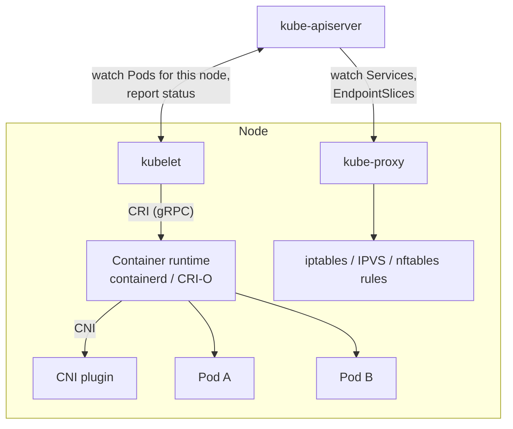
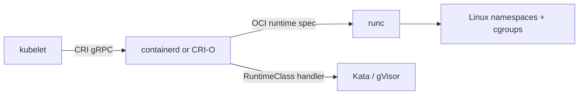

# Node components

## Summary

Node components run on every node, keep the Pods assigned to that node running and provide the Kubernetes runtime environment. There are three: the *kubelet* (the node agent that turns PodSpecs into running, healthy containers), *kube-proxy* (which programs packet filtering rules so that Service IPs reach Pods) and the *container runtime* (containerd, CRI-O or another implementation of the Container Runtime Interface, which actually creates the containers).

## Prerequisites

- [Cluster architecture overview](cluster-architecture-overview.md).
- [Container fundamentals](../containers/container-fundamentals.md).

## Core concepts

### Overview



The diagram shows the interfaces: the kubelet talks to the runtime through the CRI, the runtime sets up Pod networking through the CNI, and kube-proxy translates Services into kernel rules.

### kubelet

The kubelet is an agent that runs on each node. It makes sure that containers are running in a Pod.

- It takes a set of *PodSpecs* provided through various mechanisms (mainly the API server, but also static Pod manifest files on disk) and ensures that the containers described in them are running and healthy.
- It runs probes (liveness, readiness, startup), applies restart policies, mounts volumes, pulls images through the runtime and reports Pod and Node status to the API server.
- It sends heartbeats (Node status updates and a Lease object in `kube-node-lease`) so that the control plane can detect a failed node.
- It enforces node level resource management: eviction under pressure, cgroups configuration, reserved resources.
- It does not manage containers that were not created by Kubernetes. A container started by hand with `nerdctl` or `docker run` on the node is invisible to it.

The kubelet runs as a system service (for example a systemd unit), not in a container, because it is what starts containers.

### kube-proxy

kube-proxy is a network proxy that runs on each node and implements part of the Kubernetes Service concept.

- It maintains network rules on the node. These rules allow network communication to Pods from network sessions inside or outside the cluster.
- It uses the operating system packet filtering layer if there is one and it is available (iptables, IPVS or nftables on Linux, the Host Networking Service on Windows). Otherwise, it forwards the traffic itself (the historical userspace mode, now removed).
- It watches Services and EndpointSlices and translates each Service virtual IP and port into rules that pick a backend Pod.
- It usually runs as a DaemonSet.

Some network plugins (for example Cilium with its kube-proxy replacement) implement Services themselves with eBPF; then kube-proxy is not needed. See [Services](../services-and-networking/services.md#virtual-ip-addressing-mechanism).

### Container runtime

The container runtime is the component that lets Kubernetes run containers. It manages the execution and lifecycle of containers on the node: pulling images, creating the Pod sandbox, starting and stopping containers, streaming logs and collecting statistics.

Kubernetes supports container runtimes such as **containerd** and **CRI-O**, and any other implementation of the Kubernetes **Container Runtime Interface (CRI)**, a gRPC API between the kubelet and the runtime. Below the CRI runtime, a low level OCI runtime (usually `runc`, or sandboxed runtimes such as gVisor `runsc` or Kata Containers) creates the actual Linux namespaces and cgroups. Which runtime handler a Pod uses can be chosen with [RuntimeClass](../containers/runtime-class.md).



Docker Engine is not a CRI runtime. Since the removal of dockershim in v1.24 it can be used only through the external `cri-dockerd` adapter (see [What is Kubernetes](../overview/what-is-kubernetes.md#kubernetes-and-docker)).

## Worked example

Inspecting the node components on a kind node (untested here; kind v0.30, Kubernetes v1.37):

```bash
docker exec -it kind-control-plane bash
systemctl status kubelet --no-pager | head -5        # kubelet is a systemd service
crictl ps                                            # containers seen through the CRI
crictl pods                                          # Pod sandboxes
iptables -t nat -L KUBE-SERVICES | head              # rules written by kube-proxy (iptables mode)
exit
kubectl get ds -n kube-system kube-proxy             # kube-proxy runs as a DaemonSet
kubectl get --raw /api/v1/nodes/kind-control-plane/proxy/configz | head -c 300  # live kubelet config
```

Expected result: `kubelet` is active, `crictl ps` lists the control plane containers, and the `KUBE-SERVICES` chain has one entry per Service port.

## Trade offs and when to use it

- **containerd or CRI-O.** Both are CNCF graduated projects. containerd is the default in most distributions and managed services; CRI-O is built only for Kubernetes and follows Kubernetes versions (used by OpenShift).
- **kube-proxy modes.** iptables is the long standing default; IPVS scales better with thousands of Services; nftables (stable in recent releases) is the planned successor to iptables. An eBPF dataplane can replace kube-proxy entirely.

## Common mistakes

- **Restarting containers with the runtime CLI.** The kubelet owns the containers it created; use `kubectl delete pod` and let the controller recreate it.
- **Looking for kubelet logs in `kubectl logs`.** The kubelet is not a Pod; read `journalctl -u kubelet` or use the node log query (see [System logs](../cluster-administration/observability/system-logs.md)).
- **Assuming kube-proxy carries traffic.** In iptables and IPVS modes it only writes rules; the kernel forwards packets.

## Practice

1. Which node component would you check first if Pods are scheduled to a node but never start?
2. Does kube-proxy sit in the data path of Service traffic in iptables mode?
3. Name the interface between the kubelet and the container runtime, and one between the runtime and the network plugin.

Answers: 1. The kubelet (and through it, the runtime): `journalctl -u kubelet`, `kubectl describe pod` events. 2. No, it only programs kernel rules. 3. CRI (gRPC) and CNI.

## Further reading

- [Kubernetes Components: Node components](https://kubernetes.io/docs/concepts/overview/components/#node-components), Kubernetes documentation.
- [kubelet reference](https://kubernetes.io/docs/reference/command-line-tools-reference/kubelet/), Kubernetes documentation.
- [Virtual IPs and Service Proxies](https://kubernetes.io/docs/reference/networking/virtual-ips/), Kubernetes documentation. kube-proxy modes.
- [Container Runtime Interface (CRI)](https://kubernetes.io/docs/concepts/containers/cri/), Kubernetes documentation.
