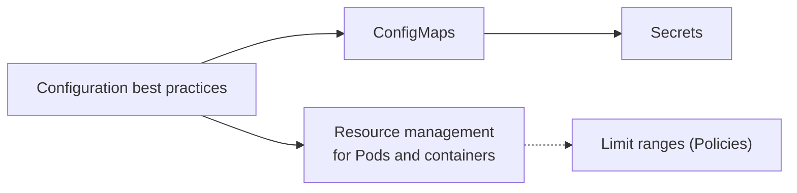

# Configuration

Resources that Kubernetes provides for configuring Pods: good practices for writing configuration, ConfigMaps for non-confidential settings, Secrets for sensitive data, and resource requests and limits. Corresponds to the "Configuration" chapter of the Kubernetes documentation Concepts. Probes, which the documentation used to list here, now live with Pods in [Workloads](../workloads/pods/probes.md).

## Map of the area

## Notes in reading order

1. [Configuration best practices](configuration-best-practices.md): general tips, naked Pods, Services, `hostPort` and `hostNetwork`.
2. [ConfigMaps](configmaps.md): structure, four ways to consume, automatic updates, immutable ConfigMaps.
3. [Secrets](secrets.md): risks, use cases, alternatives, built-in types, working with Secrets, immutability, information security.
4. [Resource management for Pods and containers](resource-management-for-pods-and-containers.md): requests and limits, resource types and units, scheduling, cgroup enforcement, extended resources.

## Planned topics

- Organizing cluster access using kubeconfig files
- Resource management for Windows nodes
