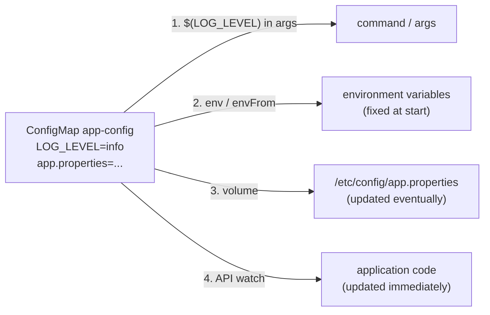

# ConfigMaps

## Summary

A ConfigMap stores non-confidential configuration as key-value pairs (up to 1 MiB) so that it is decoupled from container images. Pods consume it in four ways: in container commands and arguments, as environment variables, as files in a read-only volume, or by reading it through the Kubernetes API. Files mounted from a ConfigMap are updated eventually when the ConfigMap changes; environment variables are not. Marking a ConfigMap `immutable` protects against accidental changes and reduces API server load in large clusters.

## Prerequisites

- [Pod overview](../workloads/pods/pod-overview.md).
- [Volumes](../storage/volumes.md#volume-types).

## Core concepts

### Definition

A ConfigMap is an API object used to store non-confidential data in key-value pairs. Pods can consume ConfigMaps as environment variables, command-line arguments, or as configuration files in a volume.

A ConfigMap lets you decouple environment specific configuration from container images, so that applications are easily portable: the same image runs in development and production with different ConfigMaps.

**Caution.** A ConfigMap does not provide secrecy or encryption. If the data you want to store is confidential, use a [Secret](secrets.md) rather than a ConfigMap, or use additional (third party) tools to keep the data private.

**Size.** A ConfigMap is not designed to hold large chunks of data. The data stored in a ConfigMap cannot exceed 1 MiB. If you need larger settings, consider mounting a volume or using a separate database or file service.

### Structure

A ConfigMap is an API object that stores configuration for other objects to use. Unlike most Kubernetes objects, which have a `spec`, a ConfigMap has `data` and `binaryData` fields. These fields accept key-value pairs as their values. Both are optional. The `data` field is designed to contain UTF-8 strings, while `binaryData` is designed to contain binary data as base64-encoded strings.

The name of a ConfigMap must be a valid DNS subdomain name. Each key under `data` or `binaryData` must consist of alphanumeric characters, `-`, `_` or `.`. The keys in `data` must not overlap with the keys in `binaryData`.

### ConfigMaps and Pods

You can write a Pod `spec` that refers to a ConfigMap and configures the containers in that Pod based on the data in the ConfigMap. The Pod and the ConfigMap must be in the same namespace. The `spec` of a static Pod cannot refer to a ConfigMap or any other API objects.

There are four ways to use a ConfigMap to configure a container inside a Pod:

1. Inside a container command and arguments.
2. Environment variables for a container.
3. A file in a read-only volume, for the application to read.
4. Code running inside the Pod that uses the Kubernetes API to read a ConfigMap.

These methods suit different ways of modeling the data being consumed. For the first three, the kubelet uses the data from the ConfigMap when it launches containers for a Pod. The fourth method means you have to write code to read the ConfigMap and its data. However, because the application uses the API directly, it can subscribe to updates (watch) whenever the ConfigMap changes and react to them. With API access, this technique also lets you read a ConfigMap in a different namespace (with the right RBAC permissions).



### Using ConfigMaps

ConfigMaps can be mounted as data volumes. They can also be used by other parts of the system without being exposed directly to a Pod; for example, they can hold data that other system components use for configuration (such as the `kube-proxy` and `coredns` ConfigMaps in `kube-system`). The most common way to use ConfigMaps is to configure settings for containers running in a Pod in the same namespace.

**Using ConfigMaps as files from a Pod.** To use a ConfigMap in a Pod volume:

1. Create a ConfigMap or use an existing one. Several Pods can reference the same ConfigMap.
2. Modify the Pod definition to add a volume under `.spec.volumes[]`. Name the volume anything, and set `.spec.volumes[].configMap.name` to reference the ConfigMap.
3. Add a `.spec.containers[].volumeMounts[]` to each container that needs the ConfigMap. Set `.spec.containers[].volumeMounts[].readOnly = true` and `.spec.containers[].volumeMounts[].mountPath` to an unused directory name where you want the ConfigMap to appear.
4. Modify the image or command line so that the program looks for files in that directory. Each key in the ConfigMap `data` map becomes a file name under `mountPath`.

**Mounted ConfigMaps are updated automatically.** When a ConfigMap consumed in a volume is updated, projected keys are eventually updated as well. The kubelet checks whether the mounted ConfigMap is fresh on every periodic sync, using its local cache to get the current value. The type of cache is configured with `configMapAndSecretChangeDetectionStrategy` in the KubeletConfiguration struct: a watch (default), TTL based, or redirecting all requests directly to the API server. The total delay from the update to the new keys being projected into the Pod can therefore be as long as the kubelet sync period plus the cache propagation delay (the watch propagation delay, the TTL of the cache, or zero). The update is atomic: the files are swapped through a symlink. ConfigMaps mounted with `subPath` are not updated.

**Using ConfigMaps as environment variables.** To use a ConfigMap in an environment variable:

1. For each container, add an environment variable for each ConfigMap key you want to use to `env[].valueFrom.configMapKeyRef` (or import all keys with `envFrom[].configMapRef`).
2. Modify the image or command line so that the program looks for values in those variables.

The range of characters allowed in environment variable names is restricted. If some keys do not meet the rules, those keys are not made available to the container, though the Pod is allowed to start. Environment variables are set once at container start; a changed ConfigMap is seen only after the container restarts.

### Immutable ConfigMaps

The Kubernetes feature *Immutable Secrets and ConfigMaps* (stable since v1.21) provides an option to set individual Secrets and ConfigMaps as immutable. For clusters that use ConfigMaps extensively (at least tens of thousands of unique ConfigMap to Pod mounts), preventing changes to their data has these advantages:

- It protects you from accidental (or unwanted) updates that could cause application outages.
- It improves cluster performance by significantly reducing load on kube-apiserver, by closing watches for ConfigMaps marked as immutable.

You create an immutable ConfigMap by setting the `immutable` field to `true`.

Once a ConfigMap is marked as immutable, it is *not* possible to revert this change nor to mutate the contents of `data` or `binaryData`. You can only delete and recreate the ConfigMap. Because existing Pods keep a mount point to the deleted ConfigMap, it is recommended to recreate these Pods. A common pattern is versioned names (`app-config-v7`) or content-hashed names generated by Kustomize, so that a change creates a new ConfigMap and a Deployment rollout.

## Worked example

All three kubelet-driven consumption methods in one Pod (untested here; Kubernetes v1.30 or later):

```yaml
apiVersion: v1
kind: ConfigMap
metadata:
  name: game-demo
data:
  player_initial_lives: "3"
  ui_properties_file_name: "user-interface.properties"
  game.properties: |
    enemy.types=aliens,monsters
    player.maximum-lives=5
---
apiVersion: v1
kind: Pod
metadata:
  name: configmap-demo-pod
spec:
  containers:
    - name: demo
      image: alpine:3.20
      command: ["sh", "-c", "echo lives=$(PLAYER_INITIAL_LIVES); sleep 3600"]   # 1. used in args
      env:                                                                      # 2. env vars
        - name: PLAYER_INITIAL_LIVES
          valueFrom:
            configMapKeyRef: { name: game-demo, key: player_initial_lives }
      volumeMounts:                                                             # 3. files
        - name: config
          mountPath: /config
          readOnly: true
  volumes:
    - name: config
      configMap:
        name: game-demo
        items:
          - key: game.properties
            path: game.properties
```

```bash
kubectl apply -f configmap-demo.yaml
kubectl logs configmap-demo-pod                      # lives=3
kubectl exec configmap-demo-pod -- cat /config/game.properties
kubectl patch configmap game-demo --type merge -p '{"data":{"game.properties":"enemy.types=robots\n"}}'
sleep 90; kubectl exec configmap-demo-pod -- cat /config/game.properties   # updated file
kubectl exec configmap-demo-pod -- printenv PLAYER_INITIAL_LIVES           # unchanged until restart
```

## Trade offs and when to use it

- **Files versus environment variables.** Files update without restarts and suit structured configuration; environment variables are simple but fixed at start and visible in process listings.
- **Live reload versus rollouts.** Updating mounted files changes running Pods all at once, without a canary; versioned immutable ConfigMaps change configuration through a controlled rollout instead.
- **API access** gives immediate updates but couples the application to Kubernetes and needs RBAC.

## Common mistakes

- **Storing secrets in ConfigMaps.**
- **Expecting environment variables to update.**
- **Using `subPath` mounts and expecting updates.**
- **Exceeding 1 MiB** with embedded files or certificates bundles.
- **Referencing a ConfigMap from another namespace** in a Pod spec; it must be in the same namespace.

## Practice

1. Name the four ways a container can consume a ConfigMap.
2. You change a ConfigMap. Which consumers see the change without a restart?
3. What are the two benefits of immutable ConfigMaps?
4. Why might a ConfigMap key not appear as an environment variable with `envFrom`?

Answers: 1. Command and arguments, environment variables, files in a volume, the Kubernetes API. 2. Volume mounts (without `subPath`), after the kubelet sync and cache delay, and code watching the API. 3. Protection from accidental updates and lower API server load (no watches). 4. The key is not a valid environment variable name; it is skipped and the Pod still starts.

## Further reading

- [ConfigMaps](https://kubernetes.io/docs/concepts/configuration/configmap/), Kubernetes documentation.
- [Configure a Pod to Use a ConfigMap](https://kubernetes.io/docs/tasks/configure-pod-container/configure-pod-configmap/), Kubernetes documentation.
- [Kustomize configMapGenerator](https://kubectl.docs.kubernetes.io/references/kustomize/kustomization/configmapgenerator/), Kustomize documentation. Hashed ConfigMap names.
