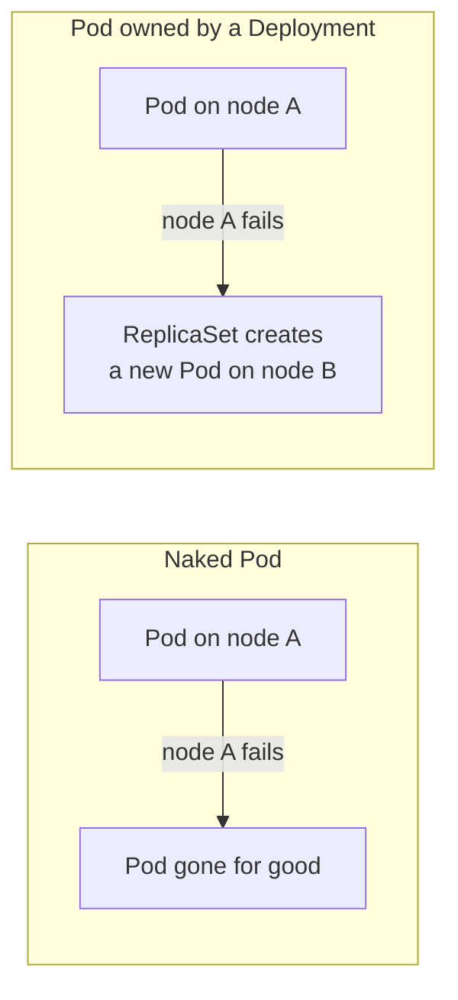
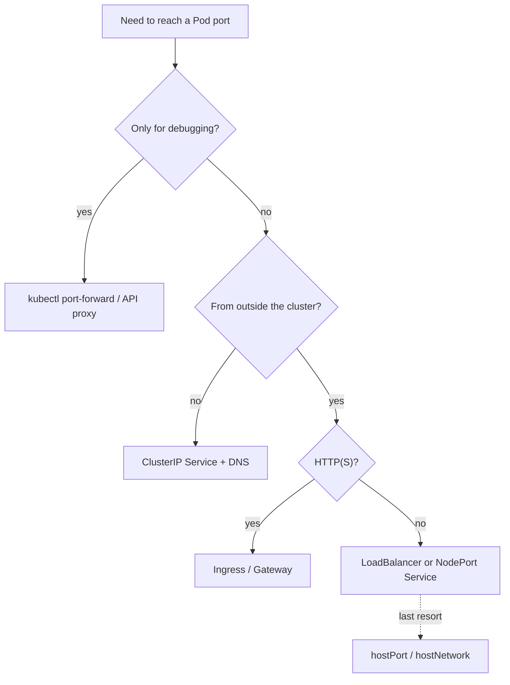

# Configuration best practices

## Summary

A short set of established practices for writing and managing Kubernetes configuration: use current stable API versions, keep manifests in version control, prefer YAML, group related objects, keep manifests minimal, record descriptions in annotations, never run "naked" Pods, create Services before the workloads that use their environment variables, prefer DNS for discovery, and avoid `hostPort` and `hostNetwork` unless there is no alternative. Each rule exists to make clusters reproducible, debuggable and schedulable.

## Prerequisites

- [Workloads overview](../workloads/workloads-overview.md).
- [Services](../services-and-networking/services.md).

## Core concepts

### General configuration tips

- **Specify the latest stable API version** when defining configurations (for example `apps/v1`, `networking.k8s.io/v1`), so manifests survive upgrades.
- **Store configuration files in version control** before pushing them to the cluster. This allows quick rollback of a configuration change and helps with cluster re-creation and restoration. It is the basis of [GitOps](../application-delivery/gitops.md).
- **Write configuration in YAML rather than JSON.** The formats are interchangeable in almost all scenarios, but YAML is more readable and allows comments.
- **Group related objects into a single file** when it makes sense. One file is often easier to manage than several. The guestbook-all-in-one.yaml example from the Kubernetes examples shows this syntax (objects separated by `---`).
- **Many `kubectl` commands work on a directory.** For example, `kubectl apply -f <directory>/` applies all manifests in it (add `-R` for subdirectories).
- **Do not specify default values unnecessarily.** Simple, minimal configuration makes errors less likely.
- **Put object descriptions in annotations**, to allow better introspection.
- **Use labels for semantic attributes** (`app.kubernetes.io/name`, `app.kubernetes.io/version`, `tier`, `environment`) so that selectors, tools and humans can work with groups of objects.

### Naked Pods

Do not use naked Pods (Pods not bound to a ReplicaSet, Deployment or other controller) if you can avoid it. Naked Pods are not rescheduled in the event of a node failure.

A Deployment, which both creates a ReplicaSet to make sure the desired number of Pods is always available and specifies a strategy to replace Pods (such as RollingUpdate), is almost always preferable to creating Pods directly, except for some explicit `restartPolicy: Never` scenarios. A [Job](../workloads/workload-management/jobs.md) may also be appropriate.



### Services

- **Create a Service before its back end workloads** (Deployments or ReplicaSets) and before any workloads that need to access it. When Kubernetes starts a container, it provides environment variables that point to all Services that were running when the container started. For example, if a Service named `foo` exists, all containers get these variables in their initial environment:

  ```text
  FOO_SERVICE_HOST=<the host the Service is running on>
  FOO_SERVICE_PORT=<the port the Service is running on>
  ```

  *This implies an ordering requirement*: any Service that a Pod wants to access must be created before the Pod itself, or the environment variables are not populated. DNS does not have this restriction.
- **Use a DNS server.** An optional (though strongly recommended) cluster add-on is a DNS server. It watches the API for new Services and creates DNS records for each. If DNS is enabled throughout the cluster, all Pods can resolve Services by name automatically.
- **Do not specify a `hostPort` for a Pod unless it is absolutely necessary.** Binding a Pod to a `hostPort` limits the number of places the Pod can be scheduled, because each `<hostIP, hostPort, protocol>` combination must be unique. If you do not specify `hostIP` and `protocol` explicitly, Kubernetes uses `0.0.0.0` as the default `hostIP` and `TCP` as the default protocol.
- **For debugging access to a port**, use the API server proxy or `kubectl port-forward` instead.
- **If you need to expose a Pod's port on the node**, consider a [NodePort Service](../services-and-networking/services.md#service-types) before resorting to `hostPort`.
- **Avoid `hostNetwork`**, for the same reasons as `hostPort` (and because it bypasses network policies and Pod network isolation).
- **Use headless Services** (with `clusterIP: None`) for service discovery when you do not need kube-proxy load balancing.



## Worked example

Applying the rules to a small application (untested here; Kubernetes v1.30 or later):

```yaml
# app.yaml: one file for related objects, Service first, minimal fields, annotations for descriptions
apiVersion: v1
kind: Service
metadata:
  name: api
  labels: { app.kubernetes.io/name: api }
  annotations:
    description: "Public API of the orders service; owned by team orders"
spec:
  selector: { app.kubernetes.io/name: api }
  ports:
    - name: http
      port: 80
      targetPort: http
---
apiVersion: apps/v1
kind: Deployment
metadata:
  name: api
  labels: { app.kubernetes.io/name: api, app.kubernetes.io/version: "1.4.2" }
spec:
  replicas: 3
  selector:
    matchLabels: { app.kubernetes.io/name: api }
  template:
    metadata:
      labels: { app.kubernetes.io/name: api, app.kubernetes.io/version: "1.4.2" }
    spec:
      containers:
        - name: api
          image: registry.example.com/orders/api:1.4.2
          ports:
            - name: http
              containerPort: 8080
```

```bash
git add app.yaml && git commit -m "Add orders API"     # version control first
kubectl apply -f ./manifests/                           # apply a whole directory
kubectl port-forward deploy/api 8080:8080               # debug access without hostPort
```

## Trade offs and when to use it

These practices are broadly established (they come from the Kubernetes documentation). Exceptions exist: node agents legitimately use `hostNetwork` or `hostPort`; one-off debugging Pods can be naked; generated manifests (Helm, Kustomize) may live as templates rather than plain YAML in Git.

## Common mistakes

- **Manifests only in the cluster**, edited with `kubectl edit`, so the source of truth is lost.
- **Copying full `kubectl get -o yaml` output** into Git, including `status`, defaults and server-generated fields.
- **Naked Pods in production**, which vanish with their node.
- **`hostPort` for convenience**, which later blocks scheduling and rolling updates on the same node.

## Practice

1. Why should a Service be created before the Pods that use it?
2. Why do naked Pods hurt availability?
3. Which alternatives should you consider before using `hostPort`?

Answers: 1. Service environment variables are injected only for Services that exist when the container starts (DNS has no such limitation). 2. Nothing recreates them when their node fails or they are deleted. 3. `kubectl port-forward` or the API proxy for debugging, a NodePort or LoadBalancer Service, or Ingress for HTTP.

## Further reading

- [Configuration Best Practices](https://kubernetes.io/docs/concepts/configuration/overview/), Kubernetes documentation.
- [Recommended Labels](https://kubernetes.io/docs/concepts/overview/working-with-objects/common-labels/), Kubernetes documentation.
- [Declarative Management of Kubernetes Objects Using Configuration Files](https://kubernetes.io/docs/tasks/manage-kubernetes-objects/declarative-config/), Kubernetes documentation.
