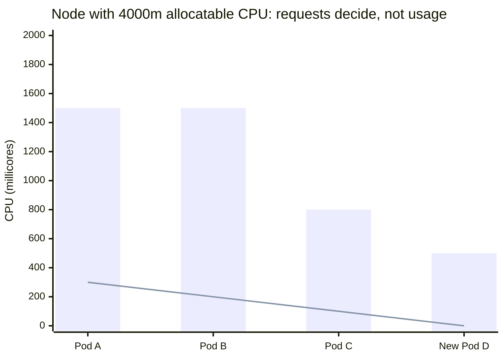
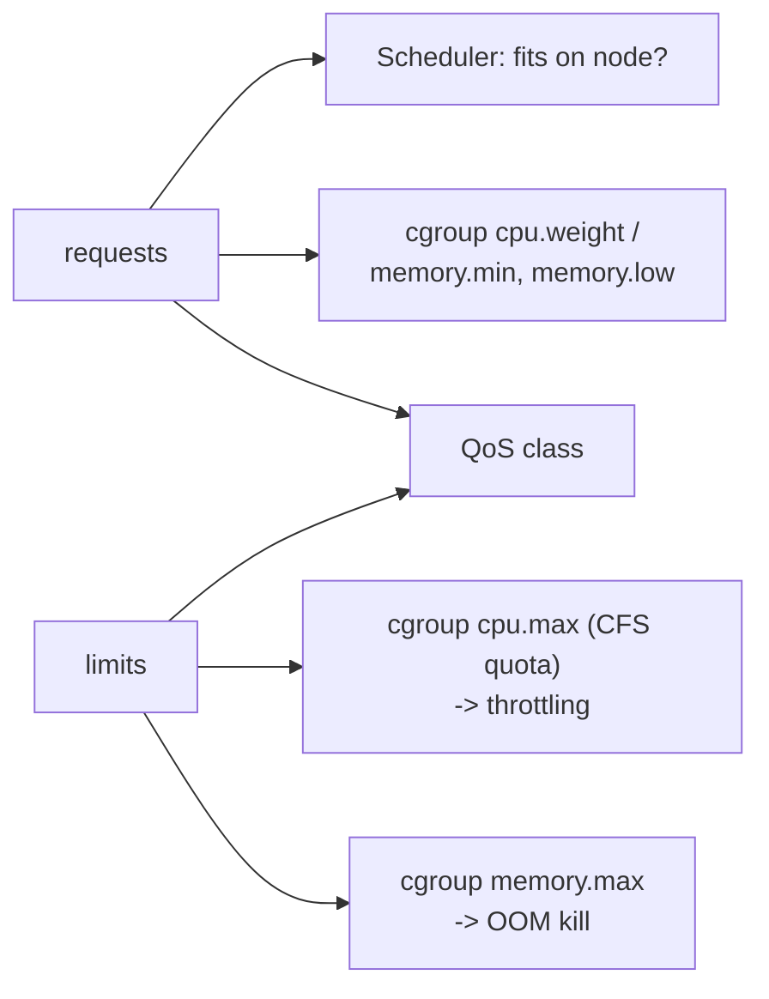

# Resource management for Pods and containers

## Summary

Each container can declare *requests* (what the scheduler reserves for it) and *limits* (the ceiling the kubelet and kernel enforce) for CPU, memory, huge pages, ephemeral storage and extended resources such as GPUs. Requests drive placement: a Pod is scheduled only to a node whose allocatable capacity covers the sum of requests, regardless of actual usage. Limits drive enforcement through cgroups: CPU over the limit is throttled, memory over the limit is OOM killed. CPU is measured in cores (`500m` is half a core), memory in bytes (`256Mi`). Namespace defaults and bounds come from LimitRange, and namespace totals from ResourceQuota.

## Prerequisites

- [Pod overview](../workloads/pods/pod-overview.md).
- Linux cgroups basics (see [Container fundamentals](../containers/container-fundamentals.md)).

## Core concepts

### Requests and limits

When you specify a Pod, you can optionally specify how much of each resource a container needs. The most common resources are CPU and memory (RAM); there are others.

When you specify the resource *request* for containers in a Pod, the kube-scheduler uses this information to decide which node to place the Pod on. When you specify a resource *limit* for a container, the kubelet enforces it so that the running container cannot use more of that resource than the limit. The kubelet also reserves at least the *request* amount of that system resource specifically for that container.

If the node where a Pod runs has enough of a resource available, a container may use more than its `request`. A container is not allowed to use more than its resource `limit`.

**Example.** A container has a `memory` request of 256 MiB and runs on a node with 8 GiB of memory, with no other Pods. It can try to use more RAM. If you set a `memory` limit of 4 GiB for that container, the kubelet (and container runtime) enforce it: the runtime stops the container from using more than the limit. When a process in the container tries to consume more than the allowed amount of memory, the system kernel terminates the process that attempted the allocation, with an out of memory (OOM) error. Limits can be enforced reactively (the system intervenes once it sees a violation) or by enforcement (the system prevents the container from exceeding the limit); different runtimes implement the same restrictions in different ways.

If you specify a limit for a resource but no request, and no admission-time mechanism has applied a default request, Kubernetes copies the limit and uses it as the request.

*Analogy.* A request is a restaurant reservation: the table is held for you whether you come hungry or not. A limit is the size of your plate: you can eat less, but not more. The analogy breaks for CPU: exceeding a CPU "plate" makes you eat more slowly (throttling), while exceeding the memory plate gets you thrown out (OOM kill).

### Resource types

*CPU* and *memory* are each a *resource type*. A resource type has a base unit. CPU represents compute processing and is specified in units of Kubernetes CPUs. Memory is specified in bytes. For Linux workloads, you can specify *huge page* resources. Huge pages are a Linux-specific feature where the node kernel allocates blocks of memory much larger than the default page size.

For example, on a system where the default page size is 4 KiB, you could specify a limit `hugepages-2Mi: 80Mi`. If the container tries to allocate more than 40 huge pages of 2 MiB each (80 MiB in total), that allocation fails. Huge pages cannot be overcommitted, so requests must equal limits.

CPU and memory are collectively called *compute resources*, or *resources*. Compute resources are measurable quantities that can be requested, allocated and consumed. They are distinct from *API resources*. API resources, such as Pods and Services, are objects that can be read and modified through the API server.

For each container, you can specify limits and requests, including:

- `spec.containers[].resources.limits.cpu`
- `spec.containers[].resources.limits.memory`
- `spec.containers[].resources.limits.hugepages-<size>`
- `spec.containers[].resources.requests.cpu`
- `spec.containers[].resources.requests.memory`
- `spec.containers[].resources.requests.hugepages-<size>`

Although you can only specify requests and limits for individual containers, it is useful to think about the overall requests and limits of a Pod: for a resource, the Pod request (or limit) is the sum of that resource over all containers in the Pod (plus init container and overhead rules, see [Init containers](../workloads/pods/init-containers.md#resource-sharing-within-containers)). Newer releases also allow Pod level `spec.resources`.

You can specify `ephemeral-storage` for managing local ephemeral storage (container writable layers, logs and `emptyDir` volumes). Each container of a Pod can specify either or both of:

- `spec.containers[].resources.limits.ephemeral-storage`
- `spec.containers[].resources.requests.ephemeral-storage`

Limits and requests for `ephemeral-storage` are measured in byte quantities. You can express storage as a plain integer or as a fixed-point number using one of the suffixes E, P, T, G, M, k, or the power-of-two equivalents Ei, Pi, Ti, Gi, Mi, Ki. For example, the following quantities all represent roughly the same value: `128974848`, `129e6`, `129M`, `123Mi`. A container that exceeds its ephemeral storage limit gets its Pod evicted.

### Resource units

**CPU resource units.** Limits and requests for CPU are measured in *cpu* units. In Kubernetes, 1 CPU unit is equivalent to **1 physical CPU core**, or **1 virtual core**, depending on whether the node is a physical host or a virtual machine running inside a physical machine.

Fractional requests are allowed. When you define a container with `spec.containers[].resources.requests.cpu` set to `0.5`, you are requesting half as much CPU time as if you had asked for `1.0` CPU. For CPU resource units, the [quantity](https://kubernetes.io/docs/reference/kubernetes-api/common-definitions/quantity/) expression `0.1` is equivalent to `100m`, read as "one hundred millicpu". Some people say "one hundred millicores", which means the same thing.

CPU resource is always specified as an absolute amount of resource, never as a relative amount. For example, `500m` CPU represents roughly the same amount of computing power whether the container runs on a single-core, dual-core or 48-core machine.

Kubernetes does not allow CPU precision finer than `1m` or `0.001` CPU. To avoid accidentally using an invalid quantity, specify CPU in the milliCPU form instead of the decimal form when using less than 1 CPU unit. For example, a Pod uses `5m` (`0.005`) CPU and you want to decrease it. In decimal form it is harder to spot that `0.0005` CPU is invalid, while in milliCPU form it is easier to spot that `0.5m` is invalid.

**Memory resource units.** Limits and requests for `memory` are measured in bytes. You can express memory as a plain integer or as a fixed-point number with one of the [quantity](https://kubernetes.io/docs/reference/kubernetes-api/common-definitions/quantity/) suffixes E, P, T, G, M, k, or the power-of-two equivalents Ei, Pi, Ti, Gi, Mi, Ki. For example, the following represent roughly the same value:

```text
128974848, 129e6, 129M, 128974848000m, 123Mi
```

Pay attention to the case of suffixes. A request of `400m` memory is 0.4 bytes, not 400 MiB (`400Mi`) or 400 megabytes (`400M`).

### How requests affect scheduling

When you create a Pod, the Kubernetes scheduler selects a node for it. Each node has a maximum capacity for each resource type: the amount of CPU and memory it can provide for Pods (its *allocatable* resources, capacity minus system and kubelet reservations). The scheduler makes sure that, for each resource type, the sum of the resource requests of the scheduled containers is less than the capacity of the node. Even if actual memory or CPU usage on the node is very low, the scheduler refuses to place a Pod on a node if the capacity check fails. This protects against a resource shortage on the node when resource usage later increases, for example during a daily peak.



The bars are requests, the line is actual usage (illustrative numbers). Pods A to C request 3800m of 4000m. Pod D (500m) does not fit, although the node is almost idle, because 3800m + 500m exceeds 4000m.

### How limits are applied

When the kubelet starts a container as part of a Pod, it passes the container's requests and limits for memory and CPU to the container runtime. On Linux, the runtime typically configures kernel cgroups that apply and enforce the limits:

- **CPU limit** defines a hard ceiling on how much CPU time the container can use. During each scheduling interval (time slice, the CFS period of 100 ms), the Linux kernel checks whether the limit is exceeded; if so, the kernel waits before allowing that cgroup to resume execution (throttling).
- **CPU request** typically defines a weighting. If several containers (cgroups) want to run on a contended system, workloads with larger CPU requests get more CPU time than workloads with small requests.
- **Memory request** is mainly used during (Kubernetes) Pod scheduling. On a node that uses cgroups v2, the runtime may use the memory request as a hint to set `memory.min` and `memory.low`.
- **Memory limit** sets a memory limit for the cgroup. If the container tries to allocate more memory than this limit, the Linux kernel OOM subsystem activates and, typically, intervenes by stopping one of the processes in the container that tried to allocate memory. If that process is the container's PID 1 and the container is marked as restartable, Kubernetes restarts the container.
- **Memory limits also cover memory-backed volumes**, such as an `emptyDir` with `medium: Memory`. The kubelet tracks `tmpfs` emptyDir volumes as container memory use rather than as local ephemeral storage.

If a container exceeds its memory request and the node it runs on becomes short of memory overall, the Pod the container belongs to is likely to be evicted (see [Node-pressure eviction](../scheduling-preemption-and-eviction/node-pressure-eviction.md)). A container might or might not be allowed to exceed its CPU limit for extended periods. However, container runtimes do not terminate Pods or containers for excessive CPU usage.



The requests and limits together also determine the Pod's [QoS class](../workloads/pods/pod-quality-of-service-classes.md).

### Extended resources

Extended resources are fully qualified resource names outside the `kubernetes.io` domain. They let cluster operators advertise, and users consume, resources that are not built into Kubernetes (for example `nvidia.com/gpu`).

Two steps are needed: first, the cluster operator advertises an extended resource; second, users request it in Pods.

- **Node-level extended resources** are tied to nodes. They are advertised by device plugins or by patching the Node status (`status.capacity`).
- **Cluster-level extended resources** are not tied to nodes. They are usually managed by scheduler extenders, which handle resource consumption and quota.

**Consuming extended resources.** Users consume extended resources in Pod specs like CPU and memory. The scheduler does the accounting so that no more than the available amount is allocated to Pods at the same time. The API server restricts quantities of extended resources to whole numbers. Examples of *valid* quantities are `3`, `3000m` and `3Ki`. Examples of *invalid* quantities are `0.5` and `1500m` (because `1500m` would be 1.5). Extended resources cannot be overcommitted: request and limit must be equal if both are set.

The more flexible successor for devices is dynamic resource allocation (DRA), planned in [Resource management](../resource-management/README.md).

### Namespace defaults and constraints

A cluster can be divided into namespaces. If a namespace has a default memory limit and you create a Pod with a container that does not specify its own memory limit, the control plane assigns the default memory limit to that container. Defaults, minimums and maximums per container or Pod are configured with a LimitRange, and totals per namespace with a ResourceQuota. Both are described in [Limit ranges](../policies/limit-ranges.md).

## Worked example

A Pod with requests and limits, and what happens when it exceeds them (untested here; Kubernetes v1.30 or later):

```yaml
apiVersion: v1
kind: Pod
metadata:
  name: memory-hog
spec:
  containers:
    - name: stress
      image: polinux/stress:1.0.4
      resources:
        requests: { cpu: "250m", memory: "100Mi" }
        limits:   { cpu: "500m", memory: "200Mi" }
      command: ["stress"]
      args: ["--vm", "1", "--vm-bytes", "250M", "--vm-hang", "1"]   # tries to use 250 MB > 200 Mi limit
```

```bash
kubectl apply -f memory-hog.yaml
kubectl get pod memory-hog -w            # OOMKilled, then CrashLoopBackOff
kubectl describe pod memory-hog | grep -A3 "Last State"   # Reason: OOMKilled, Exit Code: 137
kubectl describe node <node> | sed -n '/Allocated resources/,/Events/p'   # requests and limits per node
```

Changing `--vm-bytes` to `150M` keeps the container within its limit; it then runs as a `Burstable` Pod.

## Trade offs and when to use it

- **Always set requests.** Without them, scheduling is blind, HPA utilization is undefined and the Pod is `BestEffort`.
- **Memory limits: usually yes.** They contain leaks; set them close to the request for predictable behavior.
- **CPU limits: debated.** They prevent noisy neighbors but cause throttling even when the node is idle. Many teams set CPU requests and omit CPU limits for latency sensitive services; others require limits for multi-tenant fairness. This is a contested practice.
- **Overcommit.** Limits above requests let nodes run more Pods (higher utilization) at the risk of eviction under pressure.

## Common mistakes

- **`400m` instead of `400Mi` for memory.**
- **Requests set far above real usage**, which wastes capacity and blocks scheduling; use VPA recommendations.
- **Limits without requests** where you meant small requests: the request silently becomes the limit.
- **Ignoring ephemeral storage**, then losing Pods to disk pressure evictions.
- **Expecting CPU limits to kill a runaway process.** They throttle it.

## Practice

1. A container sets only `limits.memory: 512Mi`. What is its memory request?
2. What happens when a container exceeds its CPU limit, and when it exceeds its memory limit?
3. Why is a Pod with a 2 CPU request not scheduled on a node that shows 10% CPU usage?
4. Which of these extended resource quantities are valid: `2`, `0.5`, `2000m`, `1500m`?
5. How much is `1.5Gi` in bytes, and how does it compare to `1.5G`?

Answers: 1. 512Mi, copied from the limit. 2. CPU: throttled. Memory: the process is OOM killed (exit code 137) and the container restarted per its policy. 3. Scheduling compares the sum of requests with allocatable capacity, not actual usage. 4. `2` and `2000m`. 5. 1610612736 bytes; `1.5G` is 1500000000 bytes, about 7% less.

## Further reading

- [Resource Management for Pods and Containers](https://kubernetes.io/docs/concepts/configuration/manage-resources-containers/), Kubernetes documentation.
- [Assign Memory Resources to Containers and Pods](https://kubernetes.io/docs/tasks/configure-pod-container/assign-memory-resource/), Kubernetes documentation.
- [Reserve Compute Resources for System Daemons](https://kubernetes.io/docs/tasks/administer-cluster/reserve-compute-resources/), Kubernetes documentation. Capacity versus allocatable.
- [Quantity](https://kubernetes.io/docs/reference/kubernetes-api/common-definitions/quantity/), Kubernetes API reference.
