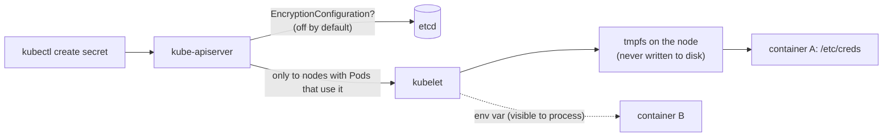
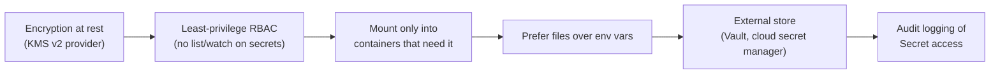

# Secrets

## Summary

A Secret holds a small amount of sensitive data (password, token, key, certificate) separately from Pod specs and images. Secrets look like ConfigMaps (key-value data up to 1 MiB, consumed as files or environment variables), but Kubernetes treats them more carefully: they are sent only to nodes that run Pods needing them and stored there in tmpfs. They are **not** encrypted by default: they are base64-encoded and stored unencrypted in etcd, and anyone who can create a Pod in a namespace can read every Secret in it. Safe use requires encryption at rest, least-privilege RBAC, restricted access per container, and often an external secret store. Built-in types (`Opaque`, `kubernetes.io/tls`, `kubernetes.io/dockerconfigjson` and others) validate expected keys.

## Prerequisites

- [ConfigMaps](configmaps.md).
- [RBAC good practices](../security/rbac-good-practices.md) (recommended).

## Core concepts

### Definition

A Secret is an object that contains a small amount of sensitive data such as a password, a token or a key. Such information might otherwise be put in a Pod specification or in a container image. Using a Secret means you do not need to include confidential data in application code.

Because Secrets can be created independently of the Pods that use them, there is less risk of the Secret (and its data) being exposed during the workflow of creating, viewing and editing Pods. Kubernetes, and applications running in the cluster, can also take additional precautions with Secrets, such as avoiding writing sensitive data to non-volatile storage.

Secrets are similar to ConfigMaps but are intended specifically to hold confidential data.

**Caution.** Kubernetes Secrets are, by default, stored unencrypted in the API server's underlying data store (etcd). Anyone with API access can retrieve or modify a Secret, and so can anyone with access to etcd. Additionally, anyone who is authorized to create a Pod in a namespace can use that access to read any Secret in that namespace; this includes indirect access such as the ability to create a Deployment. To use Secrets safely, take at least the following steps:

1. Enable encryption at rest for Secrets.
2. Enable or configure RBAC rules with least-privilege access to Secrets.
3. Restrict Secret access to specific containers.
4. Consider using external Secret store providers.

Base64 in the `data` field is an encoding, not encryption: `echo cGFzc3dvcmQ= | base64 -d` prints `password`.



### Use cases

- Set environment variables for a container.
- Provide credentials such as SSH keys or passwords to Pods.
- Allow the kubelet to pull container images from private registries.

The Kubernetes control plane also uses Secrets; for example, bootstrap token Secrets help automate node registration.

### Alternatives to Secrets

Rather than using a Secret to protect confidential data, you can choose an alternative:

- If a cloud native component needs to authenticate to another application that you know runs in the same cluster, use a ServiceAccount and its tokens to identify the client.
- Third party tools, inside or outside the cluster, can manage sensitive data. For example, a service that Pods access over HTTPS and that reveals a secret if the client authenticates correctly (for example with a ServiceAccount token). Examples: HashiCorp Vault, cloud secret managers, used directly or through the Secrets Store CSI Driver or the External Secrets Operator.
- For authentication, implement a custom signer for X.509 certificates and use CertificateSigningRequests to let it issue certificates to Pods that need them.
- Use a device plugin to expose node-local encryption hardware to a specific Pod. For example, schedule trusted Pods onto nodes that provide a Trusted Platform Module, configured out of band.

### Types of Secret

When creating a Secret, you can specify its type with the `type` field, or with equivalent `kubectl` flags where available. The type facilitates programmatic handling of the Secret data. Kubernetes provides several built-in types for common scenarios. They differ in the validations performed and the constraints imposed.

| Built-in type | Usage |
| --- | --- |
| `Opaque` | Arbitrary user-defined data |
| `kubernetes.io/service-account-token` | ServiceAccount token |
| `kubernetes.io/dockercfg` | Serialized `~/.dockercfg` file |
| `kubernetes.io/dockerconfigjson` | Serialized `~/.docker/config.json` file |
| `kubernetes.io/basic-auth` | Credentials for basic authentication |
| `kubernetes.io/ssh-auth` | Credentials for SSH authentication |
| `kubernetes.io/tls` | Data for a TLS client or server |
| `bootstrap.kubernetes.io/token` | Bootstrap token data |

You can define and use your own Secret type by assigning a non-empty string as the `type` value (an empty string is treated as `Opaque`). Kubernetes does not constrain the type name. However, if you use one of the built-in types, you must meet all requirements defined for it.

#### Opaque Secrets

`Opaque` is the default type if you do not specify one in a manifest. When you create a Secret with `kubectl`, use the `generic` subcommand for the `Opaque` type: `kubectl create secret generic`.

#### ServiceAccount token Secrets

A `kubernetes.io/service-account-token` Secret stores a token credential that identifies a ServiceAccount. This is a legacy mechanism that provides long-lived ServiceAccount credentials to Pods.

In Kubernetes v1.22 and later, the recommended approach is to obtain short-lived, automatically rotating ServiceAccount tokens with the `TokenRequest` API instead:

- Call the `TokenRequest` API directly or through a client such as `kubectl`, for example `kubectl create token <serviceaccount>`.
- Request a mounted token in a projected volume in the Pod manifest. Kubernetes creates the token and mounts it in the Pod. The token is invalidated automatically when the Pod it is mounted in is deleted. (This is what every Pod gets by default today.)

Since v1.24, long-lived token Secrets are no longer created automatically for ServiceAccounts, and unused legacy tokens are cleaned up.

#### Docker config Secrets

To store credentials for accessing a container image registry, use one of these types:

- `kubernetes.io/dockercfg`: stores a serialized `~/.dockercfg`, the legacy format for configuring the Docker command line. The `data` field contains a `.dockercfg` key whose value is the base64-encoded content of a `~/.dockercfg` file.
- `kubernetes.io/dockerconfigjson`: stores serialized JSON in the same format as `~/.docker/config.json`, the newer format for `~/.dockercfg`. The `data` field must contain a `.dockerconfigjson` key whose value is the base64-encoded content of a `~/.docker/config.json` file.

Pods reference these Secrets in `imagePullSecrets` (see [Images](../containers/images.md#using-a-private-registry)).

#### Basic authentication Secret

The `kubernetes.io/basic-auth` type stores credentials for basic authentication. The `data` field must contain one of these keys:

- `username`: the user name for authentication,
- `password`: the password or token for authentication.

Both values are base64-encoded strings. You can provide clear text content with the `stringData` field instead.

#### SSH authentication Secrets

The built-in type `kubernetes.io/ssh-auth` stores data used in SSH authentication. You must specify an `ssh-privatekey` key-value pair in the `data` (or `stringData`) field as the SSH credential.

This type is provided for convenience only. You could use an `Opaque` Secret for SSH credentials. Using the defined, public type helps other people understand the purpose of the Secret and sets a convention for the key names. The API verifies that the required keys are set for this type.

**Caution.** SSH private keys do not establish trusted communication between an SSH client and a host server on their own. A secondary means of establishing trust is needed to mitigate man-in-the-middle attacks, such as a `known_hosts` file added to a ConfigMap.

#### TLS Secrets

The `kubernetes.io/tls` type stores a certificate and its associated key, typically used for TLS.

A common use is to configure encryption in transit for an [Ingress](../services-and-networking/ingress.md), but you can use it with other resources or directly in workloads. With this type, the `tls.key` and `tls.crt` keys must be provided in `data` (or `stringData`), although the API server does not validate the values. As an alternative to `stringData`, you can provide the base64-encoded certificate and key in `data`. `kubectl create secret tls <name> --cert=<file> --key=<file>` creates one from files.

#### Bootstrap token Secrets

The `bootstrap.kubernetes.io/token` type is for tokens used during node bootstrap. It stores tokens used to sign well-known ConfigMaps. A bootstrap token Secret is usually created in the `kube-system` namespace and named `bootstrap-token-<token-id>`, where `<token-id>` is the 6 character token ID.

### Working with Secrets

**Constraints on names and data.** The name of a Secret must be a valid DNS subdomain name. You can specify `data` (values must be base64-encoded) and/or `stringData` (arbitrary strings, encoded for you) when writing a manifest. Both are optional. Keys must consist of alphanumeric characters, `-`, `_` or `.`. If a key appears in both fields, the `stringData` value takes precedence.

**Size limit.** Individual Secrets are limited to 1 MiB. This discourages very large Secrets that could exhaust API server and kubelet memory. However, creating many smaller Secrets could also exhaust memory. You can use a [resource quota](../policies/README.md) to limit the number of Secrets (or other resources) in a namespace.

**Editing a Secret.** You can edit an existing Secret unless it is immutable, with `kubectl` (`kubectl edit`) or a configuration file (`kubectl apply`). You can also edit data with Kustomize, but that creates a new Secret object (with a hashed name) containing the edited data.

**Using a Secret.** Secrets can be mounted as data volumes or exposed as environment variables to a container in a Pod. Secrets can also be used by other parts of the system without being exposed to the Pod directly; for example, they can hold credentials that other parts of the system use to interact with external systems on your behalf.

Secret volume sources are validated to make sure that the object reference actually points to an object of type Secret. Therefore a Secret must be created before any Pods that depend on it (unless it is marked `optional: true`); otherwise the Pod stays in `ContainerCreating`.

**Detecting changes.** When a Secret consumed in a volume is updated, Kubernetes tracks this and updates the data in the volume with an eventually consistent approach. Containers that use a Secret as a `subPath` volume mount do not receive updates. The kubelet keeps a cache of the current keys and values of the Secrets used in volumes for Pods on the node. The way it detects changes is configured with `configMapAndSecretChangeDetectionStrategy` in the kubelet configuration; the default is `Watch`. Updates can be propagated by an API watch (default), by a TTL based cache, or by polling the API server on every sync. The delay from an update to the new keys being projected into the Pod is the kubelet sync period plus the cache propagation delay of the chosen strategy. Environment variables are never updated in running containers.

### Immutable Secrets

You can mark Secrets (and ConfigMaps) as *immutable*. Preventing changes to the data of an existing Secret has these benefits:

- It protects you from accidental (or unwanted) updates that could cause application outages.
- For clusters that use Secrets extensively (at least tens of thousands of unique Secret to Pod mounts), immutable Secrets improve performance by significantly reducing load on kube-apiserver. The kubelet does not need to maintain a watch on any Secrets marked as immutable.

Once a Secret or ConfigMap is marked as immutable, it is *not* possible to revert this change nor to mutate the contents of `data`. You can only delete and recreate the Secret. Existing Pods keep a mount point to the deleted Secret, so it is recommended to recreate these Pods.

### Information security for Secrets

Although ConfigMaps and Secrets work similarly, Kubernetes applies extra protection to Secret objects. Secrets often hold values that span a spectrum of importance, many of which could cause escalations within Kubernetes (for example ServiceAccount tokens) and to external systems.

- A Secret is sent to a node only if a Pod on that node requires it.
- The kubelet stores the data in a `tmpfs`, so that confidential data is not written to durable storage. The Secret is deleted from the node when the Pod that depends on it is deleted.
- In a Pod with several containers, each container must request the Secret volume in its `volumeMounts` for it to be visible in that container. You can therefore restrict a Secret to the containers that need it.
- Containers get only their own ServiceAccount token unless explicitly granted access to other Secrets; they cannot read Secrets of other Pods.

**Hardening checklist** (see also [RBAC good practices](../security/rbac-good-practices.md#listing-secrets)):



## Worked example

Create a TLS Secret and a database credential, enable encryption at rest, and verify (untested here; Kubernetes v1.30 or later; the encryption step applies to a self-managed control plane):

```bash
openssl req -x509 -newkey rsa:2048 -nodes -days 30 -subj "/CN=foo.bar.com" -keyout tls.key -out tls.crt
kubectl create secret tls foo-bar-tls --cert=tls.crt --key=tls.key
kubectl create secret generic db-creds --from-literal=username=app --from-literal=password='<PASSWORD>'
kubectl get secret db-creds -o jsonpath='{.data.password}' | base64 -d   # base64 is not encryption
```

```yaml
# /etc/kubernetes/enc/enc.yaml, referenced by kube-apiserver --encryption-provider-config
apiVersion: apiserver.config.k8s.io/v1
kind: EncryptionConfiguration
resources:
  - resources: ["secrets"]
    providers:
      - aescbc:
          keys:
            - name: key1
              secret: <BASE64_32_BYTE_KEY>
      - identity: {}        # still read old unencrypted data
```

```bash
# after restarting kube-apiserver with the config, rewrite all Secrets so they are stored encrypted
kubectl get secrets -A -o json | kubectl replace -f -
# on the control plane node: the stored value now starts with k8s:enc:aescbc:v1:key1
ETCDCTL_API=3 etcdctl get /registry/secrets/default/db-creds --print-value-only | head -c 40
```

In production, prefer a KMS v2 provider over a static `aescbc` key in a file on the control plane.

## Trade offs and when to use it

- **Kubernetes Secrets** are convenient and integrate with everything, but their protection depends entirely on cluster configuration (encryption, RBAC, audit).
- **External stores** (Vault, cloud secret managers) add rotation, auditing and dynamic credentials, at the cost of another dependency; sync operators copy values back into Secrets, while the CSI driver can avoid Secrets entirely.
- **Files or environment variables.** Files can be updated and are not inherited by child processes or dumped in crash reports as easily as environment variables.

## Common mistakes

- **Committing Secret manifests to Git** (base64 is readable). Use sealed or encrypted secrets (SOPS, Sealed Secrets) or an external store.
- **Granting `list` or `watch` on Secrets**, which reveals all their contents.
- **Assuming encryption at rest is on** in a self-managed cluster.
- **Long-lived ServiceAccount token Secrets** instead of projected, short-lived tokens.
- **Expecting environment variables to change** after a Secret update.

## Practice

1. Why is base64 encoding in `data` not a security measure?
2. Which user, besides those with `get` on Secrets, can read all Secrets in a namespace?
3. What does the `kubernetes.io/tls` type require, and what does the API server not validate?
4. How do Secret volumes avoid writing data to node disks?
5. What is the recommended replacement for `kubernetes.io/service-account-token` Secrets?

Answers: 1. It is reversible encoding without a key. 2. Anyone who can create Pods (or Deployments, Jobs, and so on) in the namespace, because a Pod can mount any Secret there. 3. The keys `tls.crt` and `tls.key`; their values are not validated. 4. The kubelet stores them in tmpfs. 5. Short-lived tokens from the TokenRequest API, usually as projected volumes.

## Further reading

- [Secrets](https://kubernetes.io/docs/concepts/configuration/secret/), Kubernetes documentation.
- [Good practices for Kubernetes Secrets](https://kubernetes.io/docs/concepts/security/secrets-good-practices/), Kubernetes documentation.
- [Encrypting Confidential Data at Rest](https://kubernetes.io/docs/tasks/administer-cluster/encrypt-data/), Kubernetes documentation.
- [Secrets Store CSI Driver](https://secrets-store-csi-driver.sigs.k8s.io/), Kubernetes SIGs.
- [External Secrets Operator](https://external-secrets.io/), External Secrets project.
