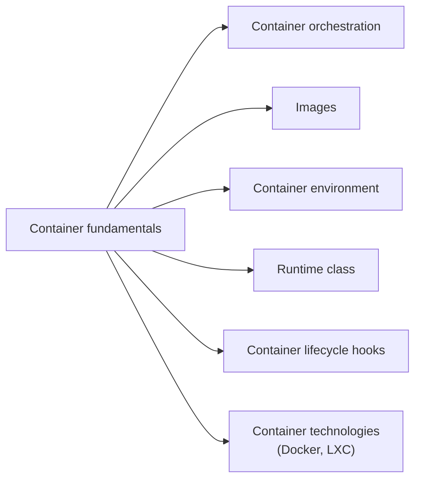

# Containers

Technology for packaging an application with its runtime dependencies, and how Kubernetes runs it: images, the environment a container sees, runtime classes and lifecycle hooks, plus the container technologies underneath. Corresponds to the "Containers" chapter of the Kubernetes documentation Concepts.

## Map of the area

Start with the fundamentals. The other notes can be read in any order; container technologies give background on the tools outside Kubernetes.

## Notes and sections in reading order

1. [Container fundamentals](container-fundamentals.md): what a container is, images, runtimes, immutability.
2. [Container orchestration](container-orchestration.md): what an orchestrator automates and how the main orchestrators compare.
3. [Images](images.md): image references, pull policies and their defaults, parallel pulls, private registries.
4. [Container environment](container-environment.md): file system, container information, Service environment variables.
5. [Runtime class](runtime-class.md): choosing the runtime configuration per Pod.
6. [Container lifecycle hooks](container-lifecycle-hooks.md): `PostStart`, `PreStop`, handler types and delivery guarantees.
7. [Container technologies](container-technologies/README.md): Docker and LXC.

## Planned topics

- Container Runtime Interface (CRI)
- Image garbage collection and pre-pulled images
- Image volumes (mounting OCI artifacts as volumes)
