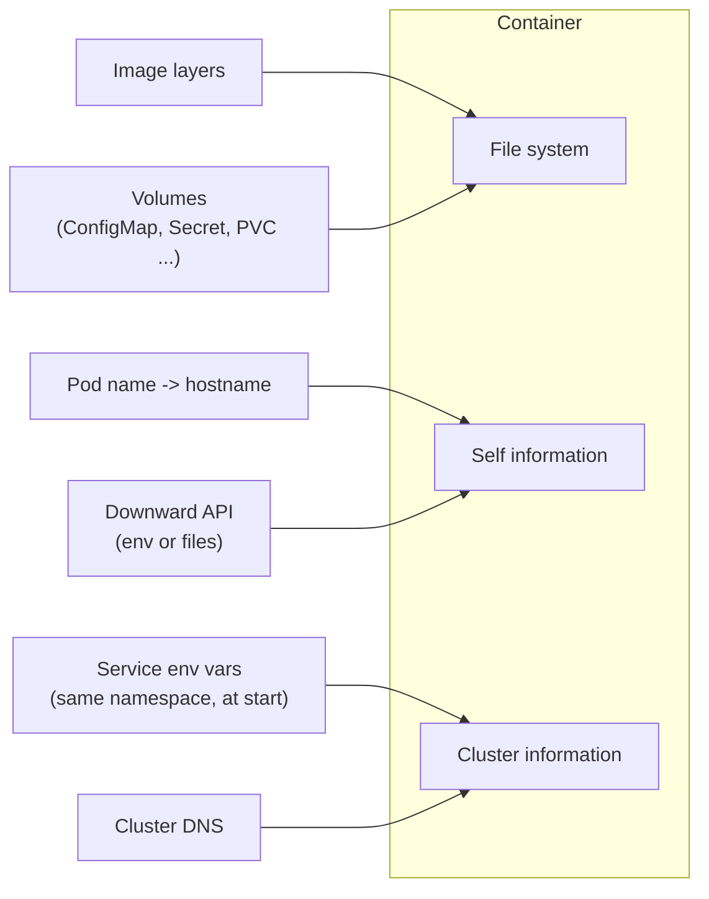

# Container environment

## Summary

Kubernetes gives every container three things: a file system (the image plus mounted volumes), information about the container itself (its host name is the Pod name, plus anything exposed through the Downward API) and information about the cluster (environment variables for the Services that existed when the container started, and DNS if the DNS add-on runs). Knowing exactly what is injected explains common surprises, such as Service variables that are missing because the Service was created after the Pod.

## Prerequisites

- [Container fundamentals](container-fundamentals.md).
- [Services](../services-and-networking/services.md) for what a Service is.

## Core concepts

### What the environment contains

The Kubernetes container environment provides several resources to containers:

- **A file system**, which is a combination of an image and one or more volumes.
- **Information about the container itself.**
- **Information about other objects in the cluster.**



### Container information

The *hostname* of a container is the name of the Pod in which the container runs. It is available through the `hostname` command or the `gethostname` function in libc. (A Pod can override it with `spec.hostname` and `spec.subdomain`, which StatefulSets use for stable names.)

The Pod name and namespace are available as environment variables through the [Downward API](../storage/volumes.md#volume-types), together with other Pod and container fields such as labels, annotations, the node name and resource limits. User defined environment variables from the Pod definition (and from ConfigMaps and Secrets) are also available, as are any variables specified statically in the image.

### Cluster information

A list of all Services that were running when a container was created is available to that container as environment variables. The list is limited to Services in the same namespace as the container's Pod and to the Kubernetes control plane Services (`KUBERNETES_SERVICE_HOST` and `KUBERNETES_SERVICE_PORT` for the API server).

For a Service named `foo` that maps to a container named `bar`, the following variables are defined:

```text
FOO_SERVICE_HOST=<the host the service is running on>
FOO_SERVICE_PORT=<the port the service is running on>
```

The full set of variables, including the Docker link compatible `FOO_PORT_...` variables, is shown in [Services](../services-and-networking/services.md#environment-variables).

Services have dedicated IP addresses and are also available to the container through DNS, if the DNS add-on (CoreDNS) is enabled. DNS has no ordering problem, so it is the preferred discovery method.

The injection of Service variables can be disabled per Pod with `enableServiceLinks: false`, which helps in namespaces with hundreds of Services (thousands of variables can slow down container start and even break some applications).

## Worked example

Observe both mechanisms (untested here; any cluster):

```bash
kubectl create deployment redis --image=redis:7.4
kubectl expose deployment redis --port=6379
kubectl run before --image=busybox:1.36 -- sleep 3600   # created after the Service exists
kubectl exec before -- env | grep REDIS_SERVICE           # REDIS_SERVICE_HOST=10.96.x.y, REDIS_SERVICE_PORT=6379
kubectl exec before -- hostname                           # before (the Pod name)
kubectl exec before -- nslookup redis                     # resolves through cluster DNS
kubectl create service clusterip late --tcp=80:80
kubectl exec before -- env | grep LATE_ || echo "no LATE_ vars: Service created after the container"
```

Expected output: the Redis variables are present, the hostname equals the Pod name, and there are no variables for the Service created after the container started.

## Trade offs and when to use it

- **Environment variables** need no DNS and work for any language, but are fixed at container start and depend on creation order.
- **DNS** always reflects the current Services and works across namespaces, but needs the DNS add-on and can be affected by DNS caching.

## Common mistakes

- **Relying on Service variables for Services created later.** Use DNS names such as `redis.default.svc.cluster.local`.
- **Variable name clashes.** An application variable such as `REDIS_PORT` can be overwritten by the injected `REDIS_PORT=tcp://...`. Set `enableServiceLinks: false` or rename.

## Practice

1. What is the hostname of a container by default?
2. Which Services appear as environment variables in a new container?
3. How do you stop Kubernetes from injecting Service variables?

Answers: 1. The Pod name. 2. Services in the same namespace that existed when the container was created, plus the `kubernetes` Service of the API server. 3. Set `enableServiceLinks: false` in the Pod spec.

## Further reading

- [Container Environment](https://kubernetes.io/docs/concepts/containers/container-environment/), Kubernetes documentation.
- [Downward API](https://kubernetes.io/docs/concepts/workloads/pods/downward-api/), Kubernetes documentation.
- [DNS for Services and Pods](https://kubernetes.io/docs/concepts/services-networking/dns-pod-service/), Kubernetes documentation.
