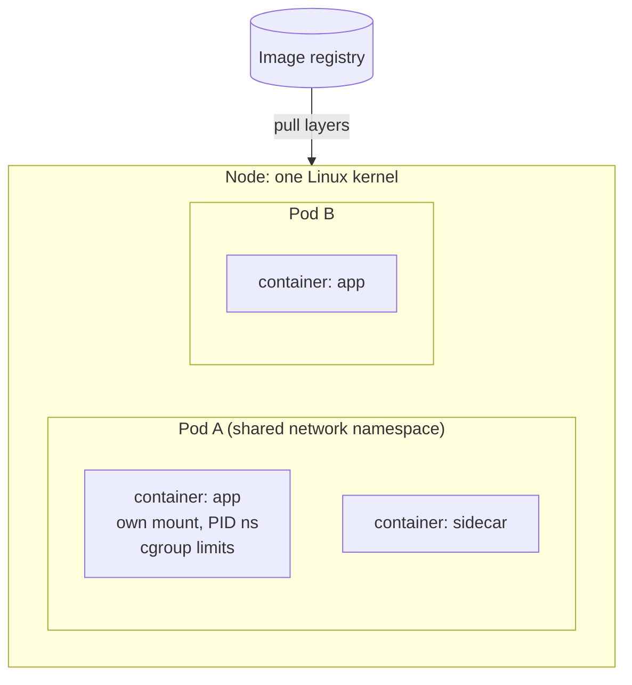
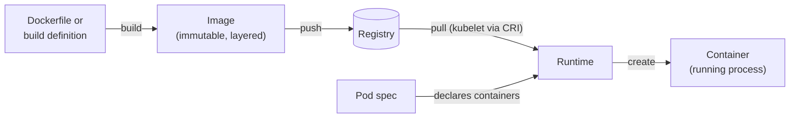

# Container fundamentals

## Summary

A container packages an application with its runtime dependencies so that it behaves the same wherever it runs. It is an isolated process on a shared Linux kernel, created from an immutable *container image*. Containers decouple applications from the host infrastructure, which makes deployment across clouds and operating systems easier. In Kubernetes, containers always run inside Pods, are started by a *container runtime*, and are replaced rather than changed when the application changes.

## Prerequisites

- Linux processes and file systems.
- [What is Kubernetes](../overview/what-is-kubernetes.md#from-physical-servers-to-containers) for the history from VMs to containers.

## Core concepts

### What a container is

Each container that you run is repeatable: because dependencies are included, you get the same behavior wherever you run it. Containers decouple applications from the underlying host infrastructure, which makes deployment easier in different cloud or OS environments.

Technically, a container on Linux is an ordinary process with three kernel features applied:

- **Namespaces** give it its own view of process IDs, network interfaces, mount points, host name, IPC and users.
- **Control groups (cgroups)** limit and account its CPU, memory, I/O and process count.
- **A root file system from an image**, usually assembled from read-only layers plus a thin writable layer (overlay file system).

*Analogy.* A container is like a shipping container: a standard box that any ship, crane or truck can handle without knowing what is inside. The analogy holds for portability and standard handling. It breaks for isolation: shipping containers are physically separate, while Linux containers share one kernel, so a kernel vulnerability can cross the boundary.

In a Kubernetes cluster, each node runs the containers that form the Pods assigned to that node. Containers in a Pod are co-located and co-scheduled on the same node.



### Container images

A *container image* is a ready-to-run software package that contains everything needed to run an application: the code and any runtime it requires, application and system libraries, and default values for essential settings. Details are in [Images](images.md).

Containers are intended to be **stateless and immutable**: you should not change the code of a container that is already running. To change a containerized application, build a new image that includes the change, then recreate the container from the updated image. Data that must survive goes into volumes (see [Volumes](../storage/volumes.md)).

### Container runtimes

The container runtime is the component that lets Kubernetes run containers. It manages the execution and lifecycle of containers in the Kubernetes environment. Kubernetes supports runtimes such as containerd, CRI-O and any other implementation of the Kubernetes CRI (Container Runtime Interface). See [Node components](../cluster-architecture/node-components.md#container-runtime).

Usually you let the cluster pick the default runtime for a Pod. If you need more than one runtime in the cluster, specify a [RuntimeClass](runtime-class.md) for the Pod so that Kubernetes runs its containers with a particular runtime configuration. You can also use RuntimeClass to run different Pods with the same runtime but with different settings.

### Container, image, runtime and Pod



| Term | What it is | Lifetime |
| --- | --- | --- |
| Image | A read-only template made of layers and a configuration. | Until deleted from the registry. |
| Container | A running (or stopped) instance of an image with its own writable layer. | Until the container is removed; restarts get a fresh writable layer. |
| Runtime | The software that pulls images and runs containers on a node. | A node service. |
| Pod | The Kubernetes object that groups containers sharing network and storage. | Until deleted; never moved between nodes. |

## Worked example

Showing immutability and the fresh writable layer (untested here; any cluster, `kubectl` v1.30 or later):

```bash
kubectl run demo --image=busybox:1.36 --restart=Always -- sh -c 'echo hi > /tmp/state; sleep 3600'
kubectl exec demo -- cat /tmp/state          # hi
kubectl exec demo -- kill 1                  # stop the main process; the kubelet restarts the container
kubectl exec demo -- ls /tmp                 # 'state' is written again by the new process, not kept
kubectl get pod demo -o jsonpath='{.status.containerStatuses[0].restartCount}{"\n"}'   # 1
```

The file was recreated only because the command writes it again at start. Anything written by hand inside a container is lost on restart, which is why state belongs in volumes and changes belong in new images.

## Trade offs and when to use it

- **Benefits.** Fast start, high density, reproducible builds, portability.
- **Costs.** Weaker isolation than VMs because the kernel is shared; mitigations are security contexts, seccomp, AppArmor or SELinux, and sandboxed runtimes (gVisor, Kata) through RuntimeClass.
- **When a VM is better.** Different kernels, strong multi-tenant isolation, or legacy software that expects a full OS.

## Common mistakes

- **Patching running containers** with `kubectl exec`. The change disappears on restart and makes replicas differ.
- **Using `latest` tags.** The same tag can point to different content; deployments become unreproducible (see [Images](images.md)).
- **Treating a container as a VM** (running SSH, cron and several daemons in one container). Use one main process per container and Pods for co-located helpers.

## Practice

1. Which two Linux kernel features provide isolation and resource limits for containers?
2. Why should you not modify code in a running container?
3. What does RuntimeClass let you choose?

Answers: 1. Namespaces and cgroups. 2. Containers are immutable and replaceable; changes are lost on restart and break reproducibility. Build a new image instead. 3. The runtime configuration (handler) used to run a Pod's containers, for example a sandboxed runtime.

## Further reading

- [Containers](https://kubernetes.io/docs/concepts/containers/), Kubernetes documentation. Containers, images and runtimes in Kubernetes.
- [Open Container Initiative specifications](https://opencontainers.org/), OCI. Image, runtime and distribution specifications.
- [namespaces(7)](https://man7.org/linux/man-pages/man7/namespaces.7.html) and [cgroups(7)](https://man7.org/linux/man-pages/man7/cgroups.7.html), Linux manual pages. The kernel features behind containers.
