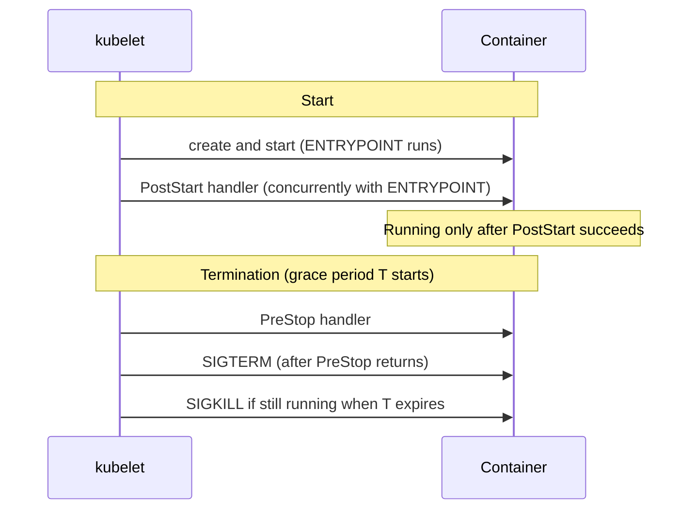

# Container lifecycle hooks

## Summary

Lifecycle hooks let a container run code at two points of its management lifecycle: `PostStart`, right after the container is created, and `PreStop`, right before it is terminated. A hook handler can run a command in the container (`exec`), send an HTTP request (`httpGet`) or pause (`sleep`). Hooks are delivered at least once, `PostStart` is not ordered relative to the entrypoint, and `PreStop` runs inside the termination grace period, which makes it the standard tool for graceful shutdown behind a load balancer.

## Prerequisites

- [Pod lifecycle](../workloads/pods/pod-lifecycle.md#container-states).

## Core concepts

### Motivation

Many programming frameworks (Angular is a well known example) have component lifecycle hooks. Kubernetes provides containers with lifecycle hooks in the same spirit. The hooks make containers aware of events in their management lifecycle and run code implemented in a handler when the corresponding hook is executed.

### The two hooks

**`PostStart`** is executed immediately after a container is created. There is no guarantee that the hook runs before the container `ENTRYPOINT`: both start at about the same time. No parameters are passed to the handler. The container does not reach the `Running` state until the `PostStart` handler completes, and if the handler fails, the container is killed.

**`PreStop`** is called immediately before a container is terminated because of an API request or a management event such as a liveness or startup probe failure, preemption or resource contention. A call to `PreStop` fails if the container is already in a terminated or completed state. The hook must complete before the TERM signal to stop the container can be sent. The Pod's termination grace period countdown starts *before* the `PreStop` hook is executed, so regardless of the outcome of the handler, the container eventually terminates within the grace period. No parameters are passed to the handler.



The diagram shows why a long `PreStop` shortens the time the application has after `SIGTERM`: both share the same grace period.

### Hook handler implementations

A container accesses a hook by implementing and registering a handler for it. There are three types of handlers:

| Handler | What it does | Where it runs |
| --- | --- | --- |
| `exec` | Executes a command such as `pre-stop.sh` inside the cgroups and namespaces of the container. Resources consumed by the command count against the container. | In the container |
| `httpGet` | Sends an HTTP request to an endpoint of the container. | From the kubelet process |
| `sleep` | Pauses for a given duration before the container continues (`PostStart`) or is stopped (`PreStop`). Introduced as beta behind the `PodLifecycleSleepAction` feature gate, enabled by default. | In the kubelet |

The deprecated `tcpSocket` handler is accepted for backwards compatibility but not supported as a lifecycle hook action.

TODO: Verify the current maturity of the `sleep` action (beta in v1.30, expected GA later) against the v1.37 documentation.

### Hook handler execution

When a hook is called, the kubelet executes the handler according to the hook action: `httpGet`, `tcpSocket` and `sleep` are executed by the kubelet process, and `exec` is executed in the container. Hook calls are synchronous within the context of the Pod: for `PostStart`, the container is not marked `Running` until the handler completes; for `PreStop`, the TERM signal waits for the handler.

### Hook delivery guarantees

Hook delivery is intended to be *at least once*: a hook may be called multiple times for one event, such as `PostStart` or `PreStop`. The hook implementation must handle this correctly (be idempotent). Generally only single deliveries happen, but for example if the kubelet restarts in the middle of sending a hook, the hook might be resent.

Hook failures are visible as Pod events: `FailedPostStartHook` and `FailedPreStopHook`.

## Worked example

Graceful shutdown behind a Service. Without a delay, a Pod can receive new connections for a short time after it is marked for deletion, because endpoint removal and `SIGTERM` happen in parallel. A `PreStop` sleep covers that window (untested here; Kubernetes v1.30 or later):

```yaml
apiVersion: v1
kind: Pod
metadata:
  name: web
spec:
  terminationGracePeriodSeconds: 45
  containers:
    - name: nginx
      image: nginx:1.27
      lifecycle:
        postStart:
          exec:
            command: ["sh", "-c", "echo started at $(date) > /usr/share/nginx/html/started"]
        preStop:
          sleep:
            seconds: 10        # let kube-proxy and load balancers drop this endpoint first
```

```bash
kubectl apply -f web.yaml && kubectl exec web -- cat /usr/share/nginx/html/started
time kubectl delete pod web    # about 10 s for PreStop plus nginx shutdown, well under 45 s
```

## Trade offs and when to use it

- **`PreStop` sleep or handling SIGTERM in the app.** A sleep is simple and language independent; handling `SIGTERM` correctly (stop accepting, drain, exit) is still required.
- **`PostStart` or init containers.** Use an init container when setup must finish before the app starts; `PostStart` runs concurrently with the entrypoint.

## Common mistakes

- **Assuming `PostStart` runs before the entrypoint.** It does not; use init containers for ordering.
- **A `PreStop` longer than `terminationGracePeriodSeconds`.** The container is killed with `SIGKILL` before it handles `SIGTERM`.
- **Non-idempotent hooks.** At-least-once delivery can run them twice.
- **Using `exec` hooks that need tools the image does not contain** (for example `sleep` in a distroless image); use the `sleep` action instead.

## Practice

1. When does the termination grace period start relative to `PreStop`?
2. Which handler types run in the kubelet process?
3. Why must hook handlers be idempotent?

Answers: 1. Before the `PreStop` hook runs; the hook consumes part of the grace period. 2. `httpGet`, `tcpSocket` and `sleep`. 3. Delivery is at least once, so a handler may be called more than once.

## Further reading

- [Container Lifecycle Hooks](https://kubernetes.io/docs/concepts/containers/container-lifecycle-hooks/), Kubernetes documentation.
- [Attach Handlers to Container Lifecycle Events](https://kubernetes.io/docs/tasks/configure-pod-container/attach-handler-lifecycle-event/), Kubernetes documentation.
- [Pod termination](https://kubernetes.io/docs/concepts/workloads/pods/pod-lifecycle/#pod-termination), Kubernetes documentation.
