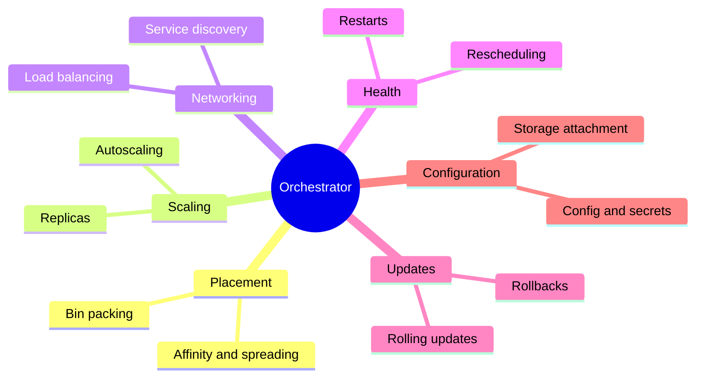

# Container orchestration

## Summary

Container orchestration is the automated management of the lifecycle of containers across many hosts: deployment, placement, scaling, networking, health checking, updates and recovery. It is what makes containerized applications practical in production. Kubernetes is the dominant orchestrator; Docker Swarm, HashiCorp Nomad and the now retired Apache Mesos (with Marathon) are or were alternatives.

## Prerequisites

- [Container fundamentals](container-fundamentals.md).

## Core concepts

### Definition

*Container orchestration* is the process of managing and automating the lifecycle of containers, including their deployment, scaling and networking across multiple hosts. It is a core technology for running complex containerized applications in production.

With an orchestrator such as Kubernetes, Docker Swarm or (historically) Apache Mesos, organizations get high availability, scalability and reliability for their applications. Orchestration simplifies operations by automating routine tasks, and it is the foundation for microservices, cloud native development and DevOps practices.

*Analogy.* An orchestra conductor does not play an instrument; they make many musicians start, stop and change tempo together. A container orchestrator does not run containers itself (the runtime on each node does); it decides which node runs what, and reacts when a musician drops out. The analogy breaks in one respect: a conductor follows a fixed score, while Kubernetes reacts continuously to a desired state that can change at any time.

### What an orchestrator automates



| Task | Without an orchestrator | With Kubernetes |
| --- | --- | --- |
| Placement | A person chooses a host for each container. | The scheduler places Pods by resources and constraints. |
| Recovery | Monitoring alerts a person, who restarts containers elsewhere. | Controllers recreate Pods on healthy nodes. |
| Scaling | Scripts start more containers. | `replicas` and autoscalers. |
| Discovery | Static IPs, config files, an external registry. | Services and DNS. |
| Updates | Manual or scripted rollouts with downtime risk. | Rolling updates with readiness checks and rollbacks. |

### Orchestrators compared

| Orchestrator | Status | Notes |
| --- | --- | --- |
| Kubernetes | CNCF graduated, the de facto standard | Declarative API, very large ecosystem. |
| Docker Swarm | Maintained as Swarm mode in Docker Engine | Simple, tied to Docker. See [Alternative orchestrators](../ecosystem/alternative-orchestrators.md). |
| HashiCorp Nomad | Actively developed | Schedules containers and non-containerized workloads. See [Alternative orchestrators](../ecosystem/alternative-orchestrators.md). |
| Apache Mesos and Marathon | Moved to the Apache Attic in 2025 (retired) | Historically important two-level scheduler; not for new systems. |

TODO: Verify the date of the Apache Mesos move to the Apache Attic.

## Worked example

The orchestration loop in one command sequence (untested here; any cluster):

```bash
kubectl create deployment web --image=nginx:1.27 --replicas=4
kubectl get pods -o wide                       # spread over nodes (placement)
kubectl cordon <node-name>; kubectl delete pod -l app=web --field-selector spec.nodeName=<node-name>
kubectl get pods -o wide                       # replacements land on other nodes (recovery)
kubectl set image deployment/web nginx=nginx:1.27.3   # rolling update
kubectl rollout undo deployment/web                   # rollback
kubectl uncordon <node-name>
```

## Trade offs and when to use it

An orchestrator pays off when you have many containers, several hosts, or need zero-downtime updates. For one host with a few containers, Docker Compose or systemd units are simpler. The choice between orchestrators is a choice between ecosystem breadth (Kubernetes) and operational simplicity (Swarm, Nomad).

## Common mistakes

- **Adopting an orchestrator for one container.** The fixed cost outweighs the benefit.
- **Assuming the orchestrator makes an application highly available.** It restarts and reschedules; the application still needs several replicas, health checks and graceful shutdown.

## Practice

1. Name four tasks an orchestrator automates.
2. What does the orchestrator not do that the container runtime does?

Answers: 1. Placement, recovery, scaling, service discovery and load balancing, rolling updates (any four). 2. Actually create and run the container processes on a host.

## Further reading

- [Overview](https://kubernetes.io/docs/concepts/overview/), Kubernetes documentation. Why an orchestrator is needed.
- [Swarm mode overview](https://docs.docker.com/engine/swarm/), Docker documentation.
- [Nomad documentation](https://developer.hashicorp.com/nomad/docs), HashiCorp.
- [Large-scale cluster management at Google with Borg](https://research.google/pubs/large-scale-cluster-management-at-google-with-borg/), Verma et al., EuroSys, 2015. The orchestrator that inspired Kubernetes.
