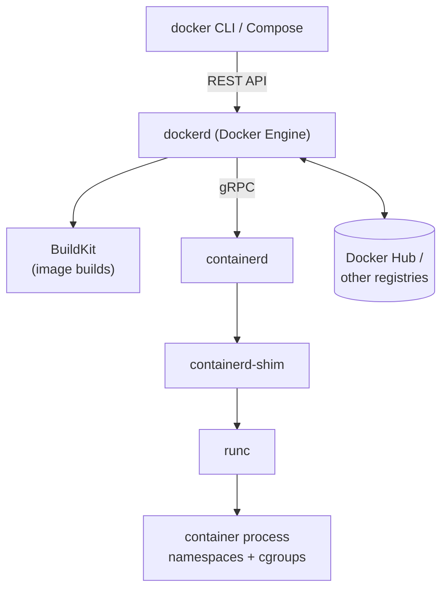

# Docker

## Summary

Docker is an open source platform that popularized application containers: it packages an application with its dependencies into a standardized image and runs it as an isolated container through OS-level virtualization. Its tools (Docker Engine, the CLI, Docker Hub, Docker Compose, BuildKit) cover building, sharing and running containers. In Kubernetes, Docker matters mainly as a build tool: Docker-built images are OCI images that any CRI runtime runs, while Docker Engine itself is no longer a built-in node runtime since dockershim was removed in v1.24.

## Prerequisites

- [Container fundamentals](../container-fundamentals.md).

## Core concepts

### Definition

Docker is an open source platform that automates the deployment, scaling and management of applications using containerization. Developers package applications with all their dependencies into standardized units called containers, which behave consistently across environments.

Docker provides a lightweight alternative to full machine virtualization by using OS-level virtualization: several isolated systems run on one host and share its kernel. Its ecosystem includes tools for building, sharing and running containers: Docker Engine, Docker Hub and Docker Compose. Docker became central to DevOps practice: it enables microservice architectures, CI/CD pipelines and efficient resource use in development and production.

### The Docker stack



| Component | Role |
| --- | --- |
| Docker CLI | User interface that sends commands to the daemon. |
| Docker Engine (`dockerd`) | Daemon that manages images, containers, networks and volumes. |
| BuildKit | Build engine for Dockerfiles, with caching and multi-stage builds. |
| containerd | Container lifecycle manager used by Docker Engine underneath (and directly by Kubernetes). |
| runc | Low level OCI runtime that creates the container process. |
| Docker Hub | Public registry and the default registry for unqualified image names. |
| Docker Compose | Declarative multi-container applications on one host. |

### Docker and Kubernetes today

- **Images.** Docker builds images that follow the OCI image specification. containerd and CRI-O run them without change, so "Docker images" work on every Kubernetes cluster.
- **Runtime.** Kubernetes used Docker Engine through a built-in adapter (dockershim) until v1.23. It was removed in v1.24 because Docker Engine does not implement the CRI and the adapter was costly to maintain. Docker Engine can still be a node runtime through Mirantis' `cri-dockerd`, but most clusters use containerd directly, which is what Docker Engine itself uses below.
- **Local development.** Docker Desktop and kind (Kubernetes in Docker) run test clusters in containers.

## Worked example

Build an image with Docker and run it on a local kind cluster without a registry (untested here; Docker Engine 27, kind v0.30):

```dockerfile
# Dockerfile: multi-stage build keeps the runtime image small
FROM golang:1.23 AS build
WORKDIR /src
COPY main.go .
RUN CGO_ENABLED=0 go build -o /app main.go

FROM gcr.io/distroless/static-debian12
COPY --from=build /app /app
ENTRYPOINT ["/app"]
```

```bash
docker build -t hello:1.0 .
kind load docker-image hello:1.0                 # copy the image into the kind nodes' containerd
kubectl run hello --image=hello:1.0 --image-pull-policy=Never
kubectl get pod hello                            # runs under containerd, not Docker Engine
```

## Trade offs and when to use it

- **Benefits.** The most widely known developer workflow, Compose for local multi-service setups, BuildKit for fast builds.
- **Costs.** A root daemon on the build host; Docker Desktop licensing applies to larger companies.
- **Alternatives.** Podman (daemonless, rootless), Buildah, kaniko or BuildKit standalone for builds in CI; containerd or CRI-O as node runtimes.

## Common mistakes

- **Mounting `/var/run/docker.sock` into Pods** to build images. It gives root on the node and does not work on nodes without Docker; use rootless builders.
- **Believing images must be rebuilt after the dockershim removal.** They do not.

## Practice

1. Why did dockershim removal not break Docker-built images?
2. Which component do Docker Engine and Kubernetes nodes have in common?

Answers: 1. They are OCI images, which containerd and CRI-O run directly. 2. containerd (and runc below it).

## Further reading

- [Docker overview](https://docs.docker.com/get-started/docker-overview/), Docker documentation.
- [Dockershim removal FAQ](https://kubernetes.io/blog/2022/02/17/dockershim-faq/), Kubernetes blog, 2022.
- [cri-dockerd](https://github.com/Mirantis/cri-dockerd), Mirantis. CRI adapter for Docker Engine.
- [OCI Image Format Specification](https://github.com/opencontainers/image-spec), OCI.
