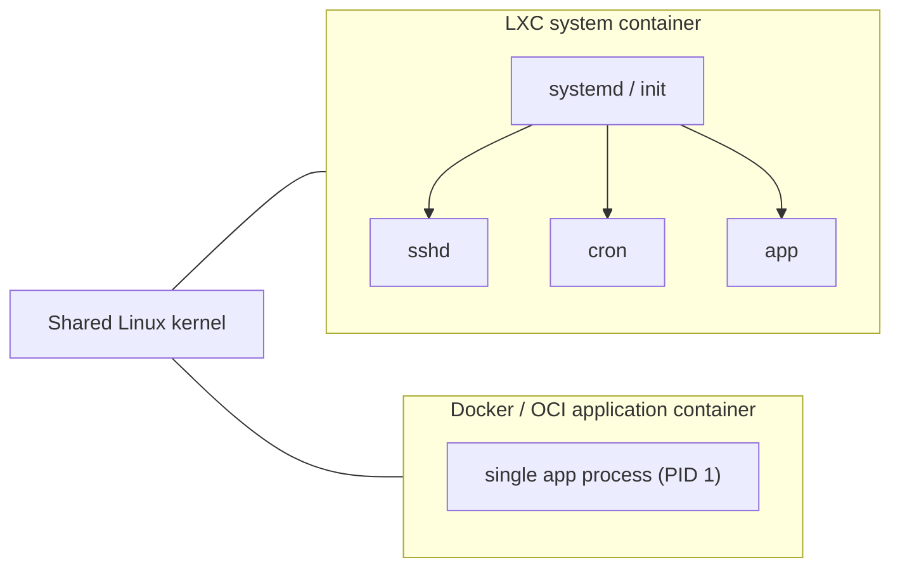

# LXC

## Summary

LXC (Linux Containers) is an operating-system-level virtualization method that runs several isolated Linux systems on one host with one shared Linux kernel. It builds on the same kernel features as Docker (cgroups and namespaces) but focuses on *system containers*: containers that behave like lightweight virtual machines with an init system and several services, rather than *application containers* that run one process. LXC is not a Kubernetes runtime; it is relevant as a historical and conceptual reference and for home labs (for example Proxmox VE runs LXC containers).

## Prerequisites

- [Container fundamentals](../container-fundamentals.md).

## Core concepts

### Definition

LXC is an operating system level virtualization method for running multiple isolated Linux systems (containers) on a single host using a single Linux kernel. It is a lightweight alternative to full machine virtualization and offers near-native performance and high density.

LXC uses Linux kernel features such as cgroups and namespaces to create containers that have their own process and network space while sharing the host kernel. This gives efficient resource use and fast deployment.

LXC is often used for development environments, testing and running several isolated services on one machine. It is similar in concept to Docker, but it takes a *system container* approach, while Docker focuses on *application containers*.

### System containers and application containers



| Aspect | LXC (system container) | Docker or OCI (application container) |
| --- | --- | --- |
| Unit | A whole OS userland with init | One application process |
| Lifecycle | Long lived, updated in place like a VM | Immutable, replaced on change |
| Image model | Distribution templates or images, usually not layered | Layered OCI images from a registry |
| Typical tools | `lxc-*` tools, LXD and Incus, Proxmox VE | Docker, Podman, containerd, CRI-O |
| Kubernetes integration | None as a CRI runtime | Native through CRI |

History: early Docker versions (until 0.9, 2014) used LXC as their execution driver before switching to their own library, libcontainer, which became runc.

## Worked example

Create a system container on an Ubuntu host (untested here; LXC 5 or 6):

```bash
sudo apt install lxc
sudo lxc-create -n web -t download -- -d ubuntu -r noble -a amd64
sudo lxc-start -n web
sudo lxc-attach -n web -- ps -ef | head      # shows systemd as PID 1 and several services
sudo lxc-info -n web                          # state, IP, memory use
```

The process list shows a full init system inside the container, in contrast to an application container where PID 1 is the application.

## Trade offs and when to use it

- **Use LXC** for VM-like environments with low overhead: home labs, legacy services that expect a full OS, dense development sandboxes.
- **Use application containers** for anything that should be orchestrated by Kubernetes.

## Common mistakes

- **Assuming LXC containers can be scheduled by Kubernetes.** They cannot; Kubernetes needs a CRI runtime.
- **Treating a system container as strongly isolated as a VM.** The kernel is shared; use unprivileged containers.

## Practice

1. What is the main difference between a system container and an application container?
2. Which two kernel features does LXC share with Docker?

Answers: 1. A system container runs a full OS userland with an init and several services; an application container runs one process. 2. Namespaces and cgroups.

## Further reading

- [Linux Containers: LXC introduction](https://linuxcontainers.org/lxc/introduction/), linuxcontainers.org.
- [Incus documentation](https://linuxcontainers.org/incus/docs/main/), linuxcontainers.org. The community fork of LXD for system containers and VMs.
- [Docker 0.9: introducing execution drivers and libcontainer](https://www.docker.com/blog/docker-0-9-introducing-execution-drivers-and-libcontainer/), Docker blog, 2014.
