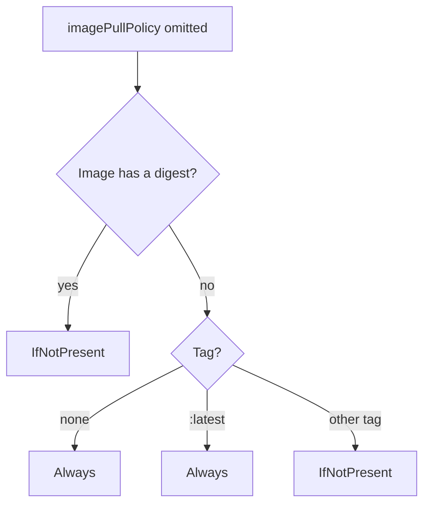

# Images

## Summary

A container image is binary data that encapsulates an application and all its software dependencies. You build an image, push it to a registry, and reference it in a Pod. The kubelet decides whether to pull the image based on the container's `imagePullPolicy`, which Kubernetes defaults from the image tag or digest. Private registries need credentials, which can come from node configuration, a kubelet credential provider, pre-pulled images or `imagePullSecrets` on the Pod.

## Prerequisites

- [Container fundamentals](container-fundamentals.md).

## Core concepts

### What an image is

A container image represents binary data that encapsulates an application and all its software dependencies. Images are executable software bundles that can run standalone and that make well defined assumptions about their runtime environment. You typically create an image of your application and push it to a registry before referring to it in a Pod.

An image reference has the form `[registry/][namespace/]name[:tag][@digest]`, for example `registry.example.com/team/api:1.4.2` or `nginx@sha256:...`. Without a registry, Docker Hub (`docker.io`) is assumed by most runtimes.

- A **tag** is a mutable, human readable label.
- A **digest** (`sha256:...`) is the content hash of the image manifest and never changes.

**Tag syntax.** Image tags consist of lowercase and uppercase letters, digits, underscores (`_`), periods (`.`) and hyphens (`-`). A tag can be up to 128 characters long and must match the regular expression `[a-zA-Z0-9_][a-zA-Z0-9._-]{0,127}`. It cannot start with a period or a hyphen.

### Updating images and the image pull policy

When you first create a Deployment, StatefulSet, Pod or other object that includes a Pod template, and you do not set the pull policy explicitly, the policy of every container is defaulted as described below. With `IfNotPresent`, the kubelet skips pulling an image that already exists on the node.

The `imagePullPolicy` of a container and the tag of the image affect when the kubelet attempts to pull (download) the image:

| Value | Behavior |
| --- | --- |
| `IfNotPresent` | The image is pulled only if it is not already present locally. |
| `Always` | Every time the kubelet launches a container, it queries the registry to resolve the name to an image digest. If an image with that exact digest is cached locally, the kubelet uses the cache; otherwise it pulls the image with the resolved digest and uses it. |
| `Never` | The kubelet does not try to fetch the image. If the image is already present locally, the kubelet tries to start the container; otherwise startup fails (see pre-pulled images below). |

`Always` is cheaper than it sounds: if the digest has not changed, only a registry metadata request is made, not a download.

### Default image pull policy

When you (or a controller) submit a new Pod to the API server, the cluster sets `imagePullPolicy` when you omit it:



- Digest given: `IfNotPresent`.
- Tag `:latest`: `Always`.
- No tag (which means `latest`): `Always`.
- A tag other than `:latest`: `IfNotPresent`.

The default is set once, at creation. Changing the tag of an existing Pod template later does not change an already defaulted policy.

### Serial and parallel image pulls

By default the kubelet pulls images one at a time (serially). You can enable parallel pulls by setting `serializeImagePulls: false` in the kubelet configuration; check that the registry and runtime handle it. Even with parallel pulls enabled, the images of one Pod are pulled serially; parallelism applies across Pods. `maxParallelImagePulls` limits the number of concurrent pulls when parallel pulling is enabled.

### Using a private registry

Private registries may require credentials to read images. They can be provided in several ways:

| Method | Scope | Requirements and notes |
| --- | --- | --- |
| Configure nodes to authenticate to the registry | All Pods on the node can read all configured private registries. | Node configuration by the cluster administrator. |
| Kubelet credential provider | Credentials fetched dynamically per registry. | The kubelet is configured with a credential provider exec plugin for the registry (common in managed clouds). See [Extending Kubernetes](../extending-kubernetes/extending-kubernetes-overview.md#infrastructure-extensions). |
| Pre-pulled images | All Pods can use any image cached on the node. | Root access to all nodes to set up; use `imagePullPolicy: Never` or `IfNotPresent`. |
| `imagePullSecrets` on the Pod | Only Pods that provide their own keys can access the registry. | A Secret of type `kubernetes.io/dockerconfigjson` in the Pod's namespace (see [Secrets](../configuration/secrets.md#docker-config-secrets)). |
| Vendor-specific or local extensions | Depends on the implementation. | With custom node configuration, you or the cloud provider can implement your own mechanism for authenticating the node to the registry. |

## Worked example

A Pod that pulls a pinned image from a private registry (untested here; Kubernetes v1.30 or later, `registry.example.com` is a placeholder):

```bash
kubectl create secret docker-registry regcred \
  --docker-server=registry.example.com \
  --docker-username=<USER> --docker-password=<TOKEN>
```

```yaml
apiVersion: v1
kind: Pod
metadata:
  name: private-app
spec:
  imagePullSecrets:
    - name: regcred
  containers:
    - name: app
      # digest pinning: reproducible, and the default pull policy becomes IfNotPresent
      image: registry.example.com/team/api:1.4.2@sha256:<DIGEST>
```

```bash
kubectl get pod private-app -o jsonpath='{.spec.containers[0].imagePullPolicy}{"\n"}'  # IfNotPresent
kubectl describe pod private-app | grep -A3 Events     # Pulling, Pulled, or ErrImagePull with the reason
```

If the secret is wrong, the Pod shows `ErrImagePull` and then `ImagePullBackOff`, with the registry error in the events.

## Trade offs and when to use it

- **Tags or digests.** Tags are readable and easy to update; digests are reproducible and tamper-evident. A common compromise is `name:tag@sha256:digest`, managed by CI or GitOps tooling.
- **`Always` versus `IfNotPresent`.** `Always` guarantees the latest content for a mutable tag but adds a registry dependency to every container start; with immutable tags, `IfNotPresent` is enough.
- **Node credentials versus `imagePullSecrets`.** Node level credentials are simpler but give every Pod on the node access to every configured registry.

## Common mistakes

- **Deploying `:latest`.** Rollbacks cannot return to "the previous latest", and replicas on different nodes can run different code.
- **Reusing a tag for new content** with `IfNotPresent`: nodes that already have the old image keep running it.
- **Creating the pull secret in the wrong namespace.** `imagePullSecrets` refer to Secrets in the Pod's own namespace.

## Practice

1. Which pull policy does a container with image `nginx` (no tag) get by default, and why?
2. With `imagePullPolicy: Always`, is the image downloaded on every container start?
3. You enabled parallel pulls, but one Pod with three containers still pulls slowly. Why?

Answers: 1. `Always`, because no tag means `latest`. 2. No; the kubelet resolves the digest and downloads only if that digest is not cached. 3. Images of a single Pod are still pulled serially.

## Further reading

- [Images](https://kubernetes.io/docs/concepts/containers/images/), Kubernetes documentation. Pull policies, defaults, private registries.
- [Pull an Image from a Private Registry](https://kubernetes.io/docs/tasks/configure-pod-container/pull-image-private-registry/), Kubernetes documentation.
- [Kubelet image credential provider](https://kubernetes.io/docs/tasks/administer-cluster/kubelet-credential-provider/), Kubernetes documentation.
- [OCI Distribution Specification](https://github.com/opencontainers/distribution-spec), OCI. Tag syntax and registry API.
