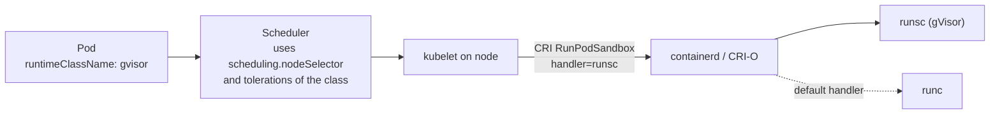

# Runtime class

## Summary

RuntimeClass is a cluster scoped API object that selects the container runtime configuration used to run a Pod's containers. A Pod names a RuntimeClass in `spec.runtimeClassName`, and the kubelet passes the class's *handler* to the CRI runtime. It lets one cluster run some Pods with the default `runc` runtime and others with a stronger isolation runtime such as gVisor or Kata Containers, or with the same runtime but different settings, trading performance for security per workload.

## Prerequisites

- [Node components](../cluster-architecture/node-components.md#container-runtime).
- [Container fundamentals](container-fundamentals.md).

## Core concepts

### Definition and motivation

RuntimeClass is a feature for selecting the container runtime configuration. The container runtime configuration is used to run a Pod's containers.

You can set a different RuntimeClass on different Pods to balance performance against security. For example, if part of your workload deserves a high level of information security assurance, you might schedule those Pods to run in a container runtime that uses hardware virtualization. You then benefit from the extra isolation of the alternative runtime, at the cost of some additional overhead. You can also use RuntimeClass to run different Pods with the same container runtime but with different settings.

*Analogy.* RuntimeClass is like choosing a room type in a hotel: the same booking system (the Pod spec) can put guests in a shared dormitory (`runc`, efficient, thin walls) or a private suite (a VM sandbox, isolated, more expensive). The analogy breaks because the "room" must exist on the node: a handler that is not configured in the runtime makes the Pod fail.

### How it works



1. An administrator configures handlers in the CRI runtime on the nodes (for containerd, `[plugins."io.containerd.cri.v1.runtime".containerd.runtimes.<handler>]`; for CRI-O, `[crio.runtime.runtimes.<handler>]`).
2. The administrator creates a `RuntimeClass` object whose `handler` field names that configuration.
3. A Pod sets `spec.runtimeClassName`. The kubelet passes the handler name to the runtime in the CRI call that creates the Pod sandbox. If the handler is unknown, the Pod fails to start.

Two optional fields add cluster level integration:

- **`scheduling`** (`nodeSelector` and `tolerations`): ensures that Pods with this class land only on nodes that support the handler. The RuntimeClass admission controller merges them into the Pod.
- **`overhead`**: declares the extra resources the sandbox uses (for example the memory of a lightweight VM). The scheduler, quota and kubelet add it to the Pod's requests. See Pod overhead in [Scheduling](../scheduling-preemption-and-eviction/README.md).

### Examples of handlers

| Handler | Isolation | Overhead | Typical use |
| --- | --- | --- | --- |
| `runc` (default) | Linux namespaces and cgroups | Lowest | General workloads |
| `runsc` (gVisor) | User space kernel intercepts system calls | Moderate, some syscall cost | Untrusted code, multi-tenant clusters |
| `kata` (Kata Containers) | Lightweight VM per Pod | Higher memory and start time | Strong isolation, regulated workloads |
| Same runtime, different settings | Same as base | Same | For example a GPU enabled runtime configuration |

## Worked example

A RuntimeClass for gVisor and a Pod that uses it (untested here; assumes `runsc` is configured in containerd on nodes labeled `sandbox=gvisor`; Kubernetes v1.30 or later):

```yaml
apiVersion: node.k8s.io/v1
kind: RuntimeClass
metadata:
  name: gvisor
handler: runsc
scheduling:
  nodeSelector:
    sandbox: gvisor
overhead:
  podFixed:
    memory: "50Mi"
    cpu: "50m"
---
apiVersion: v1
kind: Pod
metadata:
  name: untrusted
spec:
  runtimeClassName: gvisor
  containers:
    - name: app
      image: busybox:1.36
      command: ["sh", "-c", "dmesg | head -3; sleep 3600"]
```

```bash
kubectl logs untrusted      # gVisor prints its own kernel messages, e.g. "Starting gVisor..."
kubectl get pod untrusted -o jsonpath='{.spec.overhead}{"\n"}'   # {"cpu":"50m","memory":"50Mi"}
```

## Trade offs and when to use it

- **Benefits.** Per-workload isolation in a shared cluster without separate node pools for each security level.
- **Costs.** Sandboxed runtimes add CPU, memory and start latency, and some system calls or features (for example certain `/proc` behaviors, host networking, privileged mode) are not supported.
- **Alternative.** Dedicated node pools with taints and tolerations give isolation at the node level; RuntimeClass gives it at the Pod level.

## Common mistakes

- **Creating the RuntimeClass but not configuring the handler on every node.** Pods fail with a sandbox creation error; use `scheduling.nodeSelector` to target only configured nodes.
- **Forgetting `overhead`.** Without it, sandbox memory is not accounted, and nodes can be overcommitted.

## Practice

1. Which field of RuntimeClass is passed to the CRI runtime?
2. How do you make sure Pods with a RuntimeClass land on nodes that support it?
3. Give one reason to use RuntimeClass with the same runtime.

Answers: 1. `handler`. 2. Set `scheduling.nodeSelector` (and `tolerations`) on the RuntimeClass. 3. Different runtime settings, for example a configuration that exposes GPUs or uses different cgroup options.

## Further reading

- [Runtime Class](https://kubernetes.io/docs/concepts/containers/runtime-class/), Kubernetes documentation.
- [Pod Overhead](https://kubernetes.io/docs/concepts/scheduling-eviction/pod-overhead/), Kubernetes documentation.
- [gVisor documentation](https://gvisor.dev/docs/), gVisor project.
- [Kata Containers documentation](https://github.com/kata-containers/kata-containers/tree/main/docs), Kata Containers project.
