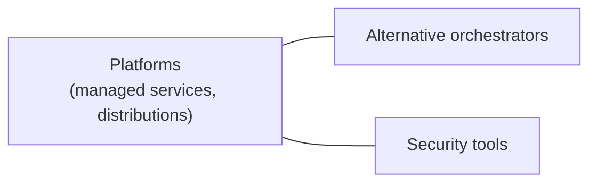

# Ecosystem

Products and projects around Kubernetes: managed services and distributions, alternative orchestrators and third party tools. This area is not a chapter of the Kubernetes documentation Concepts; its sections follow the categories of the [CNCF Cloud Native Landscape](https://landscape.cncf.io/). Notes here describe products in relation to the upstream concepts explained in the other areas.

## Map of the area

## Notes and sections in reading order

1. [Platforms](platforms/README.md): managed Kubernetes services and Kubernetes distributions.
2. [Alternative orchestrators](alternative-orchestrators.md): Docker Swarm and HashiCorp Nomad compared with Kubernetes.
3. [Security tools](security-tools/README.md): container security scanners.

## Planned topics

- Service mesh (Istio, Linkerd, Cilium service mesh)
- Observability tools (Prometheus Operator, Grafana stack, OpenTelemetry Collector)
- Serverless on Kubernetes (Knative)
- Policy engines (Kyverno, Gatekeeper)
- Developer platforms (Backstage)
