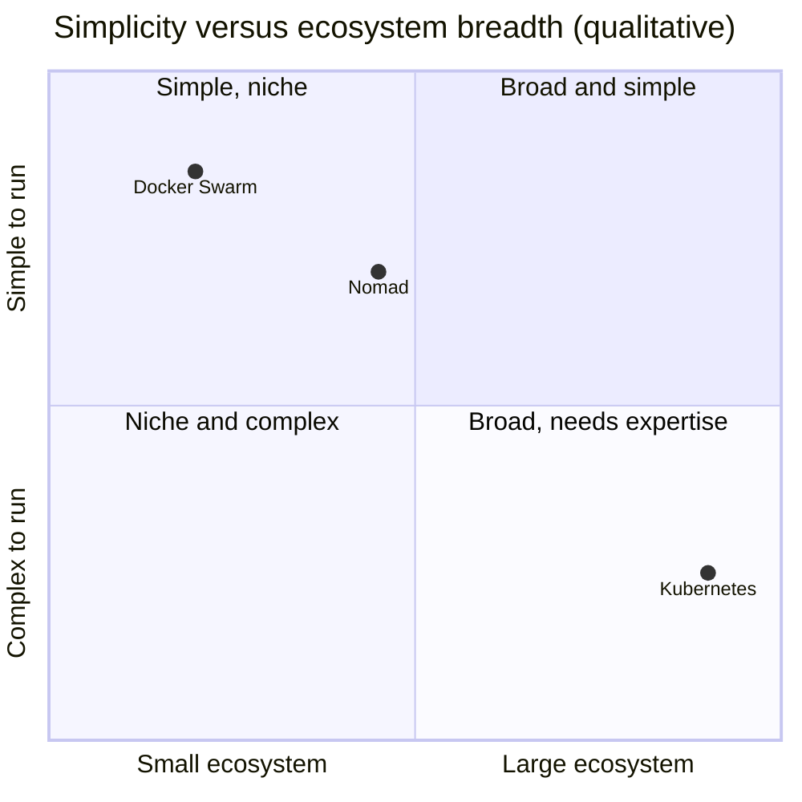

# Alternative orchestrators

## Summary

Kubernetes is not the only container orchestrator. Docker Swarm (Swarm mode in Docker Engine) turns several Docker hosts into one virtual host with services, tasks and built-in load balancing; it is simple and Docker-native but limited in features and extensibility. HashiCorp Nomad is a simpler, flexible scheduler that runs containers, virtual machines and standalone binaries; it is easy to operate but has a smaller ecosystem. They suit smaller or simpler environments; Kubernetes wins on ecosystem and extensibility.

## Prerequisites

- [Container orchestration](../containers/container-orchestration.md).

## Core concepts

### Docker Swarm

Docker Swarm is an open source container orchestration platform native to Docker. It orchestrates clusters of Docker engines and turns several Docker instances into a single virtual host. A Swarm cluster generally consists of three things:

1. **Nodes**: instances of the Docker engine that control the cluster (manager nodes, with Raft consensus) and run the containers (worker nodes).
2. **Services and tasks**: a service declares the desired state (image, replicas); tasks are the individual containers that run it.
3. **Load balancers**: Swarm load balances requests across nodes (the routing mesh) and between tasks of a service.

**Pros**

- Quite simple to install, which suits teams just starting with container orchestration.
- Lightweight.
- Provides automated load balancing between containers.
- Native to Docker, so it works with the Docker CLI and with existing Docker tools such as Docker Compose (stack files).
- Selects suitable nodes in the cluster for container deployment (placement constraints and preferences).
- Has its own Swarm API.

**Cons**

- Strongly tied to the Docker API, which limits its functionality compared with Kubernetes.
- Limited customization options and extensions.

### HashiCorp Nomad

Nomad is not a direct one-to-one alternative to Kubernetes, but it is a significant player in container orchestration. It is a simpler and more flexible orchestrator designed to handle both containerized and non-containerized workloads. It is a single binary, and it integrates with Consul (service discovery) and Vault (secrets). Since 2023, Nomad is licensed under the Business Source License, which matters for some users.

**Pros**

- **Simplicity**: easier to set up and operate than Kubernetes.
- **Flexibility**: handles a wide range of workloads; schedules containers, virtual machines and standalone applications.

**Cons**

- **Smaller ecosystem**: it does not have an ecosystem or community as large as Kubernetes.
- **Limited feature set**: may lack some advanced features and integrations available in Kubernetes.

### Comparison

| Aspect | Kubernetes | Docker Swarm | Nomad |
| --- | --- | --- | --- |
| Workloads | Containers (VMs with KubeVirt) | Docker containers | Containers, VMs, binaries, Java |
| Setup | Complex | Very simple (`docker swarm init`) | Simple (single binary) |
| Extensibility | CRDs, operators, many plugins | Limited | Task drivers, plugins |
| Networking and discovery | Services, DNS, CNI | Overlay networks, routing mesh | Consul integration |
| Ecosystem | Very large (CNCF) | Small | Medium (HashiCorp) |



The positions are a qualitative opinion, not measurements.

## Worked example

The same service on Swarm and on Nomad (untested here; Docker Engine 27, Nomad 1.9):

```bash
docker swarm init
docker service create --name web --replicas 3 --publish 8080:80 nginx:1.27
docker service ls
```

```hcl
# web.nomad.hcl
job "web" {
  datacenters = ["dc1"]
  group "web" {
    count = 3
    network { port "http" { to = 80 } }
    task "nginx" {
      driver = "docker"
      config {
        image = "nginx:1.27"
        ports = ["http"]
      }
    }
  }
}
```

```bash
nomad job run web.nomad.hcl
nomad job status web
```

## Trade offs and when to use it

- **Swarm** for small teams with Docker Compose knowledge and modest needs.
- **Nomad** for mixed workloads (containers plus legacy binaries) and teams already using Consul and Vault.
- **Kubernetes** when you need the ecosystem, extensibility, managed offerings and hiring pool.

## Common mistakes

- **Choosing Kubernetes by default** for a few services on two hosts.
- **Choosing Swarm for growth plans** that will need operators, service meshes or fine-grained policies.

## Practice

1. Name the three parts of a Swarm cluster.
2. What workload types can Nomad schedule that Swarm cannot?

Answers: 1. Nodes, services and tasks, load balancers. 2. Virtual machines and standalone (non-containerized) applications.

## Further reading

- [Swarm mode overview](https://docs.docker.com/engine/swarm/), Docker documentation.
- [Nomad documentation](https://developer.hashicorp.com/nomad/docs), HashiCorp.
- [Nomad vs. Kubernetes](https://developer.hashicorp.com/nomad/docs/nomad-vs-kubernetes), HashiCorp.
