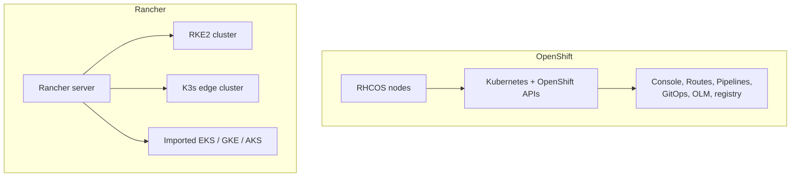

# Kubernetes distributions

## Summary

A Kubernetes distribution packages upstream Kubernetes with an installer, an operating system or node configuration, default add-ons and lifecycle tooling, so that you can run clusters on your own infrastructure or across clouds. Red Hat OpenShift is an enterprise platform that adds developer and operations tooling on top of Kubernetes with automated installation and upgrades of the whole stack. Rancher (SUSE) is a management platform for many Kubernetes clusters, with its own distributions (RKE2, K3s). Both trade added features and support for complexity and, in OpenShift's case, cost.

## Prerequisites

- [Managed Kubernetes services](managed-kubernetes-services.md).

## Core concepts

### Red Hat OpenShift

Red Hat OpenShift is an enterprise Kubernetes platform. It offers automated installation, upgrades and lifecycle management throughout the container stack: the operating system (Red Hat Enterprise Linux CoreOS), Kubernetes and cluster services. It adds a web console, integrated CI/CD (OpenShift Pipelines, based on Tekton) and GitOps (based on Argo CD), routes, an internal registry, stricter security defaults (Security Context Constraints) and the Operator Lifecycle Manager. OKD is its community distribution.

| Pros | Cons |
| --- | --- |
| **Comprehensive platform**: integrates with a broad range of hardware, software and cloud providers. | **Complexity**: can be overwhelming for users new to container orchestration. |
| **Developer friendly**: streamlines application development, deployment and lifecycle management. | **Cost**: potentially higher cost, depending on the deployment model (subscriptions). |

### Rancher

Rancher is a complete software stack for teams adopting containers. It addresses the operational and security challenges of managing multiple Kubernetes clusters, while giving DevOps teams integrated tools for running containerized workloads. It manages clusters it creates (RKE2, K3s) as well as imported clusters (EKS, GKE, AKS and others) from one interface, with centralized authentication, RBAC and policy.

| Pros | Cons |
| --- | --- |
| **User friendly**: simplifies Kubernetes management and makes it more accessible. | **Integration complexities**: integrating with existing systems can be tricky. |
| **Extensive community support**: strong community support and resources. | **Resource demands**: the management server needs adequate resources for good performance. |

The pros and cons above summarize vendor and community comparisons (secondary sources, opinion).



### Other distributions

| Distribution | Focus |
| --- | --- |
| K3s | Lightweight single binary for edge and small clusters |
| RKE2 | Security focused (CIS hardened) distribution from Rancher |
| Talos Linux | Immutable, API-managed OS for Kubernetes |
| MicroK8s | Snap-based distribution from Canonical |
| kubeadm | Upstream tool for bootstrapping clusters (a building block rather than a distribution) |

## Worked example

A local K3s cluster for experiments (untested here; K3s v1.37 on a Linux VM):

```bash
curl -sfL https://get.k3s.io | sh -
sudo k3s kubectl get nodes
sudo k3s kubectl get pods -A     # bundled CoreDNS, Traefik, local-path provisioner, metrics-server
```

## Trade offs and when to use it

- **OpenShift** suits enterprises that want one supported platform with opinionated defaults and are willing to pay for it.
- **Rancher** suits organizations that run many clusters in different places and want one management layer.
- **Lightweight distributions** suit edge, labs and CI.

## Common mistakes

- **Assuming upstream manifests run unchanged on OpenShift**: its default security constraints reject containers that run as root or as fixed UIDs.
- **Underestimating the Rancher server** as a critical component that also needs HA and backups.

## Practice

1. What does OpenShift manage beyond Kubernetes itself?
2. What is Rancher's main purpose?

Answers: 1. The operating system of the nodes and cluster services, with automated installation and upgrades of the whole stack, plus developer tooling. 2. Managing many Kubernetes clusters (created or imported) from one place.

## Further reading

- [Red Hat OpenShift documentation](https://docs.redhat.com/en/documentation/openshift_container_platform/), Red Hat.
- [Rancher documentation](https://ranchermanager.docs.rancher.com/), SUSE.
- [K3s documentation](https://docs.k3s.io/), K3s project.
