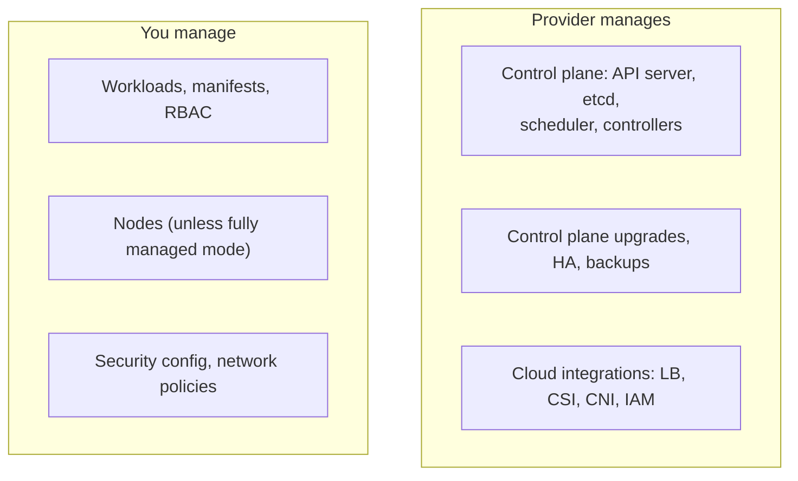

# Managed Kubernetes services

## Summary

Managed Kubernetes services run the control plane for you (API server, etcd, scheduler, controller managers, upgrades, availability) and integrate the cluster with the provider's networking, identity, storage and load balancers, while you manage workloads and, depending on the mode, the nodes. The three largest are Amazon EKS, Google Kubernetes Engine (GKE) and Azure Kubernetes Service (AKS). They differ mainly in how deeply they integrate with their cloud, how much node management they automate, and their pricing models; all run conformant upstream Kubernetes.

## Prerequisites

- [Cluster architecture overview](../../cluster-architecture/cluster-architecture-overview.md).

## Core concepts

### Shared responsibility



### Amazon EKS (Elastic Kubernetes Service)

Amazon EKS is the fully managed Kubernetes service of Amazon Web Services (AWS). It automates key tasks such as patching, node provisioning (with managed node groups, Fargate or EKS Auto Mode) and updates. EKS is integrated with AWS services such as Elastic Load Balancing, IAM and Amazon VPC, which makes it a natural choice for AWS-centric organizations.

| Pros | Cons |
| --- | --- |
| **Scalability**: supports horizontal scaling, so applications handle increased load (Cluster Autoscaler, Karpenter). | **Cost structure**: understanding and managing costs can be hard because of AWS's complex pricing model (per-cluster fee, nodes, load balancers, data transfer). |
| **AWS integration**: integration with many AWS services adds functionality and ease of use. | **Complexity for beginners**: a steep learning curve for those new to AWS or Kubernetes. |
| **Security**: IAM for fine-grained access control (EKS Pod Identity, IAM roles for service accounts). | |

### Google Kubernetes Engine (GKE)

Google Kubernetes Engine is a managed environment for deploying, managing and scaling applications on Google Cloud infrastructure. Kubernetes originated at Google (from Borg), and GKE builds on Google's experience with containers, which makes it a reliable platform for container deployment. GKE has two modes: Standard (you manage node pools) and Autopilot (Google manages nodes, billing per Pod resources).

| Pros | Cons |
| --- | --- |
| **Advanced cluster management**: an easy-to-use interface for managing and scaling clusters, release channels, Autopilot. | **Learning curve**: familiarity with Google Cloud is required to use GKE fully. |
| **Google Cloud integration**: direct integration with Google's cloud services adds performance and analytics capabilities. | **Google-centric tools**: some tools and services are proprietary, which may limit interoperability with non-Google environments. |
| **Ecosystem**: access to Google services such as BigQuery and AI and machine learning services. | |

### Azure Kubernetes Service (AKS)

Azure Kubernetes Service is Microsoft's managed Kubernetes service for deploying, managing and scaling Kubernetes on Azure. AKS offers integrated developer tools and DevOps experiences, which makes it a strong option for enterprises already invested in the Microsoft ecosystem.

| Pros | Cons |
| --- | --- |
| **Azure integration**: integration with Azure services such as Microsoft Entra ID (formerly Azure Active Directory) and Azure DevOps improves productivity and collaboration. | **Complexity for non-Azure users**: users unfamiliar with Azure may find it hard to navigate and use all features of AKS. |
| **Security and compliance**: Azure security and identity services, important for enterprises. | **Integration limitations**: AKS integrates well within Azure, but can be limited when combined with other cloud services. |
| **Developer tools**: integration with Azure developer tools makes deploying and managing applications easier. | |

### Comparison

The descriptions above summarize vendor positioning (secondary sources). Prices, limits and features change often; check the provider documentation for current values.

| Aspect | EKS | GKE | AKS |
| --- | --- | --- | --- |
| Fully managed node mode | EKS Auto Mode, Fargate | Autopilot | AKS Automatic, virtual nodes |
| Default CNI approach | VPC CNI (Pod IPs from the VPC) | VPC-native (alias IPs), Dataplane V2 (Cilium) | Azure CNI (overlay or VPC), Cilium option |
| Workload identity | EKS Pod Identity, IRSA | Workload Identity Federation | Microsoft Entra Workload ID |
| Upgrade channels | Standard and extended support | Release channels (rapid, regular, stable, extended) | Upgrade channels |

TODO: Verify the comparison table rows (mode names, CNI defaults) against current EKS, GKE and AKS documentation.

## Worked example

Creating a small cluster on each service (untested here; CLI versions current in 2026; names and regions are placeholders):

```bash
eksctl create cluster --name demo --region eu-central-1 --nodes 2
gcloud container clusters create-auto demo --region europe-west1
az aks create --resource-group demo-rg --name demo --node-count 2 --generate-ssh-keys
kubectl get nodes        # after fetching credentials for each cluster
```

## Trade offs and when to use it

- **Managed** removes control plane operations and gives integrated security and networking; you accept the provider's version window, defaults and pricing.
- **Choose by ecosystem**: the cloud where your data, identity and other services live usually decides.
- **Portability** comes from upstream APIs; avoid provider-specific features where portability matters.

## Common mistakes

- **Assuming the provider manages nodes and add-ons** in standard modes; node upgrades and add-on versions are often your job.
- **Ignoring egress and load balancer costs.**
- **Treating managed observability as sufficient** (see [Observability](../../cluster-administration/observability/observability.md#best-practices)).

## Practice

1. What does a managed service take over from you?
2. Which GKE mode manages nodes for you?
3. Name one disadvantage of each service listed above.

Answers: 1. The control plane: API server, etcd, scheduler, controller managers, their upgrades and availability. 2. Autopilot. 3. EKS: complex cost structure; GKE: Google-centric tools; AKS: harder for non-Azure users.

## Further reading

- [Amazon EKS documentation](https://docs.aws.amazon.com/eks/), AWS.
- [Google Kubernetes Engine documentation](https://cloud.google.com/kubernetes-engine/docs), Google Cloud.
- [Azure Kubernetes Service documentation](https://learn.microsoft.com/azure/aks/), Microsoft.
- [Certified Kubernetes Software Conformance](https://www.cncf.io/training/certification/software-conformance/), CNCF.
