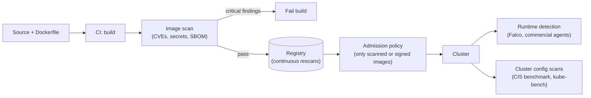

# Container security scanners

## Summary

Security scanners find known vulnerabilities (CVEs), misconfigurations, secrets and license issues in container images, manifests and running clusters before and after deployment. Integrated into CI pipelines and admission control, they stop vulnerable or misconfigured workloads from reaching production; commercial platforms add compliance reporting and runtime protection. Common options include Trivy, Grype (successor of Anchore Engine), OpenSCAP and commercial platforms such as Aqua Security, Prisma Cloud (formerly Twistlock) and Sysdig Secure.

This note is defensive: scanners reduce the attack surface of your own workloads.

## Prerequisites

- [Images](../../containers/images.md).
- [Security overview](../../security/security-overview.md).

## Core concepts

### What scanners do

Kubernetes security scanners help identify vulnerabilities and potential security threats in container images before deployment. They offer features such as vulnerability scanning, compliance checks and runtime protection for Kubernetes environments.

By integrating scanners into their pipelines, organizations help protect the security and integrity of their Kubernetes deployments and reduce the risk of security breaches and data loss.



| Scan type | Finds | Example tools |
| --- | --- | --- |
| Image vulnerability scan | Packages with known CVEs | Trivy, Grype, registry scanners |
| Configuration scan | Risky manifest settings (privileged, no limits) | Trivy, Checkov, kube-score |
| Cluster benchmark | Control plane and node misconfiguration | kube-bench (CIS), Trivy |
| Compliance scan | Policy profiles (SCAP, CIS) on hosts and images | OpenSCAP |
| Runtime protection | Suspicious behavior in running containers | Falco, Sysdig Secure, Aqua, Prisma Cloud |

### Popular options

| Tool | Type | Notes |
| --- | --- | --- |
| Trivy | Open source (Aqua Security) | Images, file systems, Git repos, Kubernetes clusters, SBOMs, misconfigurations, secrets. |
| Grype and Syft | Open source (Anchore) | Grype scans for vulnerabilities, Syft generates SBOMs; they replace the deprecated Anchore Engine. |
| OpenSCAP | Open source | SCAP-based compliance and vulnerability scanning of hosts and images. |
| Aqua Security | Commercial | Full lifecycle platform: scanning, admission, runtime protection. |
| Prisma Cloud (Twistlock) | Commercial (Palo Alto Networks) | Twistlock was acquired in 2019 and became part of Prisma Cloud. |
| Sysdig Secure | Commercial | Scanning plus runtime security built on Falco. |

## Worked example

Scan an image and a cluster with Trivy (untested here; Trivy v0.56):

```bash
trivy image --severity HIGH,CRITICAL --exit-code 1 nginx:1.27      # non-zero exit fails CI on findings
trivy image --format cyclonedx --output sbom.json nginx:1.27       # SBOM for supply chain records
trivy k8s --report summary cluster                                 # workloads and misconfigurations
```

## Trade offs and when to use it

- **Scanning finds known issues only**; it does not detect zero-days or runtime attacks.
- **Noise**: many CVEs are not exploitable in context; triage with severity, fix availability and reachability, and keep base images minimal (distroless) to reduce findings.
- **Open source scanners** cover most needs; commercial platforms add central policy, reporting and runtime protection.

## Common mistakes

- **Scanning only at build time**: new CVEs appear after deployment; rescan registries and running images.
- **Failing builds on every finding**, which leads teams to disable the scanner.
- **No admission enforcement**, so unscanned images still run.

## Practice

1. What can an image scanner not detect?
2. Why rescan images that already passed?
3. Which tool checks a cluster against the CIS Kubernetes Benchmark?

Answers: 1. Unknown vulnerabilities and malicious runtime behavior. 2. New CVEs are published for packages that were clean at build time. 3. kube-bench (Trivy can also run CIS checks).

## Further reading

- [Trivy documentation](https://trivy.dev/), Aqua Security.
- [Grype](https://github.com/anchore/grype), Anchore.
- [OpenSCAP](https://www.open-scap.org/), OpenSCAP project.
- [kube-bench](https://github.com/aquasecurity/kube-bench), Aqua Security.
- [Security Checklist](https://kubernetes.io/docs/concepts/security/security-checklist/), Kubernetes documentation.
