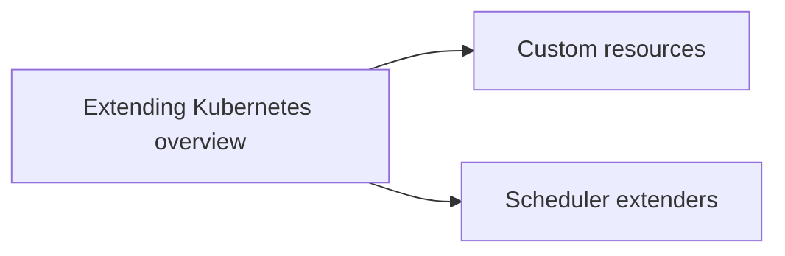

# Extending Kubernetes

Ways to change and extend Kubernetes without changing its source code: the extension patterns and points, custom resources and controllers, and custom scheduling logic. Corresponds to the "Extending Kubernetes" chapter of the Kubernetes documentation Concepts.

## Map of the area

## Notes in reading order

1. [Extending Kubernetes](extending-kubernetes-overview.md): patterns, extension points, choice flowchart, client, API, API access, infrastructure and scheduling extensions.
2. [Custom resources](custom-resources.md): custom resources, controllers and operators, declarative APIs, CRDs and aggregated APIs.
3. [Scheduler extenders](scheduler-extenders.md): multiple schedulers, framework plugins and extender webhooks, limitations.

## Planned topics

- Operator pattern (in depth)
- Kubernetes API aggregation layer
- Network plugins (CNI)
- Device plugins and dynamic resource allocation drivers
- Dynamic admission control (webhooks and CEL admission policies)
- Writing controllers with controller-runtime
