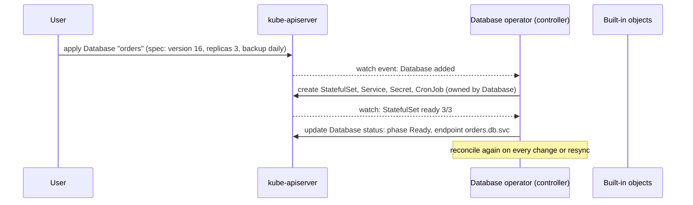
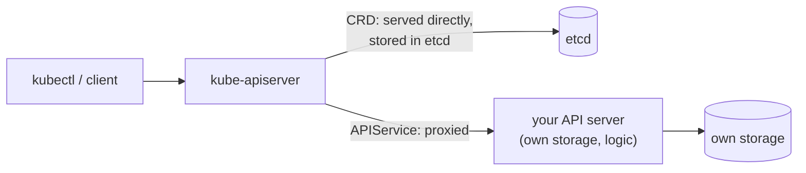

# Custom resources

## Summary

A custom resource extends the Kubernetes API with a new kind of object that is not part of a default installation. On its own it is structured data stored and served like built-in objects, usable with `kubectl` and RBAC. Combined with a custom controller that reconciles it, it becomes a declarative API; packaged with domain knowledge, this is the operator pattern. Custom resources are added either with a CustomResourceDefinition (CRD), which needs no programming and is served by the main API server, or through API aggregation, where your own API server handles the resource behind the main one. Use them when your API is declarative, CRUD-like and small; use a standalone API otherwise.

## Prerequisites

- [Extending Kubernetes](extending-kubernetes-overview.md).
- [The Kubernetes API](../overview/kubernetes-api.md).

## Core concepts

### Custom resources

*Custom resources* are extensions of the Kubernetes API.

A *resource* is an endpoint in the Kubernetes API that stores a collection of API objects of a certain kind; for example, the built-in `pods` resource contains a collection of Pod objects.

A *custom resource* is an extension of the Kubernetes API that is not necessarily available in a default Kubernetes installation. It represents a customization of a particular Kubernetes installation. However, many core Kubernetes functions are now built using custom resources, making Kubernetes more modular (for example VolumeSnapshots and the Gateway API are delivered as CRDs).

Custom resources can appear and disappear in a running cluster through dynamic registration, and cluster administrators can update custom resources independently of the cluster itself. Once a custom resource is installed, users can create and access its objects using `kubectl`, just as they do for built-in resources like Pods.

### Custom controllers and operators

Custom controllers automate the management of custom resources that Kubernetes does not support natively. They are implemented as Kubernetes controllers that watch custom resources and react to changes in their state. Custom resources are created by extending the Kubernetes API with new resource types specific to an organization's needs.

Custom controllers can be developed in various programming languages and frameworks: client-go and controller-runtime with Kubebuilder, the Operator Framework (Operator SDK), Kopf for Python, and others. The Operator Framework provides tools and practices for developing, testing and deploying custom controllers.

On their own, custom resources let you store and retrieve structured data. When you combine a custom resource with a *custom controller*, custom resources provide a true *declarative API*.

The Kubernetes declarative API enforces a separation of responsibilities. You declare the desired state of your resource. The Kubernetes controller keeps the current state of Kubernetes objects in sync with your declared desired state. This is in contrast to an imperative API, where you *instruct* a server what to do.

You can deploy and update a custom controller on a running cluster, independently of the cluster's lifecycle. Custom controllers can work with any kind of resource, but they are especially effective when combined with custom resources. The **operator pattern** combines custom resources and custom controllers to encode domain knowledge for specific applications into an extension of the Kubernetes API.



*Analogy.* A CRD is a new form at a government office: it defines the fields people can fill in, and the office files the forms. A controller is the clerk who reads each filed form and does the work. The analogy breaks because a controller keeps re-checking every form forever and fixes reality whenever it drifts, which no clerk does.

### When to add a custom resource

When creating a new API, consider whether to aggregate it with the Kubernetes cluster APIs or let it stand alone.

| Consider API aggregation (custom resource) if: | Prefer a stand-alone API if: |
| --- | --- |
| Your API is declarative. | Your API does not fit the declarative model. |
| You want your new types to be readable and writable with `kubectl`. | `kubectl` support is not required. |
| You want to view your new types in a Kubernetes UI, such as the dashboard, alongside built-in types. | Kubernetes UI support is not required. |
| You are developing a new API. | You already have a program that serves your API and works well. |
| You are willing to accept the format restrictions that Kubernetes puts on REST resource paths, such as API groups and namespaces. | You need specific REST paths to be compatible with an already defined REST API. |
| Your resources are naturally scoped to a cluster or to namespaces of a cluster. | Cluster or namespace scoped resources are a poor fit; you need control over the specifics of resource paths. |
| You want to reuse Kubernetes API support features. | You do not need those features. |

### Declarative and imperative APIs

In a declarative API, typically:

- Your API consists of a relatively small number of relatively small objects (resources).
- The objects define configuration of applications or infrastructure.
- The objects are updated relatively infrequently.
- Humans often need to read and write the objects.
- The main operations on the objects are CRUD-y (creating, reading, updating and deleting).
- Transactions across objects are not required: the API represents a desired state, not an exact state.

Imperative APIs are not declarative. Signs that your API might not be declarative include:

- The client says "do this", and then gets a synchronous response back when it is done.
- The client says "do this", and then gets an operation ID back, and has to check a separate Operation object to determine completion of the request.
- You talk about Remote Procedure Calls (RPCs).
- Directly storing large amounts of data; for example, more than a few kB per object, or more than thousands of objects.
- High bandwidth access (tens of requests per second sustained) is needed.
- Storing end-user data (such as images, PII and so on) or other large-scale data processed by applications.
- The natural operations on the objects are not CRUD-y.
- The API is not easily modeled as objects.
- You chose to represent pending operations with an operation ID or an operation object.

### Adding custom resources

Kubernetes provides two ways to add custom resources to a cluster:

- **CRDs** are simple and can be created without any programming.
- **API aggregation** requires programming, but gives more control over API behaviors such as how data is stored and conversion between API versions.

Kubernetes provides these two options to meet the needs of different users, so that neither ease of use nor flexibility is compromised.

Aggregated APIs are subordinate API servers that sit behind the primary API server, which acts as a proxy. This arrangement is called API Aggregation (AA). To users, the Kubernetes API appears extended.

CRDs let users create new types of resources without adding another API server. You do not need to understand API aggregation to use CRDs.

Regardless of how they are installed, the new resources are referred to as custom resources to distinguish them from built-in Kubernetes resources (like Pods).



**CustomResourceDefinitions.** The CustomResourceDefinition API resource lets you define custom resources. Defining a CRD object creates a new custom resource with a name and schema that you specify. The Kubernetes API serves and handles the storage of your custom resource. The name of the CRD object itself must be a valid DNS subdomain name derived from the defined resource name and its API group (`<plural>.<group>`). This frees you from writing your own API server to handle the custom resource, but the generic nature of the implementation means you have less flexibility than with API server aggregation. CRDs support OpenAPI v3 validation schemas, CEL validation rules, defaulting, versioning with conversion webhooks, and the `status` and `scale` subresources.

**API server aggregation.** Usually, each resource in the Kubernetes API requires code that handles REST requests and manages persistent storage of objects. The main Kubernetes API server handles built-in resources like Pods and Services, and can also handle custom resources in a generic way through CRDs. The aggregation layer lets you provide specialized implementations for your custom resources by writing and deploying your own API server. The main API server delegates requests for your custom resources to your server, making them available to all its clients.

### CRDs compared with aggregated APIs

CRDs are easier to use. Aggregated APIs are more flexible. Choose the method that best meets your needs. Typically, CRDs are a good fit if:

- you have a handful of fields,
- you are using the resource within your company, or as part of a small open source project (as opposed to a commercial product).

| CRDs | Aggregated API |
| --- | --- |
| Do not require programming. Users can choose any language for a CRD controller. | Requires programming and building a binary and image. |
| No additional service to run; CRDs are handled by the API server. | An additional service to create, which could fail. |
| No ongoing support once the CRD is created. Bug fixes are picked up as part of normal Kubernetes control plane upgrades. | May need to periodically pick up bug fixes from upstream and rebuild and update the aggregated API server. |
| No need to handle multiple versions of your API; for example, when you control the client for this resource, you can upgrade it in sync with the API. | You need to handle multiple versions of your API; for example, when developing an extension to share with the world. |

## Worked example

A minimal CRD and an object of it (untested here; Kubernetes v1.30 or later):

```yaml
apiVersion: apiextensions.k8s.io/v1
kind: CustomResourceDefinition
metadata:
  name: backups.ops.example.com        # <plural>.<group>
spec:
  group: ops.example.com
  scope: Namespaced
  names:
    plural: backups
    singular: backup
    kind: Backup
    shortNames: [bk]
  versions:
    - name: v1
      served: true
      storage: true
      subresources:
        status: {}
      schema:
        openAPIV3Schema:
          type: object
          properties:
            spec:
              type: object
              required: [schedule, target]
              properties:
                schedule: { type: string }
                target: { type: string }
                retentionDays: { type: integer, minimum: 1, default: 7 }
            status:
              type: object
              properties:
                lastSuccessfulRun: { type: string, format: date-time }
---
apiVersion: ops.example.com/v1
kind: Backup
metadata:
  name: orders-db
spec:
  schedule: "0 2 * * *"
  target: postgres://orders
```

```bash
kubectl apply -f backup-crd.yaml
kubectl get bk                                   # orders-db
kubectl get backup orders-db -o jsonpath='{.spec.retentionDays}{"\n"}'   # 7 (defaulted by the schema)
kubectl apply -f - <<'EOF'
apiVersion: ops.example.com/v1
kind: Backup
metadata: { name: broken }
spec: { schedule: "daily" }
EOF
# The Backup "broken" is invalid: spec.target: Required value
```

Nothing happens to databases yet: without a controller, the Backup objects are only stored data.

## Trade offs and when to use it

- **CRDs** are the default choice for declarative extensions; they inherit RBAC, watch, audit and kubectl support.
- **Aggregated APIs** fit when data should not live in etcd (metrics), when storage or conversion is special, or when the API is not CRUD-like.
- **Operators** automate day-2 operations but are critical software: a buggy operator can damage the systems it manages.

## Common mistakes

- **Storing large or high-churn data in custom resources**, which loads etcd and every watcher.
- **No status subresource**, so controllers and users overwrite each other's fields.
- **No schema validation**, which lets invalid objects in and moves errors into the controller.
- **Deleting a CRD**, which deletes all its objects.

## Practice

1. What does a custom resource give you without a controller?
2. Name four signs that an API is not declarative.
3. When would you choose an aggregated API over a CRD?
4. What is the operator pattern?

Answers: 1. Stored, validated, RBAC-protected structured data accessible with kubectl, but no behavior. 2. Synchronous "do this" calls, operation IDs, RPC thinking, large data, high request rates, end-user data, non-CRUD operations (any four). 3. When you need custom storage, special conversion or behavior, or the data should not be in etcd. 4. Custom resources plus custom controllers that encode the operational knowledge of a human operator for a specific application.

## Further reading

- [Custom Resources](https://kubernetes.io/docs/concepts/extend-kubernetes/api-extension/custom-resources/), Kubernetes documentation.
- [Extend the Kubernetes API with CustomResourceDefinitions](https://kubernetes.io/docs/tasks/extend-kubernetes/custom-resources/custom-resource-definitions/), Kubernetes documentation.
- [Operator pattern](https://kubernetes.io/docs/concepts/extend-kubernetes/operator/), Kubernetes documentation.
- [The Kubebuilder Book](https://book.kubebuilder.io/), Kubernetes SIGs.
