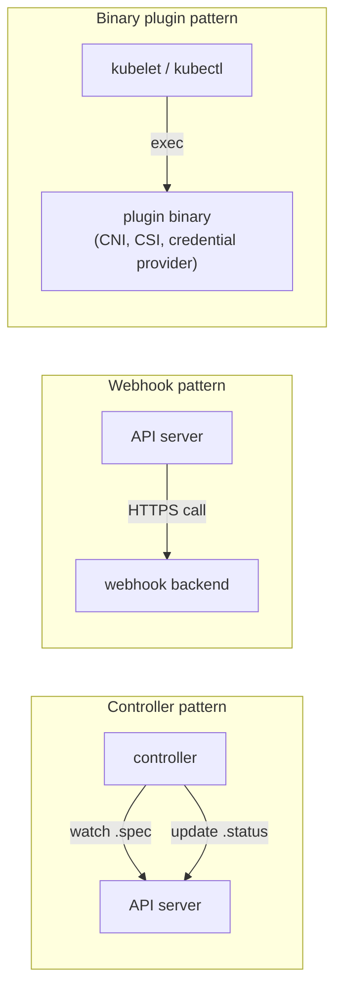
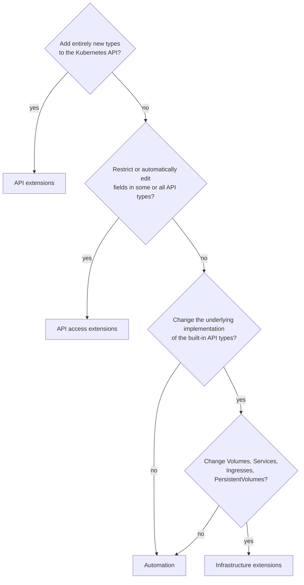
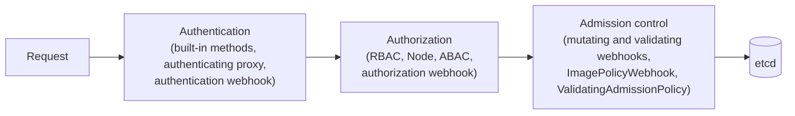

# Extending Kubernetes

## Summary

Kubernetes is built to be extended without changing its source code. Extensions follow two patterns: *controllers* that are clients of the API (read `.spec`, act, write `.status`), and *webhooks* or *binary plugins* that Kubernetes calls. They plug into seven extension points: kubectl plugins on the client, API access extensions (authentication, authorization, admission) in the API server, API extensions (custom resources and the aggregation layer), the scheduler, controllers, network plugins on the kubelet, and device plugins (plus storage plugins and image credential providers). A short decision flow picks the right kind: new types, changed behavior of existing types, or infrastructure.

## Prerequisites

- [The Kubernetes API](../overview/kubernetes-api.md).
- [Control plane](../cluster-architecture/control-plane.md).

## Core concepts

### What extensions are

Kubernetes extensions and APIs customize the behavior of Kubernetes and add new capabilities. Extensions include Custom Resource Definitions (CRDs), custom controllers, custom scheduler extenders and custom metrics APIs.

Extensions are software components that extend and deeply integrate with Kubernetes. They adapt it to support new types and new kinds of hardware.

Many cluster administrators use a hosted or distribution instance of Kubernetes. These clusters come with extensions pre-installed. As a result, most Kubernetes users do not need to install extensions, and even fewer need to author new ones.

### Extension patterns

Kubernetes is designed to be automated by writing client programs. Any program that reads and/or writes to the Kubernetes API can provide useful automation. Automation can run on the cluster or off it. By following the guidance in the documentation, you can write highly available and robust automation that works with any Kubernetes cluster, including hosted clusters and managed installations.

A specific pattern for writing client programs that work well with Kubernetes is the **controller pattern**. Controllers typically read an object's `.spec`, possibly do things, and then update the object's `.status`. A controller is a client of the Kubernetes API.

When Kubernetes is the client and calls out to a remote service, Kubernetes calls this a **webhook**, and the remote service a *webhook backend*. As with custom controllers, webhooks add a point of failure.

In the webhook model, Kubernetes makes a network request to a remote service. With the alternative **binary plugin** model, Kubernetes executes a binary (program). Binary plugins are used by the kubelet (for example CSI storage plugins and CNI network plugins) and by kubectl.



### Extension points

The figure shows where extensions plug into a cluster: (1) clients such as kubectl, (2) the API server's request handling, (3) resources served by the API server, (4) the scheduler, (5) controllers, (6) network plugins and (7) device plugins on the nodes.


1. Users often interact with the Kubernetes API using `kubectl`. Plugins customize the behavior of clients. There are generic extensions that apply to different clients, as well as specific ways to extend `kubectl`.
2. The API server handles all requests. Several types of extension points in the API server allow authenticating requests, blocking them based on their content, editing content, and handling deletion. These are described under [API access extensions](#api-access-extensions).
3. The API server serves various kinds of *resources*. *Built-in resource kinds*, such as `pods`, are defined by the Kubernetes project and cannot be changed. You can add [custom resources](custom-resources.md) and aggregated APIs.
4. The Kubernetes scheduler decides which nodes to place Pods on. There are several ways to extend scheduling, described under [Scheduling extensions](#scheduling-extensions).
5. Much of the behavior of Kubernetes is implemented by programs called controllers, which are clients of the API server. Controllers are often used together with custom resources.
6. The kubelet runs on servers (nodes) and helps Pods appear like virtual servers with their own IPs on the cluster network. Network plugins allow different implementations of Pod networking.
7. You can use device plugins to integrate custom hardware or other special node-local facilities and make them available to Pods. The kubelet includes support for working with device plugins.

### Extension point choice flowchart

If you are unsure where to start, this flowchart helps. Some solutions combine several types of extensions.



### Client extensions

Plugins for kubectl are separate binaries that add or replace the behavior of specific subcommands (any executable named `kubectl-<name>` on the `PATH`; Krew is a plugin manager). The `kubectl` tool can also integrate with credential plugins (exec plugins in kubeconfig, for example for cloud authentication). These extensions affect only an individual user's local environment, so they cannot enforce site-wide policies.

### API extensions

**Custom resource definitions.** Consider adding a *custom resource* to Kubernetes if you want to define new controllers, application configuration objects or other declarative APIs, and manage them with Kubernetes tools such as `kubectl`. See [Custom resources](custom-resources.md).

**API aggregation layer.** You can use the API aggregation layer to integrate additional services, such as metrics, with the Kubernetes API (for example `metrics.k8s.io` served by metrics-server).

**Combining new APIs with automation.** A combination of a custom resource API and a control loop is called the *controllers* pattern. If your controller takes the place of a human operator deploying infrastructure based on a desired state, it may follow the **operator pattern**, often used for stateful applications. You can also use custom APIs and control loops to control other resources, such as storage or policies (for example access control restrictions).

**Changing built-in resources.** When you extend the Kubernetes API by adding custom resources, the added resources always fall into new API groups. You cannot replace or change existing API groups. Adding an API does not directly change the behavior of existing APIs (such as Pods), whereas *API access extensions* do.

### API access extensions

When a request reaches the API server, it is first *authenticated*, then *authorized*, and then subject to various types of *admission control* (some requests are in fact not authenticated and get special treatment).



**Authentication** maps headers or certificates in all requests to a user name for the client making the request. Kubernetes has several built-in authentication methods. It can also sit behind an authenticating proxy, and it can send a token from an `Authorization:` header to a remote service for verification (an authentication webhook) if the built-in methods do not meet your needs.

**Authorization** determines whether specific users can read, write and do other operations on API resources. It works at the level of whole resources: it does not discriminate based on arbitrary object fields. If the built-in authorization options do not meet your needs, an authorization webhook calls out to custom code that makes the decision.

**Dynamic admission control.** After a request is authorized, if it is a write operation, it also goes through admission control steps. In addition to the built-in steps, there are several extensions:

- The ImagePolicyWebhook restricts which images can be run in containers.
- To make arbitrary admission decisions, a general admission webhook can be used. Admission webhooks can reject creations or updates. Some admission webhooks modify the incoming request data before it is handled further by Kubernetes (mutating webhooks).
- ValidatingAdmissionPolicy and MutatingAdmissionPolicy express such rules in CEL inside the API server, without a webhook.

### Infrastructure extensions

**Device plugins** allow a node to discover new node resources (in addition to the built-in ones like CPU and memory) through a device plugin, and to allocate them to containers (for example GPUs, FPGAs, high performance NICs).

**Storage plugins.** Container Storage Interface (CSI) plugins extend Kubernetes with support for new kinds of volumes. The volumes can be backed by durable external storage, provide ephemeral storage, or offer a read-only interface to information using a file system paradigm. See [Volumes](../storage/volumes.md#out-of-tree-volume-plugins).

**Network plugins.** A cluster needs a *network plugin* to have a working Pod network and to support other aspects of the Kubernetes network model. Network plugins let Kubernetes work with different networking topologies and technologies. See [Kubernetes network model](../services-and-networking/kubernetes-network-model.md#network-plugins-cni).

**Kubelet image credential provider plugins.** These are plugins for the kubelet to dynamically retrieve image registry credentials. The credentials are then used when pulling images from container image registries that match the configuration. The plugins can communicate with external services or use local files to obtain credentials. This way, the kubelet does not need static credentials for each registry, and it can support various authentication methods and protocols.

### Scheduling extensions

The scheduler is a special type of controller that watches Pods and assigns them to nodes. The default scheduler can be replaced entirely, while continuing to use other Kubernetes components, or several schedulers can run at the same time. This is a significant undertaking, and almost all Kubernetes users find they do not need to modify the scheduler. Lighter options are scheduler profiles and plugins ([Scheduling framework](../scheduling-preemption-and-eviction/scheduling-framework.md)) and webhooks ([Scheduler extenders](scheduler-extenders.md)).

| Need | Extension kind | Example |
| --- | --- | --- |
| New declarative object | CRD + controller | `Certificate` from cert-manager |
| Custom API storage or logic | Aggregated API server | `metrics.k8s.io` |
| Enforce policy on objects | Validating admission (webhook or CEL policy) | Kyverno, Gatekeeper |
| Inject sidecars or defaults | Mutating admission webhook | Istio sidecar injector |
| New hardware | Device plugin or DRA driver | NVIDIA device plugin |
| New storage backend | CSI driver | AWS EBS CSI driver |
| Pod networking | CNI plugin | Cilium |
| Placement logic | Scheduler plugin or extender | Coscheduling plugin |

## Worked example

Inventory of extensions in a cluster (untested here; Kubernetes v1.30 or later):

```bash
kubectl get crd                                              # API extensions: custom resources
kubectl get apiservices | grep -v Local                      # aggregated APIs
kubectl get validatingwebhookconfigurations,mutatingwebhookconfigurations
kubectl get validatingadmissionpolicies 2>/dev/null
kubectl get csidrivers                                       # storage plugins
kubectl get nodes -o jsonpath='{.items[0].status.allocatable}{"\n"}'   # device plugin resources appear here
kubectl plugin list                                          # client extensions
```

## Trade offs and when to use it

- **Prefer configuration over code**: scheduler profiles, CEL admission policies and existing operators before writing webhooks or controllers.
- **Webhooks add latency and failure points** to every matching request; set `failurePolicy`, timeouts and namespace selectors carefully.
- **Controllers are flexible** but must be idempotent, handle restarts and use leader election.

## Common mistakes

- **A failing webhook with `failurePolicy: Fail`** on all resources, which blocks the whole cluster (including fixing the webhook).
- **Trying to change built-in resource schemas** instead of adding new types or admission logic.
- **Writing a custom scheduler** when topology spread, taints or a scheduler profile would do.

## Practice

1. What is the difference between a controller and a webhook in terms of who calls whom?
2. You want to forbid images from public registries. Which extension point?
3. You want a `Database` object that creates and backs up databases. Which extension point?
4. Why can kubectl plugins not enforce site-wide policy?

Answers: 1. A controller is a client of the API server; with a webhook, the API server is the client of a remote service. 2. API access extensions: validating admission (webhook, CEL policy or ImagePolicyWebhook). 3. API extensions: a CRD plus a controller (operator). 4. They run only on the individual user's machine.

## Further reading

- [Extending Kubernetes](https://kubernetes.io/docs/concepts/extend-kubernetes/), Kubernetes documentation.
- [Dynamic Admission Control](https://kubernetes.io/docs/reference/access-authn-authz/extensible-admission-controllers/), Kubernetes documentation.
- [Kubernetes API Aggregation Layer](https://kubernetes.io/docs/concepts/extend-kubernetes/api-extension/apiserver-aggregation/), Kubernetes documentation.
- [Device Plugins](https://kubernetes.io/docs/concepts/extend-kubernetes/compute-storage-net/device-plugins/), Kubernetes documentation.
