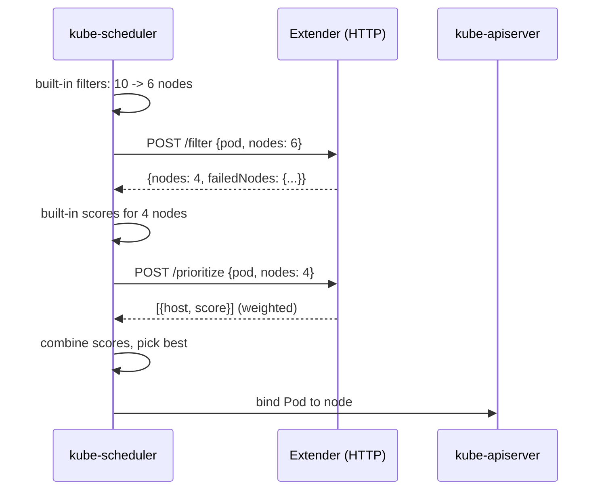

# Scheduler extenders

## Summary

When the default scheduler does not express a placement rule, there are three ways to add your own logic: run additional schedulers next to the default one (Pods choose with `spec.schedulerName`), build a custom scheduler from the scheduling framework with your own plugins, or attach a *scheduler extender*: a webhook that the default scheduler calls during filtering ("filter") and scoring ("prioritize"), and optionally for preemption and binding. Extenders are easy to write and keep you on the upstream scheduler, but they add HTTP round trips, act only at a few points, should only remove nodes rather than add them, and must build their own cluster cache.

## Prerequisites

- [kube-scheduler](../scheduling-preemption-and-eviction/kube-scheduler.md).
- [Scheduling framework](../scheduling-preemption-and-eviction/scheduling-framework.md).

## Core concepts

### Motivation

Custom scheduler extenders add scheduling logic based on custom metrics and constraints. They run as separate services next to the Kubernetes scheduler, which calls them during its scheduling cycle. They can implement placement policies specific to an organization, in any programming language: the scheduler sends the candidate Pod and nodes, the extender applies its rules and returns the result to the scheduler.

Kubernetes is known for orchestrating and managing workloads, and it also provides a series of extension mechanisms that let developers meet their own needs. Extensibility matters for open source software: developers can solve their problems without modifying the upstream source code, and contribute back upstream when appropriate.

### The options

**Multiple schedulers.** Run a custom scheduler alongside the default one; each handles the Pods that name it in `spec.schedulerName`. However, several schedulers acting on the same nodes can cause problems: they do not share a cache, may need distributed locking, and can make conflicting decisions for Pods on the same node (two schedulers both see the last free CPU). Maintaining a custom scheduler from scratch is also hard and requires deep knowledge of the default scheduler, the Kubernetes architecture and many API object details.

**Scheduling framework plugins.** Build your own scheduler binary from the upstream scheduler with additional plugins. This keeps the shared cache and all extension points, at the cost of compiling and operating your own binary (see [Scheduling framework](../scheduling-preemption-and-eviction/scheduling-framework.md)).

**Scheduler extender.** The third method, the scheduler extender, is the easiest way to enhance the scheduler while staying compatible with the upstream version. It uses configurable webhooks called "filter" and "prioritize", which correspond to the two main phases of a scheduling cycle, historically called "Predicates" and "Priorities". Extenders can also implement "preempt" and "bind" verbs.

| Option | Effort | Shares scheduler cache | Extension points | Performance |
| --- | --- | --- | --- | --- |
| Multiple schedulers | High (whole scheduler) | No | All, in your scheduler | Native, but conflicts possible |
| Framework plugins | Medium (Go, own binary) | Yes | All | Native |
| Scheduler extender | Low (HTTP service, any language) | No | Filter, prioritize, preempt, bind | HTTP and serialization overhead |

### How the default scheduler works, and where the extender plugs in

In a nutshell, the default scheduler works in this sequence:

1. The default scheduler starts with the parameters given.
2. It watches the API server and puts Pods whose `spec.nodeName` is empty into its internal scheduling queue.
3. It pops a Pod from the queue and starts a standard scheduling cycle.
4. It retrieves "hard requirements" (such as CPU and memory requests, `nodeSelector` and node affinity) from the Pod's spec. Then the predicates (filter) phase computes a list of candidate nodes that satisfy them.
5. It retrieves "soft requirements" from the Pod's spec and also applies default soft "policies" (such as Pods preferring to be packed or spread across nodes). It gives a score to each candidate node and picks the winner with the highest score.
6. It talks to the API server (by issuing a bind call) and sets `spec.nodeName` to the chosen node.



The extender is configured in the `KubeSchedulerConfiguration`:

```yaml
apiVersion: kubescheduler.config.k8s.io/v1
kind: KubeSchedulerConfiguration
extenders:
  - urlPrefix: "http://gpu-extender.kube-system.svc:8888/"
    filterVerb: "filter"
    prioritizeVerb: "prioritize"
    weight: 5
    nodeCacheCapable: false
    enableHTTPS: false
    ignorable: true          # if the extender is down, schedule without it
    managedResources:
      - name: example.com/gpu-slice
        ignoredByScheduler: true
```

### Limitations

A scheduler extender is a good option in many scenarios, but it has limitations:

- **Communication cost.** Data is transferred over HTTP(S) between the default scheduler and the extenders, so be aware of the cost of serialization and deserialization, for every Pod.
- **Limited extension points.** Extenders are only called at the end of certain phases, such as "Filter" and "Prioritize". They cannot be called at the beginning or in the middle of a phase.
- **Subtraction over addition.** Compared with the candidate list passed by the default scheduler, you might have a reason to add a node. That is risky, because the new node is not guaranteed to pass the other requirements. So the extender should perform "subtraction" (further filtering) rather than "addition".
- **Cache sharing.** In practice, an extender must make decisions by looking at the state of the whole cluster. The default scheduler makes good decisions using its cache, but that cache cannot be shared with the extender, so you have to build and maintain your own (for example with informers).

## Worked example

A minimal filter extender in Python that rejects nodes labeled `maintenance=true` (untested here; Python 3.12, standard library only; deployed as a Service reachable by kube-scheduler):

```python
# extender.py: scheduler extender filter endpoint
import json
from http.server import BaseHTTPRequestHandler, HTTPServer

class Handler(BaseHTTPRequestHandler):
    def do_POST(self):
        args = json.loads(self.rfile.read(int(self.headers["Content-Length"])))
        nodes = args.get("nodes", {}).get("items", [])     # ExtenderArgs with full Node objects
        keep, failed = [], {}
        for node in nodes:
            name = node["metadata"]["name"]
            if node["metadata"].get("labels", {}).get("maintenance") == "true":
                failed[name] = "node is in maintenance"     # subtraction only, never add nodes
            else:
                keep.append(node)
        result = {"nodes": {"items": keep}, "failedNodes": failed, "error": ""}
        body = json.dumps(result).encode()
        self.send_response(200)
        self.send_header("Content-Type", "application/json")
        self.end_headers()
        self.wfile.write(body)

HTTPServer(("0.0.0.0", 8888), Handler).serve_forever()
```

With the configuration above (`filterVerb: filter`, `nodeCacheCapable: false`), a Pod scheduled while `node-3` is labeled `maintenance=true` shows in its events that `node-3` was rejected by the extender.

## Trade offs and when to use it

- **Extenders** fit organization-specific rules that need external data (license servers, inventory systems) and teams that do not want to maintain a scheduler fork.
- **Framework plugins** fit high throughput or rules that need early extension points.
- **Before any of them**, check whether taints, affinity, topology spread, priorities or scheduler profiles already express the rule.

## Common mistakes

- **A slow extender** that adds latency to every Pod; keep it fast and set `ignorable: true` when appropriate.
- **Adding nodes in the filter response.**
- **Querying the API server per request** instead of maintaining a cache.

## Practice

1. Which two verbs correspond to the main phases of a scheduling cycle?
2. Why should an extender only remove nodes?
3. What problem do several independent schedulers have that an extender does not?

Answers: 1. `filter` and `prioritize`. 2. Nodes it adds have not passed the other filters, so the Pod might not fit there. 3. Conflicting decisions from separate caches on the same nodes; an extender advises a single scheduler.

## Further reading

- [Scheduler extender design](https://github.com/kubernetes/design-proposals-archive/blob/main/scheduling/scheduler_extender.md), Kubernetes design proposals archive.
- [Configure Multiple Schedulers](https://kubernetes.io/docs/tasks/extend-kubernetes/configure-multiple-schedulers/), Kubernetes documentation.
- [Scheduler Configuration: extenders](https://kubernetes.io/docs/reference/config-api/kube-scheduler-config.v1/), Kubernetes documentation.
- [Create a custom Kubernetes scheduler](https://developer.ibm.com/articles/creating-a-custom-kube-scheduler/), IBM Developer. Walkthrough of the extender approach.
