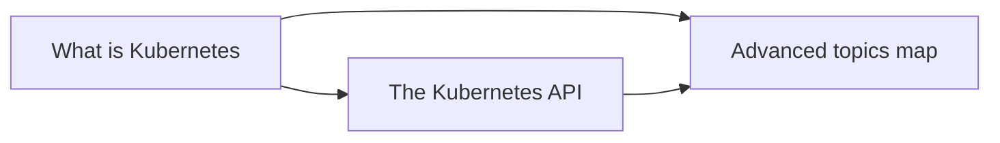

# Overview

What Kubernetes is, why it exists, how its API is organized, and a map of the advanced topics that build on the basics. Corresponds to the "Overview" chapter of the Kubernetes documentation Concepts.

## Map of the area

Start with what Kubernetes is. The API note explains how every other area is exposed. The advanced topics map is a guide for later reading.

## Notes in reading order

1. [What is Kubernetes](what-is-kubernetes.md): definition, deployment eras, capabilities, Kubernetes and Docker, the parts of a cluster.
2. [The Kubernetes API](kubernetes-api.md): the API server as the center, Discovery API, OpenAPI, API groups and versioning.
3. [Advanced topics map](advanced-topics-map.md): advanced topics and where each one lives in this knowledge base.

## Planned topics

- Kubernetes components at a glance
- Objects in Kubernetes and object management (imperative and declarative)
- Object names and IDs
- Labels and selectors
- Namespaces
- Annotations
- Field selectors
- Finalizers
- Owners and dependents
- Recommended labels
- Storage versions
- The kubectl command-line tool
