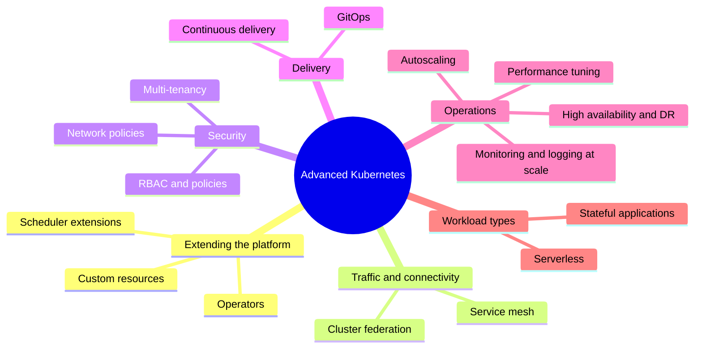
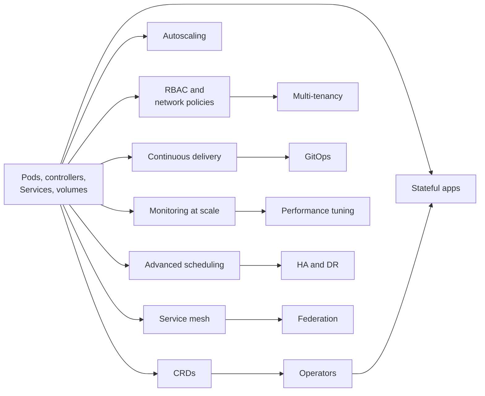

# Advanced topics map

## Summary

Beyond running Pods and Services, Kubernetes is used as a platform that can be extended with custom resources and controllers, connected through service meshes, federated across clusters, secured with fine-grained policies and operated at scale. This note is a map: it names the advanced topics, says in one or two sentences what each one is about, and points to the note or area that is its home in this knowledge base.

## Prerequisites

- [What is Kubernetes](what-is-kubernetes.md).
- Familiarity with Pods, Deployments and Services: see [Workloads](../workloads/README.md) and [Services](../services-and-networking/services.md).

## Core concepts

### Why there is an advanced layer

Kubernetes can be extended with custom resources and controllers to manage complex applications and workflows. Its networking model supports communication between Pods and Services and can be extended with service meshes and network policies. It integrates with CI/CD tools and platforms that automate deployment and updates. For storage, it offers options from local storage through network attached storage (NAS) to cloud storage providers.

The topics below are "advanced" because they build on the basics and are usually needed only when a cluster is shared, large, critical or used as an internal platform.



### The topics and their homes

| Topic | What it is about | Home in this knowledge base |
| --- | --- | --- |
| Service mesh integration | Improves how microservices communicate by adding load balancing, service discovery, mutual TLS encryption and traffic policies in a proxy layer. | `ecosystem/` (planned: service mesh); see [Network model](../services-and-networking/kubernetes-network-model.md) |
| Advanced scheduling | Goes beyond default Pod placement with custom policies, priorities, topology spread and scheduler plugins for better resource utilization. | [Scheduling, preemption and eviction](../scheduling-preemption-and-eviction/README.md), [Scheduler extenders](../extending-kubernetes/scheduler-extenders.md) |
| Cluster federation | Manages several clusters as one entity, with cross-cluster service discovery and global load balancing. | Planned in [Cluster administration](../cluster-administration/README.md) |
| Custom Resource Definitions (CRDs) | Extend the Kubernetes API with new resource types, so that you can create custom objects. | [Custom resources](../extending-kubernetes/custom-resources.md) |
| Kubernetes operators | Automate application management with custom controllers that encode domain knowledge for a specific application. | [Custom resources](../extending-kubernetes/custom-resources.md#custom-controllers-and-operators); operator pattern planned in [Extending Kubernetes](../extending-kubernetes/README.md) |
| Security policies and network policies | Fine-grained access control and network segmentation of cluster resources and traffic. | [RBAC good practices](../security/rbac-good-practices.md), [Network policies](../services-and-networking/network-policies.md) |
| Continuous deployment and delivery (CD) | Automated pipelines that roll out updates and manage the application lifecycle on Kubernetes. | [Application delivery](../application-delivery/README.md) |
| Monitoring and logging at scale | Collecting, analyzing and visualizing logs and metrics to keep the cluster healthy and fast. | [Observability](../cluster-administration/observability/README.md) |
| Stateful applications and persistent storage | Running stateful workloads so that data survives Pod restarts and failures. | [StatefulSets](../workloads/workload-management/statefulsets.md), [Volumes](../storage/volumes.md) |
| High availability and disaster recovery | Keeping applications available with minimal downtime during node failures or data center outages. | [Disruptions](../workloads/pods/disruptions.md), [Pod topology spread constraints](../scheduling-preemption-and-eviction/pod-topology-spread-constraints.md), [etcd](../cluster-architecture/etcd.md) |
| Performance tuning | Tuning cluster settings and workload configuration for efficiency and speed. | [Resource management for Pods and containers](../configuration/resource-management-for-pods-and-containers.md) |
| Multi-tenancy | Several users or teams share one cluster while their workloads and resources stay isolated. | Planned in [Security](../security/README.md); see [Limit ranges](../policies/limit-ranges.md) |
| Serverless on Kubernetes | Serverless frameworks (for example Knative) run event-driven, short-lived functions on Kubernetes without managing servers. | Planned in [Ecosystem](../ecosystem/README.md) |
| Autoscaling | Automatically adjusting the number of Pods or nodes to the demand, for cost and performance. | [Workload autoscaling](../workloads/autoscaling/README.md), [Node autoscaling](../cluster-administration/node-autoscaling.md) |
| GitOps | Git repositories as the source of truth for declarative infrastructure and applications, which gives versioned and collaborative deployments. | [GitOps](../application-delivery/gitops.md) |

### How the topics depend on each other



Read the diagram as a suggested learning order: operators need CRDs, multi-tenancy needs RBAC and network policies, and performance tuning needs monitoring.

## Worked example

A quick way to see which advanced features a given cluster already uses (untested here; any cluster, `kubectl` v1.30 or later):

```bash
kubectl get crd | wc -l                                  # how many custom resource types
kubectl get apiservices | grep -v Local                  # aggregated APIs, e.g. metrics.k8s.io
kubectl get networkpolicies -A | wc -l                   # network segmentation in use
kubectl get hpa -A                                       # autoscaled workloads
kubectl get priorityclasses                              # priority and preemption
kubectl get mutatingwebhookconfigurations,validatingwebhookconfigurations
```

A managed cluster typically shows a few dozen CRDs installed by the provider, `v1beta1.metrics.k8s.io` as a non-local APIService and several admission webhooks, which confirms that most clusters already rely on extensions.

## Trade offs and when to use it

Each advanced topic adds moving parts. Adopt one when a concrete problem needs it: a service mesh when you need mutual TLS and traffic shifting across many services, operators when a stateful product needs automated day-2 operations, federation when you run several clusters for latency or blast radius reasons. Adopting them all up front multiplies operational load.

## Common mistakes

- **Starting with the advanced layer.** Teams install a mesh, GitOps and operators before they understand Pods and Services, and then cannot debug the basics underneath.
- **Treating the list as a checklist.** Many production clusters run well without federation, serverless or a mesh.

## Practice

1. Which two building blocks together form the operator pattern?
2. Which advanced topic would you look at first to stop one team's workloads from reaching another team's databases?
3. Why does performance tuning depend on monitoring?

Answers: 1. A custom resource (CRD) and a custom controller. 2. Network policies (with RBAC and namespaces as part of multi-tenancy). 3. Without measurements you cannot tell what to tune or whether a change helped.

## Further reading

- [Extending Kubernetes](https://kubernetes.io/docs/concepts/extend-kubernetes/), Kubernetes documentation. Extension points and patterns.
- [Operator pattern](https://kubernetes.io/docs/concepts/extend-kubernetes/operator/), Kubernetes documentation. Controllers that encode operational knowledge.
- [Multi-tenancy](https://kubernetes.io/docs/concepts/security/multi-tenancy/), Kubernetes documentation. Isolation models for shared clusters.
- [CNCF Cloud Native Landscape](https://landscape.cncf.io/), CNCF. Projects for service mesh, serverless, observability and more.
