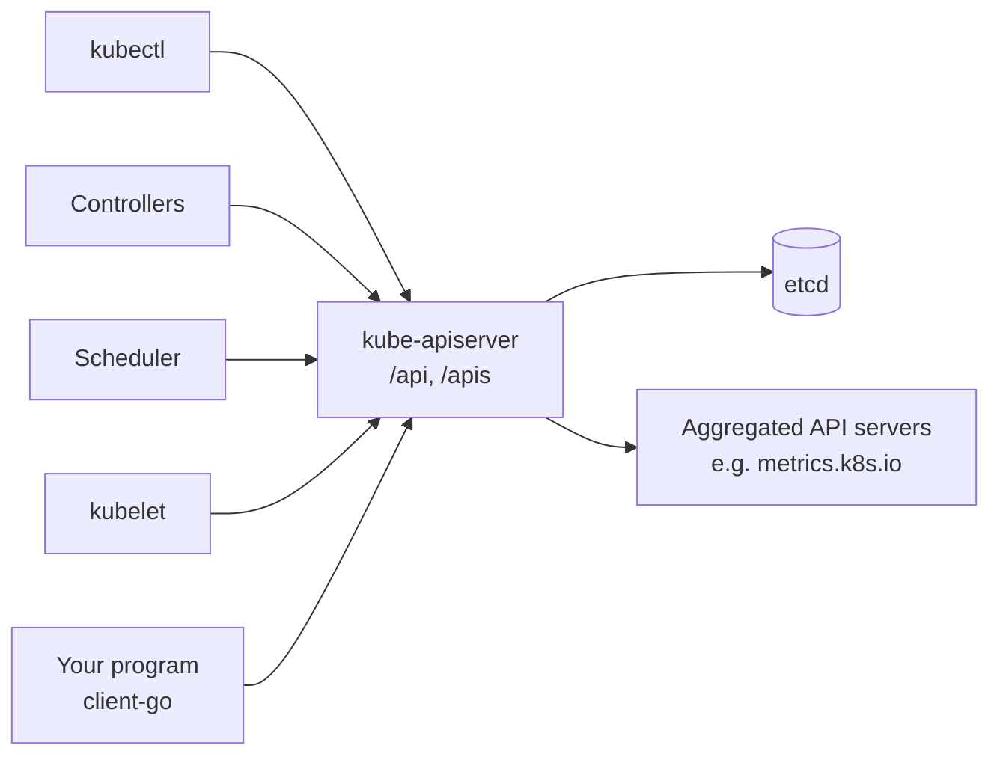
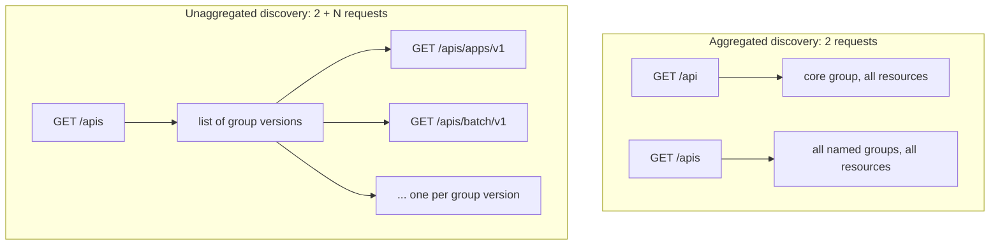

# The Kubernetes API

## Summary

Everything in Kubernetes is an object behind one HTTP API served by the kube-apiserver. `kubectl`, controllers, the scheduler, the kubelet and your own programs are all clients of this API. The API describes itself in two ways: the *Discovery API* lists which groups, versions and resources exist, and the *OpenAPI document* gives the full schema of every resource. Resources are organized into *API groups* that are versioned independently, which lets Kubernetes evolve and extend its API without breaking clients.

## Prerequisites

- [What is Kubernetes](what-is-kubernetes.md).
- Basic REST and HTTP concepts (verbs, paths, headers, JSON).

## Core concepts

### The API server as the center

The control plane centers on the API server, which exposes an HTTP API that lets end users, different parts of the cluster and external components communicate with each other. The API lets you query and manipulate the state of API objects such as Pods, Namespaces, ConfigMaps and Events.

- Most operations are done through `kubectl` or tools such as `kubeadm`, which call the API.
- You can call the API directly with REST requests.
- Client libraries (for example `client-go`, the official Python and Java clients) exist for writing applications against it.

Together with extensions, the API is a toolkit for customizing Kubernetes: custom components and new APIs (see [Extending Kubernetes](../extending-kubernetes/extending-kubernetes-overview.md)) are served through the same mechanisms as built-in resources.



The diagram shows that the API server is the only gateway: clients never talk to etcd or to each other directly.

### Two ways the API describes itself

Each cluster publishes the specification of the APIs it serves. This lets tools such as `kubectl` offer features such as command line completion and lets client generators produce typed clients. There are two supported mechanisms:

| Mechanism | What it contains | Typical consumer |
| --- | --- | --- |
| **Discovery API** | A brief summary of the available APIs: names of groups, resources and versions and the supported operations. It is a Kubernetes specific API, separate from OpenAPI, and does not describe schemas. | `kubectl` to map `kind` to a resource path, controllers to check if an API exists. |
| **OpenAPI document** | Full OpenAPI v2.0 and v3.0 schemas for every endpoint: all paths, all resources consumed and produced by every operation, and the extension components (such as CRD schemas) the cluster supports. Much larger than discovery data. | Validation, `kubectl explain`, client generation. |

OpenAPI v3 is the preferred way to read the schemas because it gives a more complete and accurate view of the API (for example it preserves fields such as `default`, `nullable` and `oneOf`), and it is served per group version at `/openapi/v3/apis/<group>/<version>`.

### Discovery API

Kubernetes publishes a list of all group versions and resources it supports through discovery. For each resource it includes:

- the name,
- whether it is cluster scoped or namespaced,
- the endpoint URL and the supported verbs,
- alternative names (short names such as `po`, `deploy`),
- the group, version and kind.

Discovery is available in two forms.

**Aggregated discovery.** All resources of the cluster are published through two endpoints, `/api` (the core group) and `/apis` (all named groups). Requesting them drastically reduces the number of requests a client needs to build its view of the cluster. The client asks for the aggregated form with the header `Accept: application/json;v=v2;g=apidiscovery.k8s.io;as=APIGroupDiscoveryList`. Aggregated discovery is stable (GA since v1.30).

**Unaggregated discovery.** Without aggregation, discovery is published in levels. The root endpoints `/api` and `/apis` list all group versions, and each group version (for example `/apis/apps/v1`) has its own document listing its resources. A client therefore needs one request per group version.



### API groups and versioning

To make it easier to remove fields or restructure resource representations, Kubernetes supports multiple API versions, each at a different path, for example `/api/v1` or `/apis/rbac.authorization.k8s.io/v1alpha1`.

- **Versioning is done at the API level**, not at the resource or field level. This keeps a clear, consistent view of system resources and behavior and allows controlling access to end-of-life and experimental APIs.
- **API groups** make the API easier to evolve and extend. A group can be enabled or disabled on the API server (`--runtime-config`). The core group has no name and lives at `/api/v1`; named groups live at `/apis/<group>/<version>`, for example `apps/v1`, `batch/v1`, `networking.k8s.io/v1`.
- **Version levels** signal stability: `v1alpha1` (may change or disappear, off by default), `v1beta1` (well tested, may still change; since v1.24 new beta APIs are off by default) and `v1` (stable, kept for a long time).
- **One object, several versions.** The same stored object can be read through any served version of its group; the API server converts between versions. One version is the *storage version* written to etcd.

| `apiVersion` in a manifest | Group | Version | Path prefix |
| --- | --- | --- | --- |
| `v1` (Pod, Service, ConfigMap) | core (legacy, no name) | v1 | `/api/v1` |
| `apps/v1` (Deployment) | `apps` | v1 | `/apis/apps/v1` |
| `batch/v1` (Job, CronJob) | `batch` | v1 | `/apis/batch/v1` |
| `autoscaling/v2` (HPA) | `autoscaling` | v2 | `/apis/autoscaling/v2` |

## Worked example

Exploring discovery and schemas against a running cluster (untested here; works with `kubectl` v1.30 or later):

```bash
kubectl api-versions | head                       # group versions from discovery
kubectl api-resources --api-group=apps -o wide    # resources, scope, verbs, short names
kubectl explain deployment.spec.strategy          # schema from OpenAPI

# Raw requests through the authenticated kubectl transport
kubectl get --raw /apis/apps/v1 | head -c 400
kubectl get --raw /openapi/v3 | head -c 400       # index of OpenAPI v3 documents

# Aggregated discovery with the special Accept header
kubectl proxy --port=8080 &
curl -s -H 'Accept: application/json;v=v2;g=apidiscovery.k8s.io;as=APIGroupDiscoveryList' \
  http://localhost:8080/apis | head -c 400
```

Expected result: `api-resources` shows for example `deployments  deploy  apps/v1  true  Deployment  [create delete ... watch]`. The aggregated response has `"kind":"APIGroupDiscoveryList"`, while the unaggregated `/apis` returns `"kind":"APIGroupList"`.

## Trade offs and when to use it

- **Discovery or OpenAPI.** Use discovery when you only need to know whether a resource exists and which verbs it supports. Use OpenAPI when you need field level schemas; it is much larger.
- **Direct REST or client library.** Direct REST is fine for scripts and debugging (`kubectl get --raw`). Programs should use a client library: it handles authentication, watches, retries and typed objects.
- **Pinning versions.** Writing manifests against `v1` APIs avoids migrations. Beta APIs give earlier access to features but can be removed after the deprecation period.

## Common mistakes

- **Using removed API versions.** For example `extensions/v1beta1` Ingress or `policy/v1beta1` PodDisruptionBudget fail on current clusters. Check the deprecation guide before upgrades.
- **Assuming a CRD exists.** Controllers should check discovery and fail clearly when a group version is missing.
- **Reading every group version separately.** Clients that walk unaggregated discovery on large clusters with many CRDs generate many requests; use aggregated discovery.

## Practice

1. What does the Discovery API not contain that the OpenAPI document does?
2. Why is versioning done at the API (group) level rather than per field?
3. How many requests does a client need for discovery with and without aggregation?
4. Which path serves Deployments, and which serves Pods?

Answers: 1. Resource schemas (field definitions). 2. It gives a consistent view of resources and behavior and allows controlling access to whole experimental or end-of-life APIs. 3. Two (`/api`, `/apis`) with aggregation; two plus one per group version without. 4. `/apis/apps/v1/namespaces/<ns>/deployments` and `/api/v1/namespaces/<ns>/pods`.

## Further reading

- [The Kubernetes API](https://kubernetes.io/docs/concepts/overview/kubernetes-api/), Kubernetes documentation. Discovery, OpenAPI, groups and versioning.
- [API Overview](https://kubernetes.io/docs/reference/using-api/), Kubernetes documentation. API versioning levels and enabling groups.
- [Deprecated API Migration Guide](https://kubernetes.io/docs/reference/using-api/deprecation-guide/), Kubernetes documentation. Which API versions were removed in which release.
- [KEP-3352: Aggregated Discovery](https://github.com/kubernetes/enhancements/tree/master/keps/sig-api-machinery/3352-aggregated-discovery), Kubernetes enhancements. Design of aggregated discovery.
